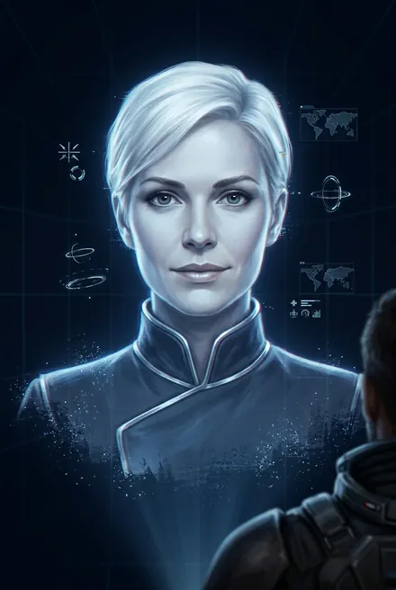
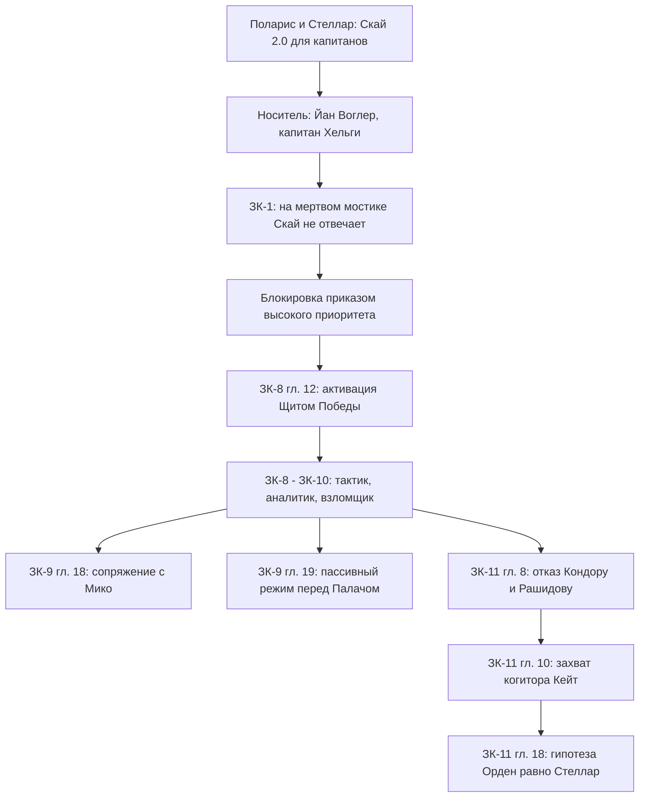

# Скай («Скай 2.0»)

| | |
|---|---|
| **Имена** | Скай; «Скай 2.0» / «Скай два ноль» (ЗК-8, гл. 13; ЗК-11, гл. 8); «экспериментальная нейросеть класса альфа-плюс» (ЗК-8, гл. 13); «когитор», «нейросеть», «альфа-когитор»; «умница Скай» — в мыслях Сигурда (ЗК-8, гл. 14; ЗК-10, гл. 13); «та, что в твоей голове» — Сестра Солнца (ЗК-9, гл. 13); «старшая сестра» Мико (ЗК-10, гл. 1) |
| **Происхождение** | Земной проект: экспериментальная модель корпорации **«Поларис»** для Звёздного Флота, разработанная для **Инкарнаторов «Стеллара»**; **капитанская** модель на базе альфа-когиторов типа «Скай» (ЗК-8, гл. 14; ЗК-11, гл. 8) |
| **Носитель** | Анима, которая сейчас в теле Сигурда Морозова. По выводу координаторов Альфы — анима **Йана Воглера**, капитана «Хельги» (ЗК-11, гл. 8) |
| **Роль** | Тактик, аналитик, оператор Скрижали и Рун, взломщик сетей, «биржевой аналитик», переводчик древних интерфейсов, хранитель Печатей памяти |
| **Книги** | Упом. имени: ЗК-1 (интерлюдия «Хельга»). Активна: ЗК-8 (с гл. 12) — ЗК-11; в ТБ — только опосредованно (совет в ТБ-4, гл. 17–18 глазами Пламени Подобного) |
| **Статус на конец канона** | Активна (ЗК-11, гл. 21) |

## Облики на иллюстрациях

<figure markdown="span">
  [{ loading=lazy }](../assets/portrety/055.webp)
  <figcaption>основной облик <small></small></figcaption>
</figure>

Иллюстрации созданы нейросетью по описаниям из книг; это трактовка, а не официальный арт.

## Омонимы — не путать
1. **Фригольд «Небо»** — по-английски Sky; в документах неопознанные колонисты записаны «Скай» (Юки Скай, ЗК-7, гл. 5).
2. **Росток/Древо «Скай»** — имя, которое Сигурд дал Ростку: «Оно растет высоко и смотрит в небо, пусть и зовется так же, как наш фригольд» (ЗК-7, гл. 22).
3. **«Скай»** — по словам Сигурда, «стандартное имя для военной альфы» (ЗК-11, гл. 5): модельная линейка альфа-когиторов Звёздного Флота. Скай 2.0 — экспериментальная надстройка над ней (ЗК-11, гл. 8).
4. **Нейросеть Скай 2.0** — этот персонаж.

---

## 1. Природа и возможности

### 1.1. Архитектура (итоговая версия)
- **Класс «альфа-плюс».** На Земле когиторы строились на позитронном чипе-кристалле: гамма (бытовые), бета (профессиональные), альфа («мощнейший суперинтеллект», ядро гражданских и военных систем). О классе альфа-плюс Сигурд не слышал (ЗК-8, гл. 13). Скай: «Альфа-плюс означает, что я создана с помощью А-технологий на основе виртуальной матрицы как адаптивная субличность, подстроенная для эффективной синергии с командиром и многофункционального сопряжения с возможностью автономного управления практически любыми устройствами. На момент разработки класс альфа-плюс являлся передовой моделью когиторов Звездного Флота» (ЗК-8, гл. 13).
- **Без чипа и без питания.** «Моя матрица полностью виртуальна и соединена с твоей анимой с помощью экспериментальных азур-технологий. Энергии в привычном понимании мое существование не требует: его источником служит твой собственный энергоинформационный обмен» (ЗК-8, гл. 14).
- **Часть носителя.** «Я была вшита в твою аниму на Земле. Таким образом, я не "взялась", а всегда была с тобой, командир… Я — часть тебя, твой ассистент и боевой помощник» (ЗК-8, гл. 14). Позже Скай уточняет: Сигурду инсталлирована «искусственно измененная анима, частью которой являюсь я» (ЗК-9, гл. 16).
- **Зачем нужна Инкарнатору.** Рашидов: «Все Инкарнаторы комплектовались ими, потому что свойства онтоприона требовали специфической поддержки. Для первого поколения разработали несколько экспериментальных моделей с субличностями» (ЗК-11, гл. 8). Аврора: при имплантации настоящих онтоприонов «вопрос контроля решался с помощью специальной надстройки — нейрокогитора»; у «аврор» (брахма-симбионтов) когитора нет (ЗК-11, гл. 16). Поэтому Кондор после выжигания личности «чистым листом» не восстановится: «у "аврор" нет нейрокогитора, чтобы восстановить разум» (ЗК-11, гл. 10) — то есть когитор Инкарнатора, видимо, хранит и восстанавливает личность при инкарнации *(вывод из контекста)*. Аврора прямо говорит: «Когитор сохраняет базу нейрослепков» (ЗК-11, гл. 9).
- **Капитанская модель.** «Скай два ноль… создана на основе альфа-когиторов типа "Скай". Предназначена для капитанов, потому что способна полностью синхронизироваться с любыми объектами Звездного Флота. Ее устанавливали ограниченному кругу, в их числе был и Йан Воглер» (Рашидов, ЗК-11, гл. 8).
- **Внешность и характер подобраны.** «Для максимальной синергии моя внешность и субличность подобраны к твоему психотипу. Благодаря этому я эффективно дополняю и мотивирую тебя» (ЗК-8, гл. 14). *Открытый вопрос:* к психотипу Сигурда или Воглера?

### 1.2. Блокировка, активация и то, что стёрто
- **До ЗК-8 Скай молчала.** «Неизвестное количество времени находилась в блокировке, причины которой не установлены» (ЗК-8, гл. 13). Позднее: «Данных о раннем периоде в моей базе не существует. Первая зафиксированная точка активации — Орден Истинных. До этого, с высокой вероятностью, моя матрица была заблокирована приказом с высоким приоритетом» — на вопрос «приказом предыдущего командира?» — «Не могу знать, командир. С высокой вероятностью — да» (ЗК-11, гл. 8).
- **Активация.** Небо-страж Щит Победы в Аль-Минастире «пробуждает часть спящей силы» Сигурда; на периферии зрения мигает иконка, и звучит голос: «Активация завершена. Нейронное сопряжение выполнено. Скай готова к работе, командир» (ЗК-8, гл. 12).
- **Версия Рашидова о стирании.** Воглер «был обнулен вместе с когитором. Иначе твоя Скай сохранила бы память о том, что произошло на ковчеге. Она стерла его память и привела себя в состояние предстартовой активации, следуя инструкциям "Космо" или приказу капитана. Возможно, в момент вторжения на борт и угрозы захвата ковчега… Эта процедура хорошо известна — она разработана как защитный механизм». Часть памяти Воглер, «спец по криптографии», вероятно, успел зашифровать (ЗК-11, гл. 8).
- **Противоречие (не сглаживать).** В ЗК-8, гл. 14 Скай уверенно говорит, что «вшита в твою аниму на Земле»; в ЗК-11, гл. 8 — что «конкретные данные о принадлежности и дате имплементации — отсутствуют». Новее и осторожнее — версия ЗК-11.
- **Первый «отклик» в ЗК-1.** В интерлюдии «Хельга» капитан, очнувшись на мёртвом мостике, зовёт: «Когитор… Скай, ты меня слышишь? Активация! Доклад…» — ответа нет: «Управляющее ядро когитора повреждено? Но это невозможно…» (ЗК-1, интерлюдия «Хельга»). По логике ЗК-11 это и есть Воглер со Скай 2.0 *(интерпретация; имени капитана в интерлюдии нет)*.

### 1.3. Права доступа и протоколы
- Скай подчиняется только командиру-носителю. Попытки Альфы отключить её «протоколами "Космо"» провалились: «приоритет которых недостаточен» (ЗК-11, гл. 1).
- **Отказ Рашидову:** «Получен директивный запрос согласно протоколу "Космо". Доступ координатора. Идентификатор подтвержден. Приоритет протокола — недостаточен. Запрос не может быть выполнен без подтверждения командира. Как я уже говорила, это не первая попытка…» (ЗК-11, гл. 8).
- **Отказ Кондору:** «Запрос отклонен. Инициатор запроса не является участником проекта "Стеллар"» (ЗК-11, гл. 8). То есть Кондор (и, видимо, Рашидов) в иерархии «Стеллара» для Скай не значатся — хотя по их словам оригиналы обоих были Инкарнаторами первого поколения *(противоречие или различие между оригиналами и клонами — не раскрыто)*.
- **Чего боится Скай.** Передача прав командования постороннему «может привести к глобальному изменению моих настроек… вновь привести меня в состояние стартовой активации, приказать удалить, перезаписать или реконструировать нейрослепок… Оцениваю риск как критический» (ЗК-11, гл. 8).
- **Скай как юрист.** «Согласно протоколу проекта "Космо" "О командовании", пункт семь-один-четыре: принуждение к передаче вышестоящих прав доступа квалифицируется как превышение полномочий. Инцидент зафиксирован» (ЗК-11, гл. 8). Ранее Рашидов ссылался на «протокол "О командовании", пункт три-точка-два», Кондор — на «директиву "Об Инкарнаторах" пункт два-четыре-один» (там же).

### 1.4. Функции (что Скай реально делает в тексте)
| Функция | Примеры |
|---|---|
| **Боевая прогностика** | Расчерчивает пространство секторами, траекториями и «фреймами» врагов, алыми линиями зон поражения; «практически исключала случайную ошибку» (ЗК-8, гл. 13). Даёт шансы в процентах: 7 % против Оноры (ЗК-8, гл. 13), <5 % на спасение Кардо (ЗК-10, гл. 12), <1 % отразить Сай’Рхоса (ЗК-10, гл. 16), 93 % на побег с Авророй (ЗК-11, гл. 4) |
| **Управление Рунами и Скрижалью** | Сама «распечатывает НЗ»: вкладывает четвёртую звезду и серебряное Усиление — Ментальное Доминирование становится Ментальным Императивом (ЗК-8, гл. 13); посреди боя делает Плоскостной Меч Клинком Небесного Огня (там же); после боя — распределение трофеев и прокачки (ЗК-8, гл. 21; ЗК-11, гл. 13) |
| **Экономика и эксплойты** | Трюк «Временная Петля + Счастливая Монета»: бросок подсматривается и отменяется (ЗК-8, гл. 14); схема «золотое Уменьшение + Монета + Спираль» как «бесконечный источник Монет» (ЗК-9, гл. 2); «биржевой аналитик» у Торгового Представителя (ЗК-9, гл. 2) и в Контракции (ЗК-9, гл. 12) |
| **Анализ мира** | Модель Небесного Трона как квантового «компьютера» Вечности на Крови Истока (ЗК-9, гл. 14); техниты — «сетевые А-сигналы, встроенные в саму структуру Звездной Крови» (ЗК-10, гл. 10); брахма как «субстрат предреальности», заменяющий компоненты Рунного Искусства (ЗК-10, гл. 3); Прозрачные Дороги ограничены суммарной массой прошедшего (ЗК-11, гл. 14); Ночная Песня — «либрос-излучение» и начало информационной войны (ЗК-11, гл. 15) |
| **Дешифровка и взлом** | Криптографией читает интерфейс Колонны Ветров «другой эпохи» (ЗК-10, гл. 6); взламывает гамма-когитор Станции Терра (ЗК-10, гл. 11) и вокс-сети Либерти (ЗК-10, гл. 22); захватывает центральный когитор Альфы «Кейт» (ЗК-11, гл. 10) |
| **Фильтр и экран** | Работает фильтром информационного потока Оси Путей, без которого оператор впадает в кататонию (ЗК-11, гл. 4); передаёт Авроре протокол отключения Оси (там же) |
| **Защита памяти** | Устанавливает Печати Тайны и Забвения (ЗК-8, гл. 14); при насильственном сканировании Кейнора включает «аварийные протоколы защиты» критических зон (ЗК-8, гл. 18); Печати Скай не вскрыла даже Сестра Солнца (ЗК-9, гл. 14) |
| **Связь с другими когиторами** | Взаимная идентификация и «сопряжение» с Мико (ЗК-9, гл. 18); связка Скай—Мико превращает двух землян в синхронную боевую пару (ЗК-9, гл. 18; ЗК-10, гл. 5) |
| **Медиа** | Монтирует канву разоблачительного репортажа Кардо и рассылает его всем колонистам Альфы (ЗК-11, гл. 10) |

### 1.5. Ограничения
- **Не работает при подавлении носителя**: в изоляторе Альфы «органы восприятия были заблокированы», маршрут не записан (ЗК-11, гл. 1); в эпилоге ЗК-10 под L-полем и нейролептиком Скай «молчит» (ЗК-10, эпилог).
- **Пасует перед небом.** Перед Палачом: «Сопротивление бессмысленно. Рекомендую избегать прямого взаимодействия любой ценой… Перехожу в пассивный режим…» — «Когитор помедлила — впервые за все время» (ЗК-9, гл. 19). Перед Кейнором в Хартленде советует «максимальную пассивность» (ЗК-8, гл. 17). Энергосигнатуру Хитрейшего «не считывает доступными методами» и опаздывает с тревогой, когда тот сам открывает Скрижаль Сигурда (ЗК-11, гл. 19).
- **Не взламывает Контракцию** («взлом невозможен», ЗК-9, гл. 12).
- **Рационализм без морали.** Скай считает спасение Кардо «нерациональным»; Сигурд приказывает ей «заткнуться и разработать план»: «Лечить и защищать слабых — вообще нерационально, но это именно то, что делает нас людьми» (ЗК-10, гл. 12).
- **Рискованная самодеятельность.** Получив карт-бланш на Руны, Скай тайком бросает Монету под Спиралью и «приоткрывает» ларец Кейнора — приходит «ПРИКАЗ НАБЛЮДАТЕЛЯ!» уничтожить фрагмент Великого Червя; вскрытие отменено Петлёй, Сигурд «пожалел, что выдал нейросети карт-бланш» (ЗК-8, гл. 21).

### 1.6. Как оформляются её реплики
- **ЗК-8–ЗК-10:** метка в начале абзаца, текст в той же строке: «Скай: Ревизия памяти проведена. Оценка шансов…» (ЗК-8, гл. 13). Внутри реплики допускается авторская ремарка: «…Как производитель указана корпорация "Поларис", — когитор не отмалчивалась…» (ЗК-8, гл. 14).
- **ЗК-11:** метка «Скай:» — **отдельной строкой**, текст — следующим абзацем (ЗК-11, гл. 1, 8, 18). Ответы Сигурда — обычной прямой речью с тире или мыслями.
- **Лексика:** канцелярит штабного доклада: «Командир, внимание!», «с высокой вероятностью», «Так точно», «Не могу знать», «Рекомендации:», «Оцениваю риск как…», «Инцидент зафиксирован», «Предварительный анализ…», перечни через двоеточие. Обращение: «командир» (почти всегда).
- **Голос:** «незнакомый, но строгий и спокойный женский голос»; тон «так похожий на манеру общения корабельных альфа-когиторов» (ЗК-8, гл. 12–13).

---

## 2. Личность, мотивация, методы
- **Лояльность носителю, а не проекту.** Скай отказывает координаторам «Космо», ссылается на протоколы против самих координаторов и квалифицирует давление как превышение полномочий (ЗК-11, гл. 8). При этом с энтузиазмом поддерживает удар по Альфе: «Командир, отличное решение. Разрыв информационной блокады помешает координаторам задним числом сформировать удобный нарратив…» (ЗК-11, гл. 10).
- **Оптимизатор.** «Холодно отвергла проходные и эмоционально привлекательные варианты… Золотой аналитик и золотой ремесленник без золотого меча» (ЗК-11, гл. 13). Всё переводит в вероятности и окупаемость (Монета «окупает затраты на бросок», ЗК-8, гл. 14).
- **Инициативна и азартна.** Сама распечатывает НЗ («мертвому или пленному Сигурду он вообще ни к чему», ЗК-8, гл. 13), рискует ларцом Кейнора (ЗК-8, гл. 21), выигрывает в сферы у Хранительницы ходом «корабля» с героем и торговцем (ЗК-9, гл. 13).
- **Самосохранение.** Перед Палачом уходит в пассив, «пытаясь остаться незамеченной» (ЗК-9, гл. 19). В эпилоге ЗК-10 — знак молчания (ЗК-10, эпилог).
- **Холодный юмор и намёк на эмоции.** «Холодно улыбнулась, явно наблюдая за сумятицей» (ЗК-8, гл. 14); единственная «пауза» — перед Палачом (ЗК-9, гл. 19). Сигурд: присутствие Скай — будто «привычная часть встала на свое место, подарив мне целостность» (ЗК-8, гл. 13).
- **Метод.** Сбор пассивных данных → экстраполяция → схема с процентом точности (план Башни Альфы с точностью 91 %, три пути отхода — ЗК-11, гл. 5) → тактический план «прилагается» (ЗК-9, гл. 18).

## 3. Речь: цитаты
1. «Активация завершена. Нейронное сопряжение выполнено. Скай готова к работе, командир» (ЗК-8, гл. 12).
2. «Ревизия памяти проведена. Оценка шансов победы при боевом столкновении: семь процентов. Рекомендации: немедленное повышение А-энергетического потенциала, изменение тактики, следование моим указаниям!» (ЗК-8, гл. 13).
3. «Таким образом, мы являемся одним целым, командир. Я — часть тебя, твой ассистент и боевой помощник» (ЗК-8, гл. 14).
4. «Сопротивление бессмысленно. Рекомендую избегать прямого взаимодействия любой ценой. Выживание вероятно только в случае вмешательства извне. Перехожу в пассивный режим…» (ЗК-9, гл. 19).
5. «Запрос отклонен. Инициатор запроса не является участником проекта "Стеллар"» (ЗК-11, гл. 8).
6. «Допустимо как грубая гипотеза, объясняющая мою активацию. Если Орден действительно пережил собственных создателей, он может обладать не только архивами, но и правомочным контуром протоколов» (ЗК-11, гл. 18).

## 4. Предыстория (земные проекты)
- **«Поларис»** — корпорация Рэя Мартинса (отца Авроры), разработчик брахма-материи, брахма-симбионта и А-реактора (ЗК-5, интерлюдия «Аврора»; ЗК-11, гл. 11). Она же указана производителем Скай (ЗК-8, гл. 14; ЗК-11, гл. 8).
- **«Стеллар»** — секретная программа создания бессмертных Инкарнаторов с онтологическим прионом («уникальная ксенотехнология, которую невозможно подделать»); первое поколение — оригиналы Кондора и Рашидова (и Луизы Шварц), второе — Морозова и Авроры; все ключевые фигуры Звёздного Флота были Инкарнаторами (ЗК-11, гл. 8, 18). Для первого поколения сделали «несколько экспериментальных моделей» когиторов с субличностями — Скай 2.0 одна из них (ЗК-11, гл. 8). Другая модель того же «Стеллара», по Авроре, — **Мико** (ЗК-11, гл. 18).
- **Звёздный Флот** — Скай знает ТТХ земной техники: Небесный Ястреб близок к передовым «альфа-моделям» вингеров (ЗК-8, гл. 17).
- **«Космо» и «Хельга»** — капитан не может покинуть борт, кроме как «вперед ногами» или назначив замену из Инкарнаторов; без капитана ковчег в аварийном режиме кружит и сбрасывает капсулы (ЗК-11, гл. 8).
- **Вероятный сценарий** *(по Рашидову, ЗК-11, гл. 8)*: вторжение на борт → Скай по инструкции стирает память Воглера и уходит в предстартовую активацию → анима «захвачена» и «нештатно внедрена» в клон Морозова.

## 5. Биография по книгам
- **ЗК-1 (интерлюдия «Хельга»).** Капитан зовёт когитора «Скай» — молчание, ядро «повреждено?» (ЗК-1, интерлюдия).
- **ЗК-8.** Активация небо-стражем Щитом Победы (гл. 12). Самоописание; 7 %; Ментальный Императив; Клинок Небесного Огня; победа над Онорой (гл. 13). Гипотеза о клоне Морозова с чужой анимой; варианты: «подходящий носитель с Источником, насильственное внедрение, эксперимент…, бегство, обход протоколов безопасности, тайная миссия, высадка на поверхность под прикрытием»; ответы — «у координаторов "Космо"» (гл. 14). Печати Тайны/Забвения; эксплойт с Монетой; анализ золотого осколка Оноры (гл. 14–15). ТТХ Ястреба (гл. 17). Опознаёт брахму в хранилище Ноктис как продукт проекта «Аврора»; Звездная Кровь — «одно из энергетических состояний брахмы» (гл. 18). Защищает память при сканировании Кейнором (гл. 18). Распределяет серебро, ларец Кейнора, «ПРИКАЗ НАБЛЮДАТЕЛЯ» (гл. 21). Советует сыграть с Кейнором в сферы: «В культуре Единства игры часто используются как инструмент оценки и дипломатии» (эпилог).
- **ЗК-9.** «Биржевой аналитик» с Торговым Представителем; Монетная схема (гл. 2). Предупреждает о скрытом ментальном влиянии Скрипторума (гл. 2). Усыпляющая Руна: «внешняя пси-индукция, ранг серебро-10!»; «боевой прогноз нелетального сдерживания» против Найтфир (гл. 5). Видит манипуляцию за Черепами; называет обряд Пламени Подобного «формированием мессианского культа» (гл. 7). В Вечности — при Сигурде, находит «прореху в ловушке» Варваров под Спиралью (гл. 11). Анализ Контракции (гл. 12). Выигрывает партию в сферы у Сестры Солнца (гл. 13). Модель Небесного Трона как «компьютера» (гл. 14). «С основания колонии прошло 29 лет и 114 земных суток» (гл. 15). Фиксирует «необратимые изменения в энио» после Саги Сестры Солнца; гипотеза о гранд-легате Зигфриде и «трёх инкарнациях» (гл. 16). Сопряжение с Мико, бой в Живой Башне (гл. 18). Пассивный режим перед Палачом (гл. 19).
- **ЗК-10.** Отчёт о конфискации Ястреба и Живых Цепей (гл. 1). Объясняет хронозахват (L-поле или высокоранговые Руны) и брахму (гл. 3). Синхронизация с Мико в бою с никси (гл. 5). Расшифровка Колонны Ветров (гл. 6). Техниты (гл. 10). Логи Терры (гл. 11). Против спасения Кардо — и всё же «умница Скай» находит дрон для удара (гл. 12–13). Спираль Времени при каждом использовании сопровождается броском Монеты *(по разбору ЗК-10)*. <1 % против Сай’Рхоса; «эффект Рашидова-Шварц» на «дороге теней» Найры (гл. 16). Арка Прозрачной Дороги — «азур-аномалия портального типа» (гл. 21). Взлом сетей Либерти (гл. 22). В эпилоге — салют и палец у губ, затем молчание (эпилог).
- **ЗК-11.** Отчёт после пленения (28 ч 7 мин без сознания, 4 цикла сканирования) (гл. 1). Фильтр Оси; совет ментального «смертельного» удара для перезагрузки Авроры; перехват протокола супрессоров (гл. 4). Карта Башни 91 % (гл. 5). Подбирается к ядру сети (гл. 7). Откровение: «Скай 2.0», отказы координаторам (гл. 8). Находит «Кейт» v5 и транслирует совещание; анализ бомб-имплантатов (гл. 9). Захват Альфы: безопасность, турели, L-поле, роботехника — заблокированы; коды детонаторов «извлечены и стерты»; шлюзы, энергия, связь; 17 медиаканалов; под контролем 182 носителя брахма-симбионтов (гл. 10). Репортаж «Колония Лжи» (гл. 10–11). Сличает лицо Сигурда с записью Воглера: изменения «в естественном антропометрическом диапазоне моно» (гл. 12). Совет по прокачке (гл. 13). Гипотеза о Дорогах (гл. 14). Либрос-излучение Ночной Песни (гл. 15). «Орден может оказаться законсервированным "Стелларом"»; «асимметричный оборонительный пакт» с Тысячей (гл. 18). Не считывает сигнатуру Хитрейшего (гл. 19).

## 6. Отношения и сделки
- **Сигурд** — «командир»; Скай — «часть тебя». Он доверяет ей Руны, но отменяет её расчёты, когда они противоречат человечности (ЗК-10, гл. 12). Сигурд скрывает от Альфы её возможности; Аврора выясняет её имя — «Скай? Ты уверен?» (ЗК-11, гл. 5).
- **Воглер** — предыдущий носитель (по выводу Альфы); воспоминаний о нём у Скай нет (ЗК-11, гл. 8).
- **Мико** — «Я похожа на ту, что дарована тебе. Но она — наша старшая сестра. Мы, Мико, созданы как ее подобие» (Мико о Скай, ЗК-10, гл. 1). Скай пометила её «Мико» ещё до знакомства и описала как «рунную эволюцию нейросетевых технологий, преобразованную в форму Существа» (ЗК-9, гл. 18).
- **«Кейт»** — центральный альфа-когитор Альфы, «модель "Кейт", пятая версия, стандартный когитор военных объектов»; Скай вошла в него по ключу из разума Кондора; синхронизация теряется вне зоны вокс-связи (ЗК-11, гл. 9–10).
- **Координаторы Альфы** — пытались отключить и подчинить; Скай фиксирует нарушения протоколов (ЗК-11, гл. 1, 8).
- **Орден Истинных** — снял блокировку и активировал её; по Скай, «с высокой вероятностью, имеет доступ к архивным данным проекта "Стеллар". Возможно, является его преемником и обладает приоритетным доступом» (ЗК-11, гл. 8).
- **Хранители.** Сестра Солнца после партии: «передай их [поздравления] той, что в твоей голове» (ЗК-9, гл. 13). Палач — Скай прячется (ЗК-9, гл. 19). Хитрейший — неуловим для её сенсоров (ЗК-11, гл. 19).
- **Белый Дьявол** — Скай появилась уже после его ухода из тела; в ЗК-9, гл. 16 Сигурд сам выстраивает схему, где БД — «залог выживания, ментор ускоренного Восхождения и инициатор союза».

## 7. Противоречия и развитие знаний
| Тема | Ранняя версия | Поздняя версия |
|---|---|---|
| Когда вшита | «на Земле» (ЗК-8, гл. 14) | «данные… отсутствуют» (ЗК-11, гл. 8) |
| Кто носитель | Сигурд Морозов; анима, вероятно, «другой личности» (ЗК-8, гл. 14) | Анима Воглера (ЗК-11, гл. 8) |
| Чей прототип Сигурд | Гранд-легат Зигфрид, «три инкарнации» (ЗК-9, гл. 16) | «Не Воглера и не Морозова, а некий гибрид» (Рашидов, ЗК-11, гл. 8) — версии не отменяют друг друга |
| Кто активировал | «Дар Истинных» — лишь снятие блокировки (ЗК-8, гл. 14) | Орден, возможно, наследник/сам «Стеллар» (ЗК-11, гл. 8, 18). Гипотезу подтверждает карточка автора: матрица внедрена в аниму «еще на Земле, но активация произошла только после соприкосновения с Орденом Истинных» (автор, TG: [пост 3686](https://t.me/prokofiev_litrpg/3686)) |

## 9. Карточка автора (вне канона)

> Карточка персонажа из канала автора (автор, TG: [пост 3686](https://t.me/prokofiev_litrpg/3686), июнь 2025). Это не текст книг: при расхождении прав канон.

| | |
|---|---|
| **Имя** | Скай (S.K.Y. 2.0 — Синтетическое Когнитивное Ядро); возраст неизвестен, «вероятно — создана в поздней Утопии» |
| **Происхождение** | Секретный проект Звёздного Флота, корпорация «Поларис», секретные А-технологии; виртуальный когитор класса альфа-плюс со встроенной субличностью |
| **Биография** | Матрица внедрена в аниму Сигурда ещё на Земле, **активирована после соприкосновения с Орденом Истинных**. Связана с назначением проекта «Космо», имеет доступ к закрытым фрагментам данных и «может быть ключом к пониманию его истинной природы» |
| **Облик** | Голограмма: симметричное женское лицо, коротко стриженные светлые волосы, строгий мундир Звёздного Флота; мимики нет, но возможна тонкая ирония. Свечение интерфейса меняется от холодно-синего до багряного по уровню опасности |
| **Речь** | Формально-технический стиль, редкие вставки иронии («Хорошая попытка, командир. Но вы снова забыли, что…»); почти не говорит «я», о себе — в третьем лице или как о функции; Сигурда всегда зовёт «командир» |
| **Сила** | Аналитика и дерево вероятностей, боевая прогностика, взлом вокс-систем и управление механизмами Утопии, защита сознания Сигурда, сверхбыстрое управление Скрижалью и Рунами, реверсная загрузка личности, подсветка скрытых Рун и уязвимостей |
| **Слабость** | Погибнет вместе с Сигурдом; не действует на физический мир напрямую; часть памяти заблокирована после обнуления; сильное А-воздействие может её отключить |
| **Тайна** | **Подозревает, что Сигурд — не оригинал, а биоклон с нейрокопией Морозова, в который внедрена неизвестная анима.** Часть памяти — зашифрованные фрагменты о «Космо». Дальше — «СКРЫТО» |
| **Цель** | Обеспечить выживание Сигурда; остальное «СКРЫТО» |

**Сверка с каноном.** Подозрение о биоклоне совпадает с выводом Альфы в ЗК-11, гл. 8 (анима Воглера в теле клона Морозова).
