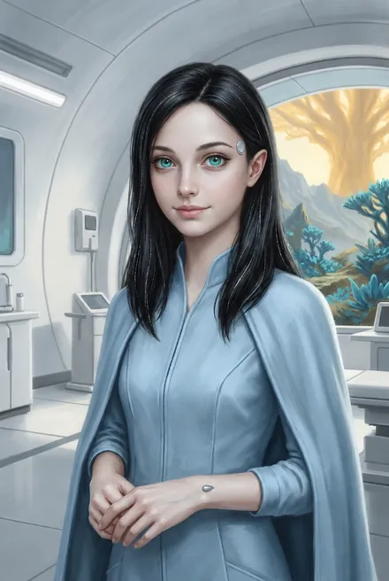
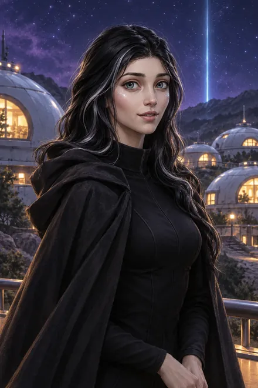
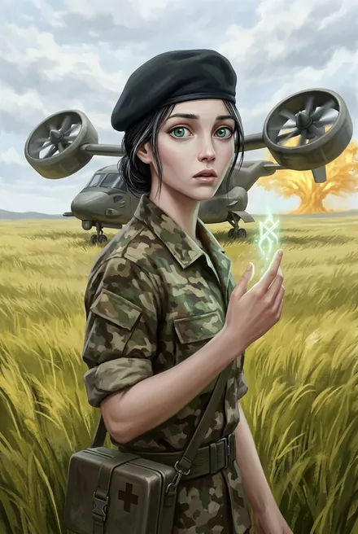
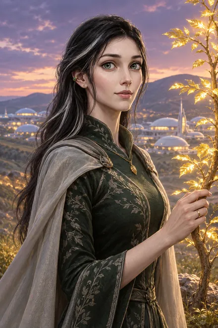
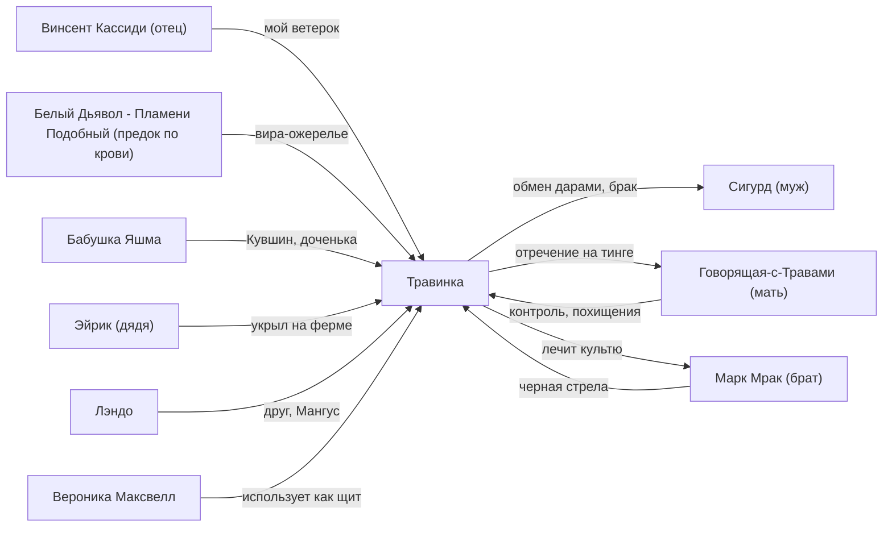

# Травинка-на-Ветру (Адель Кассиди)

## Облики на иллюстрациях

<figure markdown="span">
  [{ loading=lazy }](../assets/portrety/011.webp)
  <figcaption>Медком фригольда <small>ЗК-1, гл. 19 — ЗК-3</small></figcaption>
</figure>
<figure markdown="span">
  [{ loading=lazy }](../assets/portrety/012.webp)
  <figcaption>Тайное свидание / вечер в «Виски» <small>ЗК-2, гл. 9 — ЗК-4, гл. 3</small></figcaption>
</figure>
<figure markdown="span">
  [{ loading=lazy }](../assets/portrety/013.webp)
  <figcaption>Медик боевого копья <small>ЗК-4, гл. 5 — ЗК-5</small></figcaption>
</figure>
<figure markdown="span">
  [{ loading=lazy }](../assets/portrety/014.webp)
  <figcaption>Цветущая Восходящая, жена <small>ЗК-6, гл. 26 — ЗК-11</small></figcaption>
</figure>

Иллюстрации созданы нейросетью по описаниям из книг; это трактовка, а не официальный арт.

## 1. Шапка

| | |
|---|---|
| **Имя для Восхождения** | **Травинка-на-Ветру**, коротко «Травинка». Имя выбрала мать: «Имя для Восхождения очень подходит для моей дочери, ведь я сама его выбирала» (ЗК-1, гл. 21) |
| **Земное имя** | **Адель Кассиди** (ЗК-1, гл. 21). Его почти никто не использует: «Мало кто во фригольде использовал земное имя Травинки, поэтому оно прозвучало как-то дико» (ЗК-4, гл. 4). Отец переходит на «Адель», когда говорит официально или отдаёт распоряжения (ЗК-6, гл. 27; ЗК-10, гл. 13) |
| **Прозвища, обращения** | «мой ветерок», «мой маленький ветерок», «мой маленький вихрь» (отец, ЗК-6, гл. 19 и дальше); «мисс Кассиди» (Вероника, ЗК-6, интерлюдия, гл. 10); «эльфийская принцесса» (мысленно Сигурд, ЗК-10, гл. 8); «племянница», «доченька» (бабушка Яшма, ЗК-7, гл. 16; ЗК-10, гл. 2); «дочь моя», «упрямое дитя» (мать) |
| **Происхождение** | Полукровка. Отец — землянин **Винсент Кассиди**, первый рикс. Мать — **Говорящая-с-Травами**, изгнанница Народа Теней из септы Каменных Луков, рода владык с кровью Кел Аммоса (Белого Дьявола). Родилась в Единстве: «Я ведь родилась здесь» (ЗК-1, гл. 21). Голос в голове Сигурда сразу узнаёт в ней «каменные глаза Аммос» (ЗК-1, гл. 21) |
| **Народ** | Народ Земли, фригольд «Небо». Сама она подчёркивает: «Во мне, кинг, течёт кровь не только матери из Людей Теней, но и отца с Земли! Я принадлежу к Народу Земли» (ЗК-6, гл. 21) |
| **Статус по крови** | Законная наследница древней крови Каменных Луков после гибели Яростного-как-Пламя (ЗК-9, гл. 7). Прапраправнучка Белого Дьявола, по мнению Сигурда (ЗК-7, гл. 5) |
| **Роль** | Медик медкома (ЗК-1–02). Медик группы «Одиссей» (ЗК-4). Травница, лаборант, изготовитель пилюль (ЗК-7). Заведующая Островом Трав и плантацией звёздных Трав (ЗК-8, гл. 16). Невеста, потом жена Сигурда и дочь рикса |
| **Книги** | ЗК-1–ЗК-12. Главные женские линии — в ЗК-2, ЗК-4, ЗК-5 (две интерлюдии от её лица), ЗК-6 (интерлюдия от её лица). Упоминания в ТБ-1 (гл. 16) и ТБ-3 (гл. 5) |
| **Возраст** | 19 лет в ЗК-2: «девятнадцатилетней девушки» (ЗК-2, гл. 10; §4); «мне двадцать лет, я уже замужем» (ЗК-7, гл. 5). Карточка автора тоже даёт 19 (автор, TG: [пост 4260](https://t.me/prokofiev_litrpg/4260)). *Противоречие канона:* стигмат она получила в 6 лет, когда Марку было 17 (ЗК-2, гл. 9; ЗК-6, интерлюдия), а Марку в ЗК-1 по автору 27 — тогда в ЗК-2 ей около 16. См. `09_open_threads.md`, §4 |
| **Статус на конец канона** | Жива, живёт во фригольде с мужем. На большом сроке беременности: «тот, кого мы ждали, уже шевелился» (ЗК-11, гл. 12). Не знает, что брата убил её муж: отец решил ей не говорить (ЗК-11, гл. 15). **ЗК-12, гл. 2:** беременна («с округлившимся животиком»); заведует Островом Трав — купол «Домуса», лаборатория, восемь садоводов, «мое копье»; бабушка Яшма дважды приходила к ней и сказала, что деревце «уже знает, для чего создано». Сигурд под Плащом Тишины рассказывает ей о Белом Дьяволе, Тысяче, Альфе, «Стелларе», своей сути Инкарнатора и «Хельге»; она отвечает: «Я всегда знала, что ты не простой колонист… Я — Травинка-на-Ветру, дочь рикса и фламиники… Я умею видеть». О том, кто убил Марка, в этой сцене не сказано |

**Внешность кратко.** Хрупкая и стройная, мраморно-белая кожа, высокие скулы, чуть заострённые ушки, ямочки на щеках. Чёрные волосы с серебряными (белыми) прядями. Большие миндалевидные глаза. Пахнет барбарисом и мятой (ЗК-1, гл. 21; ЗК-2, гл. 9), позже «леденцом и мятой» (ЗК-11, гл. 12). Серебряные пряди — «знак древних вождей Народа Теней. Они происходят от самих Кел» (ЗК-7, гл. 5). С годами всё больше похожа на мать: «Говорят, чтобы понять, какой будет женщина спустя годы, нужно посмотреть на её мать» (ЗК-4, гл. 16). В Лабиринте Сигурд впервые замечает это сходство (ЗК-8, гл. 11).
*Расхождение по цвету глаз:* «сине-зелёные» (ЗК-1, гл. 21; ЗК-2, гл. 9), «весенне-зелёные» (через сравнение с Юки, ЗК-3, §4), «нефритово-зелёные» (ЗК-4, §4; ЗК-9, гл. 16). Самый поздний вариант — нефритово-зелёные.

---

## 2. Личность

### Базовый характер
- **Мягкая, открытая, улыбчивая.** Первое впечатление Сигурда: «открытая, улыбчивая и милая» (ЗК-1, гл. 21). Застенчива, но любопытна: «я наводила о тебе справки» (ЗК-2, гл. 9). Легко смущается и краснеет, часто хихикает.
- **Профессионал-медик.** Даже уставшая, работает чётко и спокойно. Объясняет «терпеливо», как учитель (ЗК-1, гл. 21). Свои Руны предлагает тратить на других. Сигурд отказывается от её Руны, и она запоминает это как знак его характера (ЗК-1, гл. 21).
- **Упрямство и «стержень воли».** Главная черта, заложенная в имени. На тинге Сигурд чувствует ментально: «Внутренний стержень моей возлюбленной, сгибающийся, но не ломающийся под ветром чужой воли, оказался необычайно прочен. Воистину, Травинка-на-Ветру…» (ЗК-6, гл. 21).
- **Импульсивность и смелость.** Решения принимает за ночь и сразу действует. После того как поймала Пикси-шпионку, записалась в боевую группу и в 6 утра написала Веронике (ЗК-4, гл. 9). Угнала винтокрыл вместе с копьём Динамита (ЗК-5, интерлюдия 2).
- **Ревность.** Сама предупреждает: «Имей в виду, я очень ревнивая и никаких других жён не потерплю!» (ЗК-4, гл. 9). Ревнует к Юки («А как же та девушка, которую ты привёз с собой?», ЗК-4, гл. 3) и к Морвейн («Она слишком красивая!», ЗК-9, гл. 9).
- **Гордость отцом.** Отец для неё легенда: «очень сильным. И надёжным, как скала» (ЗК-4, гл. 4). При этом, если подумать, она признаёт, что видела его редко (там же).
- **Наивность в политике (ранняя).** Повторяет оценки матери и брата и сама себя ловит: «Ой, я и вправду заговорила как она» (ЗК-4, гл. 9). Рабство трэлей на ферме Эйрика принимает спокойно: «Это лучше, чем убивать всех, разве не так, Сигурд?» (ЗК-4, гл. 9).
- **Детская непосредственность и чувственность.** Восторгается золотом: «Золото… Оно такое красивое…» (ЗК-6, §11). Восторгается подарками: Наряды, Ароматы, Зеркало (ЗК-8, гл. 16; ЗК-10, гл. 8). Сигурд мысленно сравнивает её с «маленькой волшебницей».

### Мотивация и ценности
- **Свобода выбора.** Ключевая реплика серии: «просто жить, как все… Самой выбирать, с кем встречаться, и не чувствовать себя за это виноватой. Не отчитываться о каждом шаге, строить свою жизнь как мне надо… а не маме» (ЗК-2, гл. 9).
- **Любовь к Сигурду**, которую она сама выбрала. Обмен дарами для неё священен: «Дары нельзя возвращать, даже во сне…» (ЗК-6, гл. 19).
- **Исцеление и забота о живом.** Медкомам и «вообще всем, кто жизнь растит и сохраняет, покровительствует Творящая» (ЗК-7, гл. 16). Это её самоопределение.
- **Справедливость важнее родства.** Перед тингом: «Мой брат… должен ответить за людей, смерти которых повлёк» (ЗК-6, гл. 6). На тинге называет мать и брата преступниками (ЗК-6, гл. 21).
- **Семья в широком смысле.** Будет заботиться, «чтобы её племянников не травили из-за отца» (ЗК-6, гл. 27). Нежно относится к йурру Кышу, хранит его во время «смерти» Сигурда (ЗК-4, гл. 3) и не выпускает его переноску даже в плену Железного Вьюна (ЗК-6, гл. 18).

### Страхи и слабости
- **Страх перед матерью.** Детский, глубокий, хотя и смешанный с любовью. Мать никогда не сражалась открыто, но «её недоброжелатели очень быстро исчезали» (ЗК-6, интерлюдия).
- **Страх перед Людьми Теней.** На площади у Храма она глубже прячет лицо в капюшон, когда мимо проходят «стройные и беловолосые Люди Теней» (ЗК-6, интерлюдия).
- **Слабое Восхождение.** «Я очень слабая Восходящая. Меня же почти не выпускают за пределы фригольда, откуда взять Руны?» (ЗК-2, гл. 9). После пропажи отца Руны и Кровь шли «другим Восходящим» (ЗК-6, интерлюдия). Не воин, в бою уязвима (ЗК-6, гл. 23).
- **Эмоциональная уязвимость.** Плачет публично, хотя мать внушала: «слёзы делают тебя слабой и некрасивой» (ЗК-5, интерлюдия 1).
- **Зависимость от чужой защиты.** Её дважды похищают (ЗК-4, гл. 16; ЗК-6, интерлюдия). Она «разменная монета» в чужих планах (ЗК-4, гл. 15).

### Эволюция по серии
1. **ЗК-1–02: «Девочка под колпаком».** Тайком бегает на свидания, боится, что «мама узнает». Не умеет целоваться (ЗК-2, гл. 9).
2. **ЗК-4: бунт.** Открытая ссора с матерью, переезд в общую спальню, вступление в «Одиссей», близость с Сигурдом. Мать вмешивается и уносит её силой (ЗК-4, гл. 3–16).
3. **ЗК-5: разрыв.** Узнаёт про связь матери с Трейвом, получает пощёчину и бросает: «Я… никогда не буду такой как ты!» (интерлюдия 1). Полностью принимает версию Сигурда о преступлениях брата (интерлюдия 2).
4. **ЗК-6: выбор.** Отказывается идти с матерью: «Я бронзовая Восходящая» (интерлюдия). На тинге публично обвиняет мать и брата. Закрывает собой Сигурда и получает стрелу. Раненая, лечит отца, и это решает исход боя (гл. 23). Будит Семя Руной матери и выходит замуж (гл. 27, эпилог 1).
5. **ЗК-7–11: хозяйка и будущая мать.** Самостоятельный специалист: лаборатория, затем плантация звёздных Трав. Получает покровительство Яшмы, беременна. Становится эмоциональным якорем Сигурда против его «холодного расчёта»: «Пока она рядом, я останусь собой» (ЗК-9, гл. 16). Политически она остаётся в стороне. Отец и муж прячут от неё самые тяжёлые тайны: судьбу Марка, Мико, Домен (ЗК-6, гл. 26; ЗК-10, гл. 1; ЗК-11, гл. 15).

---

## 3. Речь

**Манера.** Мягкая, живая, разговорная, с частыми «Ой…», «Ой-ей-ей», «Ну…». Часто называет собеседника по имени («Сигурд, …»). Эмоции выдают многоточия и вопросы. В гневе речь становится короткой, рубленой, с восклицаниями. Говорит на правильном глобише без «варварской» грамматики (в отличие от Лэндо), знает Единое Наречие. Пересказывает мамины сказки и легенды: о столице Круга, уничтоженной воинами Вечности (ЗК-4, гл. 12), о граги, «домовом духе» ферм (ЗК-6, гл. 5), о Яшме (ЗК-7, гл. 16).

**Обращения.** «мама», «папа»/«отец»; «дядя Эйрик», «дядя» (ЗК-4, гл. 9; ЗК-5, интерлюдия 2); «мэм»/«мисс Максвелл» (Вероника); «Сигурд». Лэндо зовёт по имени. Животным говорит «малыш» (Кыш).

**Цитаты:**
1. «Ну… просто жить, как все. Самой выбирать, с кем встречаться, и не чувствовать себя за это виноватой» (ЗК-2, гл. 9).
2. «Сильви! Ах ты… ах ты маленькая дрянь! Я тебя поймаю и посажу в бутылку!» (ЗК-4, гл. 4).
3. «Имей в виду, я очень ревнивая и никаких других жён не потерплю!» (ЗК-4, гл. 9).
4. «Нет! Я… никогда не буду такой как ты!» — матери (ЗК-5, интерлюдия 1).
5. «Клянусь, дядя, я не вернусь во фригольд! Лучше умру, чем стану её инструментом!» (ЗК-5, интерлюдия 2).
6. «Нет. Ни за что. Не пойду. Я давно не дитя. Я бронзовая Восходящая. Я никуда с тобой не пойду и буду сама решать свою судьбу!» (ЗК-6, интерлюдия).
7. «Отец, это я, твой ветерок! Это твой подарок, пояс Трёх Ветров!» (ЗК-6, гл. 19).
8. «Обещай, что вернёшься… Не мне. Ему» — кладёт ладонь Сигурда себе на живот (ЗК-10, гл. 8).

Бонус: «Кинг, ещё не все имена названы!» (ЗК-6, гл. 21) — реплика, которая выводит на сцену Винсента.

---

## 4. Предыстория (до ЗК-1)

- **Рождение и раннее детство.** Родилась в Единстве, в семье первого рикса и фламиники. Брат Марк старше её на 10 лет (ЗК-2, гл. 10). Сначала семья жила «не здесь, а внизу, возле леса», в первом поселении землян. «Отец учил брата, а мать — меня» (ЗК-1, гл. 21). Вероника в чужой памяти видит «молодого Винсента Кассиди, обнимающего Говорящую-с-Травами, двое жмущихся к ним темноволосых детей — мальчик и девочка» (ЗК-5, гл. 20).
- **Подготовка к Восхождению с младенчества** *(выведено)*. Говорящая говорит, что многие Народы кормят детей «мясом сильных зверей», «и я сама делала так» (ЗК-4, интерлюдия «Фригольд»). Позже Травинка рассказывает Сигурду: у сильных Восходящих рождаются дети «с толикой Звёздной Крови», мать учила её, какие звёздные Травы и части звёздных зверей нужны, чтобы такой ребёнок вступил «сразу на бронзовую ступень» (ЗК-9, гл. 10). Отсюда ранние стигматы обоих детей.
- **Инициация в 6 лет.** Отец получил от Наблюдателей Руну-Портал, рискнул, вынес «много Крови, много Рун, много Звёздных Монет». На большом тинге он «купил нам с братом стигматы» (ЗК-2, гл. 9). В интерлюдии ЗК-6 детали: Марку было 17, она «была совсем ребёнком». Жрецы в фиолетовых мантиях «с лицами и глазами острыми, как ножи». Вечность показалась ей «прекрасной, как рай» (ЗК-6, интерлюдия). Мать «очень сильно ругала отца за то, что он сделал её Восходящей в столь раннем возрасте», и между родителями «пробежала чёрная кошка». Она стала **самой юной Восходящей фригольда** и к совершеннолетию могла бы выйти на бронзу, «если бы отец не пропал» (там же).
  - *Расхождение:* «Руна-Портал» (ЗК-2) или «богатая добыча из опасного Домена» (ЗК-6). Если Марку тогда было 17, а ей 6, разница в возрасте 11 лет, а не «десять» (ЗК-2, гл. 10).
- **Отцовский ритуал подарков.** Возвращаясь из походов, Винсент привозил «либо мне, либо Марку» вещь со Звёздной Кровью: Траву, Ядро, Реликт, иногда Предмет, «как Живой Лист или Полог Ночи» (ЗК-4, гл. 4). От отца у неё также Пояс Трёх Ветров и Кольцо Неуязвимости (ЗК-4, гл. 5, по разбору).
- **Отец «редко бывал дома».** Он отдыхал пару недель и снова уходил. Фригольдом в его отсутствие правили знаменосцы Эйрик и Вероника, «мама тоже помогала» (ЗК-4, гл. 4).
- **Пропажа отца.** Ей сказали, что отряд отца «попал в засаду в ледяных тоннелях», нашли тела его копья, но не его самого. Мать утверждала, что он «ушёл в Домен» (ЗК-6, гл. 19) и что он «не умер», а «воспользовался тайной Руной» (ЗК-4, гл. 9). Мать до сих пор «иногда зовёт его по ночам, во сне» (ЗК-4, гл. 9). Они вместе горевали (ЗК-5, интерлюдия 1).
  - *Противоречие о её возрасте:* «Мне было двенадцать, когда он пропал» (ЗК-4, гл. 4). «Мне тогда было всего девять лет», когда Эйрик ушёл после выборов, то есть после пропажи (ЗК-4, гл. 9). Отец пробыл в плену «десять, почти одиннадцать» лет (ЗК-6, гл. 19), а в ЗК-6 ей около 19–20. Отсюда около 9 лет: версия «двенадцать» выбивается.
- **Выборы после пропажи** (её пересказ слов матери и Марка, ЗК-4, гл. 9). По законам Восхождения риксом должна была стать мать, у неё самая высокая Слава, «потому что она рождена в Единстве». Но фригольд не принял «чужую по крови», а Тени считали её предательницей, и она не могла ездить на тинги. Эйрик хотел жить «как принято здесь», Вероника обещала «как на Земле», люди выбрали Веронику, и Эйрик ушёл строить ферму.
- **Годы застоя.** После выборов Руны и Кровь доставались другим (ЗК-6, интерлюдия). За пределы фригольда её почти не выпускали. Выросла медиком медкома. У неё 15 Рун, «в основном лечебные или связанные с Травами» (ЗК-2, гл. 9). Мать учила лечению и Травам, но не дошла до «главной части» до получения бронзы. Свои Руны мать «всегда держала в секрете» (ЗК-6, интерлюдия).
- **Брат.** В детстве Марк «всегда защищал. От всего, даже от того, с чем бы мне лучше самой справиться… Он ещё хуже мамы!» Ко времени ЗК-2 они в ссоре и не разговаривают (ЗК-2, гл. 10).
- **Поклонники.** «Были… Только все боятся ко мне подходить. Из-за мамы» (ЗК-2, гл. 9). Её «многие боятся» (ЗК-2, гл. 2). Серьёзно ни с кем не целовалась.
- **Остров Трав.** Знала о тайном Домене матери, «бывала там несколько раз». Это «старая Руна, которая досталась маме в наследство. Отец хотел развивать его, но мама… это долгая история» (ЗК-6, гл. 6).

---

## 5. Биография по книгам

### ЗК-1 «Звёздная Кровь»
- **Гл. 19.** Во время ваала дрейков Сигурд и Лэндо встречают её с четырьмя детьми: «Травинка! Что ты тут делать⁈». Детей и девушку сажают в багги, мужчины остаются прикрывать.
- **Гл. 21.** Она медик-Восходящая медкома в голубой накидке. Осматривает очнувшегося Сигурда, объясняет шрам от Алой Ночницы и стигматы: «Это не магия, скорее технология, принципов которой мы не понимаем». Предлагает Руну Зелёного Листа, Сигурд отказывается («Тут есть люди, кому твои Руны пригодятся больше»). Между ними «пробежала незримая искра». Называет своё земное имя Адель Кассиди. Входит мать, требует от Сигурда «ядро» и выпроваживает его. Травинка нарочито резко отвечает ему «У меня совершенно нет свободного времени!», но прижимает палец к губам и стучит по воксу на виске: их подслушивают.

### ЗК-2 «Фригольд»
- **Гл. 1–2.** Лэндо рассказывает Сигурду о ней и о матери-«ведьме». На похоронах у колумбария короткий разговор: она предлагает переписываться по воксу, признаётся, что её «многие боятся». Переписываются до полуночи.
- **Гл. 9. Первое свидание.** Сбегает тайком. Руной «Бурный Рост» выращивает сон-траву для Кыша. Слушает рассказы о Земле: город тысячи башен, лётная академия. Объясняет, как устроены Навыки: её Руна Первой Помощи на бронзе стала Навыком «Медико-Санитарная Подготовка». Рассказывает про Полог Ночи, инициацию, Вечность и Чертог Встреч, судьбу стигматов погибших («Поэтому мы всегда забираем тела своих Восходящих»). Обещает тайно спросить мать о руинах города Кел. Первый поцелуй: она не умеет целоваться, «полчаса обучения», потом убегает.
- **Гл. 10. Второе свидание.** Рассказывает о брате и о том, что знаменосец — «правая рука рикса». О Кругах и Древах: местное Древо — Элтанир, «золотой лаурин».
- **Гл. 11.** Лечит избитого Сигурда Рунами Заживления, Регенерации и Зелёного Листа. Дарит артефакт Кел **Живой Лист**, бронзовый Предмет и подарок отца. По словам Сигурда, амулет спасает его в Гнезде (ЗК-2, §3).
- **Гл. 12.** После драки Травинку «берут под опеку» (ЗК-2, §2). В финале книги она считает Сигурда погибшим.

### ЗК-3 «Земли Теней»
- В основном мотив героя: он хранит верность ей и отказывает Юки (ЗК-3, гл. 5). Разум Сигурда подсказывает, что Мрак бережёт сестру как «династическую партию» (ЗК-3, гл. 2). Видящая-сквозь-Тьму говорит: «тот, кто женится на Травинке, получит вес среди всех септ» (ЗК-3, гл. 13).
- **Эпилог.** Встречает вернувшегося Сигурда в слезах: «Дурак! … думала, что ты умер!»

### ЗК-4 «Одиссей»
- **Гл. 1–3.** Встречает Сигурда у карантина. Истинный Взор показывает над её плечом невидимую фею: «Пикси / Руна-Существо / ранг: серебро». Это Сильви, шпионка матери. Травинка поругалась с матерью и живёт в общей спальне. Всё время его отсутствия держала у себя Кыша и поставила на него **рунную метку**. Отдаёт Сигурду Живой Лист, полученный со склада. Он по незнанию предлагает вернуть дар, она в ужасе. Он дарит ей **Хладноцвет**, и она объясняет обычай Народов Круга: обмен дарами со Звёздной Кровью означает «избрали друг друга», это и помолвка, и признание (гл. 3).
- **Гл. 4.** Вспоминает отца. Ночь на сеновале над загоном тауро: бешеный тауро ломает опору. Травинка Руной успокаивает и «опрашивает» животное («Ему кто-то помог…»), облаком светящейся пыльцы проявляет Сильви и грозит «посадить в бутылку». Вероника объявляет состав «Одиссея», среди прочих «Адель Кассиди, Восходящая ранга „дерево“, специализирующаяся на медицине». Белый Дьявол комментирует: рикс «отнимает у матери дочь, чтобы спровоцировать Говорящую», и делает Травинку «щитом» Сигурда.
- **Гл. 5.** Динамит выясняет её Руны: целительные и травнические, Руна-Хранилище, Кольцо Неуязвимости, Пояс Трёх Ветров (ЗК-4, §2).
- **Гл. 9.** На ферме Эйрика объясняет, почему вступила в группу: «Я выбрала тебя… Значит, нужно действовать!» Рассказывает о хозяйстве Эйрика: шёлковые птицы, цезари, сталь-жуки, трэли, о брачных обычаях Круга и о выборах после пропажи отца.
- **Гл. 10–12.** В рейдах «Одиссея». Говорящая ультимативно требует вернуть дочь, та отказывается (гл. 10). Даёт Сигурду пилюли матери: розовая на +6 капель, голубая на +10 (гл. 11). Пересказывает легенду матери о столице Круга, где правил изгнанный Вечностью «небесный Восходящий» (гл. 12). Это прообраз истории Белого Дьявола и Эстэ.
- **Гл. 14–15.** После очередного скандала с матерью зовёт Сигурда собирать травы «с пустой бутылкой». В гроте проявляет Пикси пыльцой, Сигурд хватает её Призрачной Рукой, Травинка сачком сажает «Сильви» в бутылку, запечатывает липким орехом и пускает по ручью. Первая близость. Потом она внезапно засыпает: мать её усыпила.
- **Гл. 16.** Сигурд и Говорящая сходятся в поединке над спящей дочерью, затем торгуются. Мать уносит Травинку Руной перемещения в свой Домен: «Помни о нашем договоре, Сигурд…». Нарратор: «Так и забрали мою Травинку» (ЗК-4, §11).
- До конца книги Травинка недоступна, около двух недель она пробудет на Острове Трав (ЗК-5, интерлюдия 1).

### ЗК-5 «Вечность» — две интерлюдии от её лица
- **Интерлюдия 1.** Похороны пропавших в Шторме. Сигурда зачисляют в погибшие, и она плачет, хотя мать смотрит ледяным взглядом: «Держи себя в руках, жалкая размазня». Видит возвышение Марка, теперь серебро и второго знаменосца при новом риксе Трейве, и чувствует «ревнивую злость»: «на её мечты и планы, на её чувства — всем было всегда плевать!». Публичный демарш Лэндо. Узнав про угрозу ему, Травинка лично предупреждает принца. Входит в покои матери и застаёт её с Трейвом. В ссоре мать говорит: «твой брат телом пошёл в отца, но унаследовал мой ум, ты же — наоборот, моё молодое отражение с глупым сердцем своего отца». Даёт пощёчину и объявляет, что найдёт ей мужа на тинге. Травинка: «Я… никогда не буду такой как ты!». В копье Динамита, под Пологом Ночи, сообщает про рунную метку на Кыше: йурр жив, значит, может быть жив и Сигурд. Просится с ними к «дяде Эйрику».
- **Интерлюдия 2.** Угон «Грифона»: Фьюри неудачно сажает его на ферме. Травинка заступается: «Это не имущество фригольда! Винтокрыл пригнал Сигурд… А мы обменялись с ним дарами». Эйрик оставляет её и Лэндо у себя: «Отпустить тебя я не могу, дочка… Но обещаю: Говорящей тоже не выдам. Я кое-что обещал твоему Сигурду». Динамит рассказывает Эйрику о преступлениях Марка, и Травинка окончательно понимает «коварство своих родичей». Утром приходит Мрак, но Эйрик её не выдаёт. Жёны Эйрика, Венди и Сюгретта, загружают её работой. Ярослав привозит запись золотого игг-света из Шторма. Эйрик: «в нашем Круге появился сильный Восходящий».
- **Гл. 21.** Вероника уверяет Сигурда: «С Травинкой всё в порядке».

### ЗК-6 «Тинг»
- **Гл. 5.** Отряд Вероники находит разорённую Огнезубом ферму, Травинка жива. Рассказывает о граги.
- **Гл. 6.** Почувствовав в Сигурде Кровь, решает, что он «дикий Восходящий». Признание в любви. Знает от Динамита про Марка, ваал и покушения и упрекает: «Почему ты не рассказал мне сразу?». Анализирует сама: «Моя мама — из Народа Теней, у неё такое в крови, а Марк — пошёл в неё. Я же — кровью в отца… Мы давно не вместе, мы давно не семья. И я готова драться с ними». Рассказывает про Остров Трав.
- **Гл. 7.** Получает «Мангус», оставленный ей Лэндо. Сигурд тайно добывает для неё бронзовое Развитие (10 Монет за 230 капель) и свою серебряную Руну Исцеления, через Веронику. Травинка становится **«слабой бронзой и целительницей»**.
- **Гл. 8–9.** Кинг Трав Ветер Равнин рассказывает, что Говорящая предлагала Травинку в жёны любому из его сыновей. Он отказался: девушка уже обменялась дарами с Сигурдом. Лэндо объясняет, что сам не женился бы на ней: «Кровь есть кровь», она наполовину из Людей Тени. Ночь с Сигурдом.
- **Интерлюдия «Травинка».** Подробный POV: воспоминание об инициации, ожидание Сигурда у Храма, стычка с группой Трейва. Мать: «Я обещала подобрать тебе хорошего мужа на тинге… дочь моя, иди за мной!». Ответ Травинки: «Я бронзовая Восходящая». Марк пытается схватить её за руку, Динамит и Грохот вклиниваются. Вечером она рассказывает Веронике о силах матери: «очень сильное серебро», Белый Лотос, Звериная Стая, Иллиумовая Пыль, Корни, «превращать траву в ножи», яды, Кошмарная Роща («Только слышала о нём»). Ночью всех усыпляют и опутывают **Железным Вьюном**. Травинка, парализованная, видит, как невидимый Марк пробивает сердца Веронике и Фьюри, как гибнет Динамит. Слышит голос матери: «Нет, Травинка нужна мне здесь. О, она, кажется, даже нас слышит…». Ледяное прикосновение, и она теряет сознание.
- **Гл. 17–18.** Мать предлагает её Когтю-как-Серебро как «дар», «непокорный дар»: «Ты получишь союз и дитя, в чьих жилах течёт древняя кровь, в обмен на Клятву и кровь Каменных Луков». Сигурд вырывает её из древесного саркофага-футляра, покрытого Железным Вьюном. Даже в плену она прижимает к груди переноску с Кышем.
- **Гл. 19.** В Серебряном Замке Сигурд лечит её Живым Листом и Руническим Эликсиром. Через ментальную связь она показывает ему ночь нападения. Видит серебряный стигмат и золото Сигурда: «Я сплю под чёрным дурманом и ты мне снишься?». Надевает ему обратно Живой Лист: «Дары нельзя возвращать, даже во сне…». Освобождение отца из Колонны Безвременья. Винсент готов ударить «иллюзию», и Травинка встаёт между ними, окружённая вихрем Пояса Трёх Ветров: «Отец, это я, твой ветерок!». Объявляет об обмене дарами с Сигурдом. Требует судить Марка: «Он опасен, его нужно судить!».
- **Гл. 21.** На тинге вместе с Сигурдом выступает обвинителем: «Моя мать, Говорящая-с-Травами, сделала это. И мой брат, Мрак-подобный-Пламени, помогал ей». Мать заявляет, что её разумом завладели Тени. Травинка: «Кинг, ещё не все имена названы!», и Винсент сбрасывает капюшон.
- **Гл. 22.** Во время фионтара родителей шепчет названия маминых Рун, плачет: «Отпусти его! Отпусти!». Пояс Трёх Ветров, который она отдала отцу, помогает Винсенту развеять Иллиумовую Пыль.
- **Гл. 23.** В хаосе Кошмарной Рощи кричит матери: «Мама, что ты делаешь⁈». **Закрывает Сигурда собой, и чёрная стрела Марка пробивает её насквозь** чуть ниже левой груди. Мать кричит: «Быстрее! Убей их!», Марк уточняет: «Обоих?». Истекая кровью, Травинка бросает **серебряное Исцеление на отца** в коконе, и этот ход решает бой: Винсент вырывается и убивает Говорящую.
- **Гл. 24.** Минос лечит её Алой Ночницей.
- **Гл. 25–26.** Сигурд публично отдаёт Семя Винсенту как свадебный дар за неё. Винсент: «Даны тебе плечи — неси!». Раненой летит домой на «Грифоне».
- **Гл. 27.** На суде над Марком отговаривает Сигурда от фионтара: «Сигурд… Сигурд, не надо». Отец: «Я не могу отдать тебе сына, но отдаю дочь. Вот твой фионтар, Сигурд». По знаку отца лечит культю брата серебряным Исцелением. Посадка Семени: «Разбуди его, Травинка». Бросает три Руны, одна из них **серебряный «Голос Трав»**: «Она осталась… от мамы». Рождается Росток: «Сигурд, ты слышишь? Оно говорит с нами!». Предложение и объявление о помолвке в «Виски».
- **Эпилог 1.** Свадьба под Ростком. Паре выделяют отдельный отсек.

### ЗК-7 «Дикая Охота»
- **Гл. 3.** Первая самостоятельная работа: голубые травяные пилюли, восполняющие 1–2 капли и ускоряющие регенерацию, в конвертах для каждого копья (на конверте Сигурда сердечко). Она «пытается заменить Говорящую-с-Травами».
- **Гл. 5.** Сцена семейного утра. «Мне двадцать лет, я уже замужем, и мой муж — серебряный Восходящий». Рассказывает о серебряных прядях, «знаке древних вождей», и Кел Аммосе. Просит показать ей Домен, но отец её предупредил. Лечит Грая и Рэя, впавших в ступор от призрака Пожирателя.
- **Гл. 13.** Ночь перед полётом к Народу Трав.
- **Гл. 16.** К Ростку приходит **бабушка Яшма**. Травинка просит отца «говорить с ней вежливо». Яшма шепчет ей что-то на ухо, называет «племянницей» и дарит **Кувшин Звёздной Воды**. Ночью Травинка объясняет мужу покровительство Единых и говорит о Забытом: «Это было стёрто, забыто, и об этом не говорят». В подготовке к войне с таврами её освобождают от медкома, и вместе с двумя помощницами она делает эликсиры и пилюли.

### ЗК-8 «Истинный»
- **Гл. 5.** Сигурд в бою использует её серебряное Исцеление, которое она ему одолжила.
- **Гл. 9, 11.** Хитрейший намекает на «нерождённое дитя». В Лабиринте Второго Шага Сигурд видит иллюзию истязаемой и умирающей Травинки и отвергает её: «Я… люблю тебя. Но эта любовь не должна сбивать меня с пути».
- **Гл. 14.** Подтверждает беременность («по земному счёту мы всего несколько месяцев жили вместе»).
- **Гл. 16.** Получает от Сигурда серебряные Руны **Сто Благородных Ароматов** и **Тысяча Нарядов** и обратно Исцеление: «Серебро для моей бронзовой Восходящей». Назначена **заведующей Островом Трав**: совет фригольда создал там плантацию звёздных Трав и лабораторию пилюль и эликсиров. С помощью Руны матери прорастила дождевик (вода для лечебных эликсиров), сиропник (амброзия), жемчужные ягоды, коронный лист. Мечтает о звёздном Адамовом Яблоке. Её советчица — **Лиэссс**, одна из старших эмиссаров Народа Древа при Ростке.

### ЗК-9 «Ранг неизвестен»
- **Гл. 2.** Шепчет мужу, что он изменился. Сигурд признаёт, что после сознательной смерти в Зиккурате стал «холоднее, жёстче… и циничнее».
- **Гл. 6.** Сигурд отдаёт ей серебряную Руну Развития и настаивает приберечь её для первой серебряной звезды. Она «не так давно преодолела бронзовый порог».
- **Гл. 7.** Кассиди: наследники древней крови Луков теперь Травинка и дети Сигурда. Коготь-как-Серебро предлагает Сигурду как мужу Травинки взять власть в Каменных Луках.
- **Гл. 9.** Первая семейная сцена из-за Морвейн: «Она слишком красивая!».
- **Гл. 10.** Серебряная Форель вручает Сигурду для неё жемчужное ожерелье с подвеской-каплей, бронзовый Предмет. Это **вира** от Пламени Подобного: «пусть на ней блестят лишь звёздные дары». Отец «понемногу подбрасывает ей бронзовые Руны Развития». Рассказывает о детях сильных Восходящих (см. §4).
- **Гл. 15.** Первый урожай плантации. По разбору, нектар сиропника повышает Восприятие (ЗК-9, §2). С восторгом рассказывает о воде дождевика и жемчужных ягодах.
- **Гл. 16.** Будит мужа после Саги Сестры Солнца и видит его «чужое» лицо со светящимися глазами. Сигурд осознаёт, что начинает думать о ней как о «стратегическом ресурсе», и сознательно возвращается: «Травинка. Моя Травинка. Не стратегический ресурс… Пока она рядом, я останусь собой».

### ЗК-10 «Прозрачные Дороги»
- **Гл. 2.** Во время налёта Псов Вечности она на Острове Трав. Яшма проникла в её секретный Домен, похвалила плантацию, снова назвала «доченькой», добавила Кувшину Изменение, уменьшающее перезарядку, и предупредила: «Детишкам лучше с Забытым не баловать, а деревце растить и поливать. Песики-то нюх хороший имеют…».
- **Гл. 8.** Получает **Говорящее Зеркало**: оно показывает идеальное отражение и подбирает причёски и макияж. Ночь перед отлётом в Альфу. Живот «пока почти незаметный, но уже округлившийся». Берёт клятву вернуться. Получает от Сигурда **бусину снов** из Архива Снов Эстэ: «Он поможет нам видеть сны друг друга». Её слова: «Спасибо, что пришёл ко мне тогда, в первый раз… Не побоялся».
- **Гл. 13.** Вместе с Миносом и Кассиди лечит истощённую командора Мэй Чжэнь со станции Терра: «Адель, позже… Займись пациентом, мой ветерок».
- **Эпилог.** В полубреду в Альфе Сигурд видит её.

### ЗК-11 «Колония Альфа»
- **Гл. 12.** Прибегает в Домен на доклад Сигурда: «Я чуть с ума не сошла, Сигурд!». Ребёнок уже шевелится по вечерам.
- **Гл. 15.** Отец Сигурду: «Травинке лучше не знать. Она ждёт ребёнка».
- **Гл. 19.** Дом, совместный сон. Вечность в лице Хитрейшего напоминает Сигурду: «Во фригольде тебя ждёт Травинка и ваше дитя».
- **Гл. 20.** Помощницей в её «звёздном саду» стала девушка из Людей Трав, невеста Райана Максвелла. Травинка сообщает новость о свадьбе Лэндо и Келли Флоу в День Творящей у Пылающего Рога.

### Цикл ТБ
- **ТБ-1, гл. 16.** Пламени Подобный сравнивает с ней Морвейн: «Морвейн — не Травинка-на-Ветру и даже не Говорящая-с-Травами, её кровь куда гуще».
- **ТБ-3, гл. 5.** Названа вместе с детьми Марка как носительница крови Говорящей, «но их Слава была невелика». *Неточность разбора ТБ-3 (§4: «дочь/внучка — неясно») снимается текстом ЗК: она дочь Говорящей.*

---

## 6. Способности по книгам

| Книга | Ранг | Руны, Предметы, Навыки |
|---|---|---|
| ЗК-1 | «дерево» (гл. 21) | Руна Зелёного Листа, восстанавливающая силы. Рунный круг «скромный древесно-зелёный» (ЗК-1, §6). Стигмат в левом запястье с клеймом Вечности |
| ЗК-2 | дерево, 15 Рун (гл. 9); по разбору «до бронзы Духа одна звезда» (§4) | Бурный Рост. Заживление, Регенерация, Зелёный Лист (гл. 11). Навык **Медико-Санитарная Подготовка** из Руны Первой Помощи. **Полог Ночи** — бронзовая Руна-Предмет, золотой кафф с сине-зелёной инкрустацией на ухо, подарок отца: «нас не увидят», позже он создаёт эффект Сферы Тишины (ЗК-5, интерлюдия 1). **Живой Лист** — бронзовый Предмет-амулет Кел, подарен Сигурду |
| ЗК-4 | «дерево» (гл. 4) | Целительные и травнические Руны (её перечень, гл. 5: **Набор Травницы**, Полог Тишины, Зелёный Лист, Бурный Рост, **Солнечный Луч**, Заживление, Регенерация, **Умиротворение**, Ментальная Связь, **Живые Травы**, **Поиск Растений**), Руна-Хранилище, **Кольцо Неуязвимости**, **Пояс Трёх Ветров** (оба от отца, гл. 5). Руна успокоения и «опроса» животных, облако светящейся пыльцы, проявляющее невидимок (гл. 4). Рунная метка на существе, позволяющая отслеживать его на расстоянии (гл. 3; ЗК-5, интерлюдия 1) |
| ЗК-5 | дерево/бронза (§4: «мусорное Заживление») | Полог Ночи |
| ЗК-6 | **слабая бронза** после бронзового Развития от Сигурда (гл. 7). Себя называет «бронзовой Восходящей» (интерлюдия) | **Серебряное Исцеление** (Руна Сигурда через Веронику, гл. 5–7): мгновенно заживляет все раны, но не возвращает утраченное (гл. 27). **Голос Трав** — серебряная Руна матери (гл. 27). Вместе с ним пробуждает Семя Игг-Древа Рунами **Пробуждение Жизни** и Бурный Рост (гл. 27). Пояс Трёх Ветров отдан отцу на фионтар (гл. 22) |
| ЗК-7 | бронза (§4) | Флорокинез, Исцеление, Полог Тишины (§4). **Кувшин Звёздной Воды** — серебро, 5 усилений, два неизвестны: «Содержит кувшин, наполненный Звёздной Водой, ускоряющей рост и созревание Трав. Наделяет всё растущее Звёздной Кровью… смертельна для Червей» (гл. 16). Ремесло: травяные пилюли и эликсиры |
| ЗК-8 | бронза | **Сто Благородных Ароматов**, **Тысяча Нарядов** (серебро, гл. 15–16). Исцеление возвращено |
| ЗК-9 | бронза, «недавно преодолела бронзовый порог» (гл. 6) | Серебряное Развитие, отложенное до первой серебряной звезды (гл. 6). Бронзовые Развития от отца. Жемчужное ожерелье-Предмет (бронза, гл. 10). По разбору «хранитель доступа к Реликварию» (§4) |
| ЗК-10 | бронза (Восходящая с Кувшином, §4) | Кувшину добавлено Изменение, уменьшающее перезарядку (гл. 2). Руны Сигурда **Капсула Ароматов** и **Эликсир Звёздного Сна** оставлены в Реликварии для медкома (гл. 1, 8); таблица «Система Восхождения» записывает их за Травинкой. Говорящее Зеркало (гл. 8). Бусина снов (Минерал из Эстэ, гл. 8) |
| ЗК-11 | — | Без изменений |

**Ремесло и знания (не Руны).** Медицина (земная и рунная), травничество, изготовление пилюль и эликсиров, уход за животными. Знает обычаи Круга, сказки и легенды, которые рассказывала мать, «древности нашего Круга». Говорит на Едином Наречии. Пользуется Атласом.

**Аспекта нет.** Титул: формально нет. В ЗК-4 она числится в «Одиссее» как медик-доброволец.

---

## 7. Отношения

### Сигурд Морозов — возлюбленный, жених, муж
- **Знакомство:** он спасает её с детьми (ЗК-1, гл. 19), она лечит его (гл. 21). Искра с первого прикосновения.
- **Свидания и тайна:** вокс, ночные встречи, Полог Ночи. Марк угрожает Сигурду из-за неё (ЗК-2, гл. 10).
- **Дары:** Живой Лист от неё (ЗК-2, гл. 11), Хладноцвет от него. Обмен завершён в ЗК-4, гл. 3, и Говорящая признаёт: «Вы уже обменялись дарами, а теперь скрепили дары близостью» (ЗК-4, гл. 16).
- **Трагедия разлуки:** дважды считает его мёртвым (ЗК-2, финал; ЗК-5).
- **Тинг:** она его «щит» в политике и буквально под стрелой (ЗК-6, гл. 23). Он её освободитель (гл. 18).
- **Брак:** прекрасный быт, страсть. Сигурд её оберегает и всё меньше берёт в походы: «не хотел я больше рисковать жизнью своей возлюбленной» (ЗК-9, гл. 6). Он скрывает от неё многое: Белого Дьявола, как была побеждена Азимандия (ЗК-7, гл. 5), убийство Марка (ЗК-11, гл. 15), свою природу Истинного. Она чувствует, что он меняется (ЗК-9, гл. 2, 16).
- **Клятвы:** формальных Клятв перед Наблюдателем между ними нет. Есть «клятва вернуться» (ЗК-10, гл. 8) и обмен дарами. Говорящая отказалась от Клятвы «отдать Травинку» до того, как Сигурд станет «настоящим Восходящим» (ЗК-4, гл. 16).

### Говорящая-с-Травами — мать
- Детство: забота, «любовь и ласка». Общее горе, когда пропал отец (ЗК-5, интерлюдия 1).
- Юность: тотальный контроль. Шпионка Сильви (ЗК-4), запрет на ухажёров, план выдать за рикса или его сына (ЗК-2, гл. 9; ЗК-6, гл. 8). Мать видит её «собственностью» и «орудием» (ЗК-4, гл. 9).
- Разрыв: Трейв, пощёчина, «Я тебя ненавижу» в глазах (ЗК-5, интерлюдия 1). Мать держит её в плену и продаёт как «непокорный дар» (ЗК-6, гл. 18).
- Конец: публичное обвинение (ЗК-6, гл. 21), смерть матери на её глазах (гл. 23). Слёзы во время фионтара, в котором её отец убивает её мать (гл. 22).
- Наследство: Руна **Голос Трав** (гл. 27), Остров Трав, где она потом работает (ЗК-8, гл. 16), травничество и знание о подготовке детей к Восхождению (ЗК-9, гл. 10).

### Винсент Кассиди — отец
- Детская идеализация (ЗК-4, гл. 4) и трезвое «мы тебя почти не видели» (ЗК-6, гл. 19).
- Освобождение: её вихрь Пояса Трёх Ветров и Живой Лист узнаются как отцовские подарки (ЗК-6, гл. 19).
- После возвращения: «мой ветерок», ласковая опека. Отдаёт её Сигурду. Прячет от неё тайны (Домен — ЗК-6, гл. 26; Мико — ЗК-10, гл. 1; смерть Марка — ЗК-11, гл. 15). Подбрасывает ей Руны Развития (ЗК-9, гл. 10).

### Марк «Мрак» Кассиди — брат
- Детство: гиперопека. Позже ссора: «Я с ним поругалась и больше не разговариваю» (ЗК-2, гл. 10).
- Ревность к его взлёту (ЗК-5, интерлюдия 1). Видит, как он убивает её спутников (ЗК-6, интерлюдия), получает его стрелу (гл. 23).
- Требует суда (гл. 19), но лечит его культю (гл. 27) и бережёт его детей (там же).
- Не знает, что в его теле Пламени Подобный и что убил его муж.

### Белый Дьявол / Пламени Подобный — предок по крови
- Её мать — потомок Кел Аммоса, Травинка — «прапраправнучка» вселенца, по оценке Сигурда (ЗК-7, гл. 5). Сигурд в шутку думает: «Вряд ли Травинке понравилось бы, что предок делит с нами ложе».
- Пламени Подобный, живущий в теле её брата, посылает ей виру, жемчужное ожерелье (ЗК-9, гл. 10).
- Она о нём почти ничего не знает: Сигурд держит вселенца в тайне. Рикс засекретил даже Домен (ЗК-6, гл. 26). Знает только, что в Домене есть «золотой друг».

### Копьё Динамита и «Одиссей»
- Динамит, Грохот, Лэндо, Инь, Янь, Грай, Фьюри — «копьё Сигурда, её бывшее копьё» (ЗК-5, интерлюдия 1). С ними она бежит к Эйрику.
- **Лэндо Солнечное Крыло**: ей «всегда нравился красивый и гордый принц». Предупреждает его об угрозе со стороны матери. Он оставил ей «Мангус» (ЗК-6, гл. 7) и говорит прямо: «Кровь есть кровь» (ЗК-6, гл. 9).
- Она присутствует при гибели Динамита (ЗК-6, интерлюдия).

### Эйрик — «дядя»
- Старый соратник отца. Укрывает её, хотя не отпускает в Шторм (ЗК-5, интерлюдия 2). Его жёны Венди и Сюгретта — её «надзирательницы по работе». С Венди она потом работает в медкоме (ЗК-7, гл. 5).

### Вероника Максвелл
- Взаимное «мэм» / «мисс Кассиди». Вероника включает её в «Одиссей», чтобы спровоцировать Говорящую (ЗК-4, гл. 4) и защитить её «по законам Земли» (интерлюдия «Фригольд»). Расспрашивает её о Рунах матери (ЗК-6, интерлюдия). Говорит ей: «на вашем месте о Сигурде я бы вообще не беспокоилась».

### Бабушка Яшма
- Таинственная «золотая» покровительница (возможно, нечто большее). Называет её «племянницей», затем «доченькой». Дарит и улучшает Кувшин, приходит к ней даже в закрытый Домен (ЗК-7, гл. 16; ЗК-10, гл. 2). Травинка говорит о ней «с необычной теплотой» и жалеет её.

### Народы и фракции
- **Народ Теней** — кровь, которую она стыдливо прячет под капюшоном (ЗК-6, интерлюдия). Для Каменных Луков она законная наследница (ЗК-9, гл. 7).
- **Народ Трав** — кинг отказался брать её в невестки (ЗК-6, гл. 8). Девушка Трав — её помощница (ЗК-11, гл. 20).
- **Народ Древа** — Лиэссс её советует (ЗК-8, гл. 16).
- **Юки** — внешне похожа (те же «зелёные глаза Аммос», ЗК-3, §4). В ЗК-4, гл. 3 есть лёгкая ревность к ней.
- **Морвейн** — объект ревности (ЗК-9, гл. 9). Тоже кровь Аммос.

---

## 8. Тайны, крючки, ограничения

### Открытые вопросы и крючки
1. **Ребёнок Сигурда.** Отец — Истинный («предтеча предтеч», ЗК-11, гл. 15), мать — носитель крови Аммос и Каменных Луков, вскормленная звёздными Травами. Травинка сама говорит, что дети сильных Восходящих рождаются с Кровью (ЗК-9, гл. 10). Кем станет ребёнок: Истинным, наследником Луков, «диким Восходящим»? Яшма предупреждает: «Детишкам лучше с Забытым не баловать» (ЗК-10, гл. 2). Пол ребёнка в каноне не назван («Не мне. Ему», ЗК-10, гл. 8; «тот, кого мы ждали», ЗК-11, гл. 12): «ему» может относиться и к «ребёнку» вообще.
2. **Право на престол Каменных Луков.** Формально она и её дети наследники (ЗК-9, гл. 7). Престол занял Пламени Подобный в теле её брата (ТБ-3). Шелковая Тень, её бабушка, планировала «вернуть» детей Марка и могла бы заинтересоваться и ею (ТБ-3, гл. 7). *В каноне они не встречались.*
3. **Бабушка Яшма.** Что Яшма прошептала ей на ухо в ЗК-7, гл. 16, не раскрыто. Почему выбрала именно её? Связь с Творящей.
4. **Остров Трав.** «Старая Руна в наследство» матери. Отец «хотел развивать» Домен, мать была против, «долгая история» не рассказана (ЗК-6, гл. 6). Хижину на острове построил Винсент (ЗК-6, гл. 25).
5. **Что знает Травинка о Марке.** Она уверена, что брат изгнан и, вероятно, погиб в Единстве. Узнав, что его тело носит Пламени Подобный, а убил его Сигурд, она получит сильнейший драматический конфликт. Отец сказал: «эта смерть всегда будет стоять между нами» (ЗК-11, гл. 15).
6. **Рост силы.** Она стоит на пороге серебра. Отложенное серебряное Развитие, Голос Трав и Кувшин дают задел для Аспекта, вероятно растительного или «змеиного», как у матери *(предположение)*.
7. **Ранняя инициация.** Что она видела в Вечности в 6 лет («рай»)? Её отражение в Вечности существует: стигмат с клеймом.
8. **Мамины уроки.** Секреты Рунного Искусства фламиники, которые она «не успела» получить. Тайник матери с её Рунами и записями во фригольде не упомянут.

## 9. Карточка автора (вне канона)

> Карточка персонажа из канала автора (автор, TG: [пост 4260](https://t.me/prokofiev_litrpg/4260), сентябрь 2025). Это не текст книг: при расхождении прав канон.

| | |
|---|---|
| **Имя, возраст** | Травинка-на-Ветру, настоящее имя Адель Кассиди; 19 лет |
| **Происхождение** | Фригольд Небо, Круг Элтанир; метис — наполовину землянка, наполовину Народ Теней (Кел Аммос) |
| **Род занятий** | Бронзовая Восходящая, помощник медкома, учитель детей, алхимик-травник. **После возвращения отца — выращивает звёздные Травы и делает алхимические препараты в Домене** |
| **Биография** | Восходящей стала юной «по инициативе отца»; воспитывала мать. Работала в медкоме, учила детей ботанике и водила собирать травы. Спутница Сигурда; помогла разоблачить заговор против отца |
| **Приметы** | Тонкая, мраморно-белая кожа, высокие скулы, огромные миндалевидные сине-зелёные глаза («каменные глаза Аммос»), чёрные волосы с серебристыми прядями, слегка заострённые уши |
| **Характер** | «Сгибающаяся, но не ломающаяся под ветром»: застенчива, но горда и амбициозна, как отец; смела в беде, плачет от стресса; готова к самопожертвованию |
| **Речь** | Мягко, с теплотой; строга в медицинских вопросах |
| **Слабость** | Физически слаба, эмоционально уязвима в делах семьи, бывает слишком доверчива |
| **Тайна** | **Боится, что унаследовала от матери не только внешность, но и «тёмные» склонности Народа Теней**; переживает, как окружающие видят её смешанное происхождение |
| **Цель** | Мир в колонии, стать хорошей целительницей, счастье с Сигурдом, равновесие между двумя наследиями |

**Сверка с каноном.** Возраст 19 совпадает с ЗК-2, но спорит с возрастом при гвоздях (см. §1). «Домен» в карточке — видимо, Остров Трав с плантацией звёздных Трав (ЗК-8, гл. 16).
