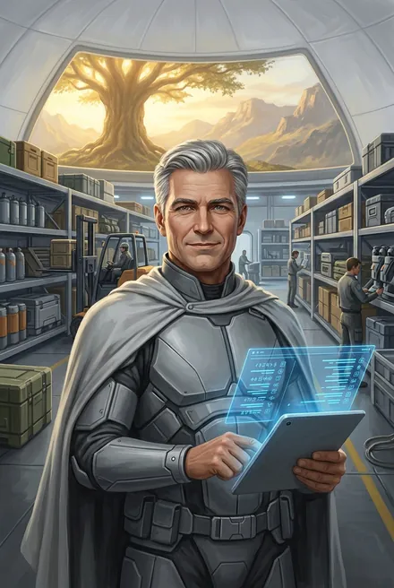

# Трейв Уитли (и его сын Тревор Моримото «Мажор»)

> **Трейв** и **Уитли** — один человек: **Трейв Уитли**. В тексте его зовут то по имени («Трейв», чаще), то по фамилии («Уитли», «мистер Уитли» — ЗК-4, гл. 14; «Очень много вопросов к Уитли!» — ЗК-6, гл. 1). В копье Сигурда он **никогда не служил**; в копье был его старший сын **Тревор** (ЗК-7–08). В ЗК-9, гл. 6 есть авторская описка: «после ухода **Трейва** в нашем копье было вакантное место» — имеется в виду Тревор (место занял Жабник).

---

## Облики на иллюстрациях

<figure markdown="span">
  [{ loading=lazy }](../assets/portrety/041.webp)
  <figcaption>«Джентльмен» <small>ЗК-1 — ЗК-6</small></figcaption>
</figure>

Иллюстрации созданы нейросетью по описаниям из книг; это трактовка, а не официальный арт.

## Часть 1. Трейв Уитли

| | |
|---|---|
| **Имя** | Трейв Уитли; «мистер Уитли» (так обращается Сигурд, пока Трейв не просит: «Просто Трейв», ЗК-4, гл. 14) |
| **Происхождение** | Землянин, «один из первых колонистов-экспертов» (ЗК-5, интерлюдия «Травинка»); «эксперт» проекта «Космо» (ЗК-4, гл. 10). «Мы с первого цикла вместе» — Винсенту (ЗК-6, гл. 24) |
| **Роль** | Завхоз и глава производственного сектора фригольда (ЗК-1, гл. 16–18) → один из «троицы лидеров» с Вероникой и Майклом (ЗК-2, гл. 14) → **второй знаменосец, «левая рука Вероники»** (ЗК-4, гл. 14); «бессменный знаменосец Вероники и глава производственного крыла» все её десять лет (ЗК-5, интерлюдия «Травинка»). Первым (военным) знаменосцем при Веронике был Майкл, «правая рука Вероники» (ЗК-4, гл. 1) → врио рикса (ЗК-4, гл. 18) → **рикс** (87 % голосов, ЗК-5) → изгой |
| **Восхождение** | Бронза; Титул «тан»/танаан (ЗК-1, гл. 16); «избрал навык „рунного мастера“ — творец, созидатель» (ЗК-4, гл. 14); умеет перезаряжать Предметы Звездной Кровью (ЗК-4, гл. 3, 14) |
| **Книги** | ЗК-1 – ЗК-6; упоминания ЗК-7–10 |
| **Статус** | **Мёртв**: изгнан Винсентом из Народа Земли и испепелён игг-оружием Хранителя Великого Древа (ЗК-6, гл. 24) |

### Личность
- **Маска честного администратора.** Под Аурой Доверия Вероники кажется Сигурду «открытым и добрым» (ЗК-1, гл. 16). Перекупщик: «Трейв… может вызвериться, правильный он слишком» (ЗК-2, гл. 8). «Пользовался большим уважением» и отвечал за «все производство, строительство, технику» (ЗК-4, гл. 14).
- **Деловитость.** Принимает и описывает вещи новичков, ценит Схемы («Наноткань бы очень пригодилась», ЗК-1, гл. 16); быстро модернизирует «Грифон» (второй винт, «Пилумы», ЗК-4, гл. 4, 12, 14).
- **Двойное дно.** Жёстко отрицает утечку оружия: «Невозможно. У нас все учтено… Выбрось из головы эту ерунду, Сигурд» (ЗК-4, гл. 14) — а сам сливал излишки репликации изгоям Кнута (ЗК-5, гл. 15; ЗК-6, гл. 26).
- **Слабость:** марионетка Говорящей-с-Травами, её любовник (ЗК-5, интерлюдия; ЗК-6, гл. 1 — «не самостоятельная фигура»). Трус: на суде лжёт, отрекается («клянусь, я ничего не знал о проклятой Руне!… Ты ведь меня знаешь, мы с первого цикла вместе»), левый глаз дёргается в нервном тике (ЗК-6, гл. 24).

### Речь
Вежливо-деловая, в роли рикса — напыщенная: «Вероника Максвелл! Ты обвиняешься в преступной халатности…» (ЗК-6, интерлюдия «Травинка»); «Я, Трейв Уитли, новый рикс Людей Земли, буду говорить от фригольда Небо…» (ЗК-6, гл. 20); «Я не пастух тем, кто утратил свой Титул… Может, об этом лучше спросить Людей Тени?» (там же).

### Биография
- **ЗК-1, гл. 16–17.** С Вероникой и Майклом допрашивает Сигурда; принимает вещи и Схемы («Мангус»), начисляет баллы, выдаёт переноску для Кыша; «раздербанил все» (Минос, гл. 22). *Мелкое противоречие:* Набор Колониста в гл. 3 — «тип 2», Трейв в гл. 16 говорит «тип-3» (из прежней версии досье).
- **ЗК-2.** Строит новую морозильню (гл. 1); на похоронах — среди глав (гл. 2); рисует «идеальную картину» коммуны, далёкую от правды (гл. 8). Вероника и Трейв обсуждали «птичку Альфы, которую можно вытащить из тени» — Фьюри/«Одиссей» (ЗК-3, гл. 12).
- **ЗК-4.** Защищает Сигурда как «ценный актив» — единственного пилота (интерлюдия «Фригольд»); восстанавливает «Грифон»; заряжает амулет Травинки бесплатно; продаёт Сигурду «Мангусы»; рассуждает о Камнях Пути и рунных мастерах — «особая каста» (гл. 14). Во время рейда — врио рикса (гл. 18).
- **ЗК-5.** Избран риксом (87 %); назначает Мрака вторым знаменосцем (Серену — первым); пытается удержать Лэндо как заложника; Травинка застаёт его с Говорящей. Сигурд находит в Шторме мегакрипторы с земным оружием у Кнута — «доказательство предательства Трейва» (гл. 15).
- **ЗК-6.** У Храма требует ареста Вероники (интерлюдия); на тинге представляется риксом; Винсент возвращается и вызывает его — за Трейва бьётся Мрак (гл. 21). После проигрыша отрекается от Титула, лжёт о пленниках; Винсент изгоняет его — Хранитель Древа пронзает и испепеляет (гл. 24). Ядро Домена с пленниками было у него в крипторе/Руне-Хранилище (свидетельство Свирели, гл. 24). Его люди из производственного крыла приговорены к принудительным работам (гл. 26). Его место заняла Вероника (гл. 27).
- **После смерти:** Ключ становится рунным мастером фригольда (ЗК-7, гл. 7); секреты Говорящей «Трейв унес… в могилу» (ЗК-7, гл. 8).

### Семья
Был не женат (ЗК-5, интерлюдия). С матерью своих детей — азио из Либеро Марсо — «разошелся давным-давно, но с детьми отношения поддерживал, курировал их» (ЗК-7, гл. 8). Старший сын — Тревор.

### Тайны
- Когда и почему он начал снабжать Кнута; что знал о Порталах Говорящей и её рунном мастерстве (ЗК-5, гл. 19).
- «Птичка Альфы» — его роль в выкупе Фьюри.

---

## Часть 2. Тревор Моримото «Мажор»

| | |
|---|---|
| **Имя** | Тревор Моримото (фамилия матери); кличка **«Мажор»** — от Грохота (ЗК-7, гл. 9) |
| **Происхождение** | 20 лет; **рождён в Единстве** («А я местный»); мать — с Либеро Марсо, японские корни: «Мать оттуда, да» (ЗК-7, гл. 9); старший сын Трейва Уитли (ЗК-7, гл. 8) |
| **Роль** | Новобранец копья Сигурда (ЗК-7), «риксом группы новичков» назначен по разбору; слабое звено → копьё Кассиди (ЗК-8, гл. 16) |
| **Ранг** | Не Восходящий |
| **Книги** | ЗК-7, ЗК-8, ЗК-10 |
| **Статус** | Жив, в копье Винсента Кассиди (ЗК-10, гл. 5) |

**Внешность (кратко):** «Крупный темноволосый парень с правильными чертами лица, он был похож на отца — и одновременно отличался, взяв немного от матери-азио» (ЗК-7, гл. 8); новенький черно-оранжевый «Фокс» (ЗК-7, гл. 9), позже чёрный (ЗК-10, гл. 5).

**Характер.** На бумаге идеален: «психофизиологические тесты… идеальными. Ярко выраженные лидерские качества… Интеллект, реакция и физика — намного выше среднего» (ЗК-7, гл. 8); у Миноса — «одним из лучших учеников». Травинка (дружили в детстве): «Умник он, а не умный… Нос любит задирать… это сынок Трейва, весь в него!» (ЗК-7, гл. 8). Скрыл родство с Трейвом. В бою — паника; завидует Восходящим (ЗК-8, гл. 7). Признание: «Страшно очень! Трясет меня всего… Не пойду я туда больше, командир» (ЗК-8, гл. 7) — Сигурд ценит, что он смог признать страх.

**Биография.**
- **ЗК-7, гл. 5, 8–9.** В списке кандидатов — «подающий большие надежды»; Сигурд берёт его вопреки совету Миноса «из чувства протеста». Задирает Юки («ты на кухне работала») — та приставляет нож к его горлу; Грохот: «будешь у нас Мажор».
- **Гл. 10, 13, 17, 19.** Трясётся под обстрелом, блюёт, палит «в молоко»; не приходит на праздник; остаётся у винтокрыла; получает копытом от тавра.
- **ЗК-8, гл. 3–7.** В Серебряном Замке — на подхвате (двойка с Кроу), ломается во тьме; Сигурд обещает уход «с почетом».
- **ЗК-8, гл. 16.** Винсент забирает его в своё копьё — «со стороны выглядело как повышение».
- **ЗК-10, гл. 5.** Четвёртый в копье Кассиди в рейде к Колонне Ветров, «напряженным и явно нервничал».

**Крючки:** отношение сына к памяти отца-предателя; «мажор», выросший в колонии, против «диких» Восходящих; второй шанс у Кассиди; младшие дети Трейва (упомянуты как «детьми», ЗК-7, гл. 8).
