# Персонажи цикла «Тысяча Братьев» (ТБ-1…ТБ-5) и древние силы — сводный указатель

Досье лежат в этой папке. Персонажи основной серии (Сигурд, Травинка, Винсент, Аврора, Минос и др.) — в [Персонажи основной серии «Звездная Кровь» (ЗК-1…ЗК-11) — сводный указатель](../personazhi/zvezdnaya-krov.md). Статус — на конец канона (ТБ-5 / ЗК-11). «упом.» — только упоминания.

## 1. Сводная таблица

### 1.1. Протагонист и его Руны-Существа
| Имя | Кто | Книги | Статус | Досье |
|---|---|---|---|---|
| 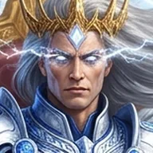{ .idx-ico loading=lazy } Белый Дьявол / Дарующий Молнии / Пламени Подобный | Осколок Забытого, Один из Тысячи; голос в Сигурде → тело Марка Кассиди; кинг Народа Молний | ЗК-1–11, ТБ-1–05 | Жив, золото | [досье](../personazhi/belyj_dyavol.md) |
| 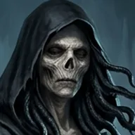{ .idx-ico loading=lazy } Морвейн кель'Талас (Морвена) | Заклинательница Душ, бывшая Хранительница Кургана Янтандера; Руна → свободная союзница | ЗК-5–06, 09–10, ТБ-1–05 | Мертва (ТБ-5, гл. 20) | [досье](../personazhi/morvejn.md) |
| 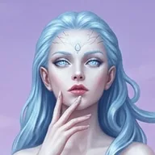{ .idx-ico loading=lazy } Азимандия Визу Аран | Золотая кел-леди, рунный мастер; Руна-Существо | ЗК-2–06, ТБ-1–05 | Руна сломана | [досье](../personazhi/azimandiya.md) |
| 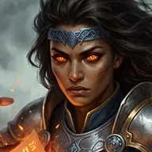{ .idx-ico loading=lazy } Провидица / Ида Сторн | Паладин Империи Семи Звёзд; Руна-Существо | ЗК-5, ТБ-1–05 | Руна сломана | [досье](../personazhi/providica.md) |
| Циклоп, Варвар, Танцовщица, Садовник, Лик, Собирашки, Призрачные Девы | Свита Азимандии | ЗК-5, ТБ-1–05 | Руны сломаны (ТБ-5) / Девы у Сигурда | [досье](../personazhi/azimandiya.md) |
| Эсмерра | Разум астролита Аммос, навигатор | ТБ-3–05 | Сердце Эстэ | [досье](../personazhi/sushchestva_skrizhali.md) |
| Архитектор Доменов | Отражение Зентариса | ТБ-3–04 | Действует | [досье](../personazhi/sushchestva_skrizhali.md) |
| Аур-Тален | Держатель Молний Эстэ | ТБ-3–04 | Действует | [досье](../personazhi/sushchestva_skrizhali.md) |
| Игг-Феникс | Золотая Руна воскрешения | ТБ-4–05 | Потерян (ТБ-5, гл. 15) | [досье](../personazhi/sushchestva_skrizhali.md) |
| Белый Крылан → Ледяной Драккарис | Дрейк-Существо | ТБ-1–05 | Сломан (ТБ-5) | [досье](../personazhi/sushchestva_skrizhali.md) |
| Скрипторум Некролита | Владыка Некролита | ЗК-9, ТБ-4–05 | Руна у ПП | [досье](../personazhi/sushchestva_skrizhali.md) |
| Бродячий Торговец («Компания») | Существо-фактотум Хитрейшего | ТБ-1–05 | Действует | [досье](../personazhi/hraniteli.md) |

### 1.2. Тысяча Братьев
| Имя | Кто | Книги | Статус | Досье |
|---|---|---|---|---|
| 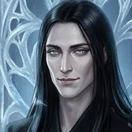{ .idx-ico loading=lazy } Кейнор, Ледяной Кузнец | Небо, владыка Эргиаля, убийца Мерзости | ЗК-8–11, ТБ-2–05 | Жив | [досье](../personazhi/kejnor.md) |
| 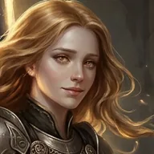{ .idx-ico loading=lazy } Моргейн | Владычица Путей и Порталов, «собрала Тысячу» | ЗК-2, ТБ-5 | Жива в теле Илианы | [досье](../personazhi/morgejn.md) |
| 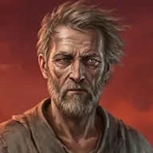{ .idx-ico loading=lazy } Предатель — Арвейн Размыкатель | Небо, Аспект Разделитель, прародитель кель-родов | ТБ-5 | Мёртв | [досье](../personazhi/arvejn_predatel.md) |
| 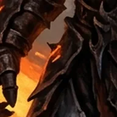{ .idx-ico loading=lazy } Орин Огненный Клинок | Владыка Горна, чемпион Арены | ТБ-1 | Мёртв | [досье](../personazhi/orin.md) |
| 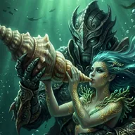{ .idx-ico loading=lazy } Сатори «Морская Роза» | Русалка-ментал | ЗК-8, ТБ-2–05 | Жива | [досье](../personazhi/satori.md) |
| Осьминог | Страж Сатори / Брат (противоречие) | ЗК-8, ТБ-2–04 | Жив | [досье](../personazhi/satori.md) |
| Нор-Аэль, Соловей-в-Ночи | Онейромантка, «второй голос Тысячи» | ЗК-11, ТБ-3–05 | Жива | [досье](../personazhi/tysyacha_bratev.md) |
| Янтандер Златоуст | «Уста Тысячи», Курган Талас | ТБ-1–05 | Мёртв (ТБ-5) | [досье](../personazhi/tysyacha_bratev.md) |
| Лодочник | Река времени, говорил с Молчащим | ЗК-11, ТБ-2–05 | Скован (Курган Амарис?) | [досье](../personazhi/tysyacha_bratev.md) |
| Урсонд Несущий Бурю (Буревестник) | Проклятый флот, Курган Майр | ТБ-2–05 | Неизвестно | [досье](../personazhi/tysyacha_bratev.md) |
| Король Хворей | Эпидемии, Курган Роан | ТБ-1, 03, 05 | Скован | [досье](../personazhi/tysyacha_bratev.md) |
| Гнилая Садовница (Цветок) | Ученица Творящей, «срединное небо» | ТБ-3, 05 | Неизвестно | [досье](../personazhi/tysyacha_bratev.md) |
| Чёрный Крест | Владыка Легионов, основатель ордена | ЗК-8, ТБ-2–03 | Мёртв (ТБ-3) | [досье](../personazhi/tysyacha_bratev.md) |
| Эрланд | Прячется на Живом Острове | ТБ-3 | Неизвестно | [досье](../personazhi/tysyacha_bratev.md) |
| Мелькиор, Сарвара Нежная | Убиты Орином | ТБ-1–02 | Мертвы | [досье](../personazhi/tysyacha_bratev.md) |
| Генерал Тысячи (Алый Король) | Лидер Тысячи | ТБ-2–05 (упом.) | Мёртв (Чёрные Врата) | [досье](../personazhi/tysyacha_bratev.md) |
| Дракон | Создатель драконьих Рун | ТБ-2–04 (упом.) | Неизвестно | [досье](../personazhi/tysyacha_bratev.md) |
| Деймос, Тёмная Звезда, Миротворец, Тысячеликая | Опозоренные | ТБ-3 (упом.) | В Вечности | [досье](../personazhi/tysyacha_bratev.md) |
| Лишённый Имени, Жаждущий, Считающий, Хор, Художник + галерея | Каталог прологов | ТБ-3, 05 (упом.) | В основном мертвы | [досье](../personazhi/tysyacha_bratev.md) |
| Брат Кургана Варрен | Имя неизвестно | ТБ-5 | Скован | [досье](../personazhi/tysyacha_bratev.md) |

### 1.3. Народ Теней / Молний, жёны и знать
| Имя | Кто | Книги | Статус | Досье |
|---|---|---|---|---|
| 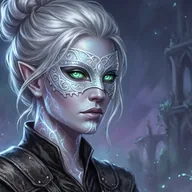{ .idx-ico loading=lazy } Найтфир (Ночной Страх) | Луноликая, первая жена, Королева Снов | ЗК-9, ТБ-3–04 | Жива, регент Эстэ | [досье](../personazhi/najtfir.md) |
| 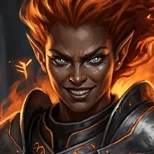{ .idx-ico loading=lazy } Каласса Огненная-как-Ветер | Полукровка, рикс Каменных Луков | ЗК-11, ТБ-3–04 | Жива, беременна | [досье](../personazhi/kalassa.md) |
| Шелковая Тень | Бабушка тела, первый знаменосец | ТБ-3–04 | Жива | [досье](../personazhi/narod_tenej.md) |
| Коготь-как-Серебро | Рикс Небесных Когтей | ЗК-3, 06, 09, ТБ-3–04 | Жив | [досье](../personazhi/narod_tenej.md) |
| Острый-как-Шип | Рикс Серых Шипов | ТБ-3–04 | Жив | [досье](../personazhi/narod_tenej.md) |
| Шепот-в-Ночи | Глава Луноликих | ТБ-3–04 | Мертва | [досье](../personazhi/narod_tenej.md) |
| Яростный-как-Пламя | Рикс Каменных Луков, потомок БД | ЗК-6, 09, ТБ-3 | Мёртв | [досье](../personazhi/narod_tenej.md) |
| Пожиратель Костей / Всадник | Золотой Отрекшийся, рикс Черепов | ЗК-9, ТБ-2–03 | Уничтожен | [досье](../personazhi/narod_tenej.md) |
| Режущий Руны | Эрл, рунный мастер Луков | ТБ-3–04 | Жив | [досье](../personazhi/narod_tenej.md) |
| Серебряное Облако, Молния-из-Стали, Рвущий-Червивые-Жилы и др. | Знать септ | ТБ-3–04 | Живы | [досье](../personazhi/narod_tenej.md) |
| Королева Снов (древняя) | Хранительница Архива Снов Эстэ | ЗК-5, ТБ-4 | Прах / Отражение развеяно | [досье](../personazhi/narod_tenej.md) |

### 1.4. Другие Народы и спутники
| Имя | Кто | Книги | Статус | Досье |
|---|---|---|---|---|
| Иниэсс Зелёный Лист | Кинг Народа Древа, золото | ЗК-6–07, ТБ-4 | Жива | [досье](../personazhi/iniess.md) |
| Серебряная Форель (Мирисс) | Народ Реки, должница | ТБ-1, ЗК-9, ТБ-4 | Жива | [досье](../personazhi/narody_tb.md) |
| Аурвак Владыка Чешуи | Рикс Мёртвой Рыбы | ЗК-6, ТБ-1, ТБ-4 | Мёртв (Псы) | [досье](../personazhi/narody_tb.md) |
| Элесс Голубая Раковина | Фламиника Мёртвой Рыбы | ТБ-1 | Неизвестно | [досье](../personazhi/narody_tb.md) |
| Чёрный Триглав | Рикс Болотных Пещер, драконий Жезл | ТБ-1 | Мёртв | [досье](../personazhi/narody_tb.md) |
| Камешек, Змейка | Люди Гор | ТБ-1, ТБ-4 | Живы | [досье](../personazhi/narody_tb.md) |
| Свирель и изгои | Земляне-изгои | ТБ-1 | Мертвы | [досье](../personazhi/narody_tb.md) |
| Сторм Сто Смертей | Кинг Людей Моря | ТБ-4 | Жив | [досье](../personazhi/narody_tb.md) |
| Ветер Равнин, Раатан, Безумец | Вожди Трав, Леса, пещер | ЗК-6–07, ТБ-4 | Живы | [досье](../personazhi/narody_tb.md) |
| Тиис-Унно | Шайо-Иннах | ТБ-4 | Жив | [досье](../personazhi/narody_tb.md) |
| Талайн Змеиный Глаз | Держатель Меча Эстэ (древность) | ТБ-1 | Давно мёртв | [досье](../personazhi/narody_tb.md) |
| 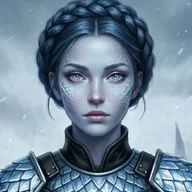{ .idx-ico loading=lazy } Эрин Ледяная Искра | Лед-кузнец, возлюбленная БД | ТБ-2 | Жива | [досье](../personazhi/erin.md) |
| Марисса Золотая Змея | Эвгина Ноктис, драконья Руна Кейнора | ЗК-8, ТБ-2, ТБ-4 | Жива (Руна) | [досье](../personazhi/dom_noktis.md) |
| Эверент Ноктис Кел Аммос | Экзарх Корпуса, авгур | ЗК-8, ТБ-2 | Жив | [досье](../personazhi/dom_noktis.md) |
| Онора | Эрда Корпуса | ЗК-8, ТБ-2, ТБ-4 | Жива | [Дом Ноктис](../personazhi/dom_noktis.md), [Эрда Онора](../personazhi/onora.md) |
| Обочина, Вешка, Подкова | Караванщики рода Фел | ТБ-5 | Обочина и Подкова мертвы; Вешка — Руна | [досье](../personazhi/karavanshchiki.md) |
| Найра Эль-Кадис, Вейн Эль-Керр | Великий Караван | ЗК-10, ТБ-5 | Живы | [досье](../personazhi/karavanshchiki.md) |
| 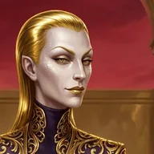{ .idx-ico loading=lazy } Флекс Торий | Душеторговец Вечности | ЗК-5–06 | Казнён (отражение) | [досье](../personazhi/flex-torij.md) |

### 1.5. Кель-рода Курганов (ТБ-5)
| Имя | Кто | Статус | Досье |
|---|---|---|---|
| Талар кель'Саар | Муж Морвейн, дух Кувшина | Неизвестно | [досье](../personazhi/kel_roda_kurganov.md) |
| Эльвейн кель'Талас | Дочь Морвейн, Первый Ключ | Мертва | там же |
| Морри | Правнучка Морвейн, новая хранительница | Жива (Эстэ) | там же |
| Итта Основательница | Дочь Предателя, дух | Погибла | там же |
| Эйр-Талас, Коравейн, Хельвейн, Ллеу | Предки Талас | Духи | там же |
| Илиана кель'Саар | Хранительница Саар, сосуд Моргейн | Жива | там же |
| Арагвейн кель'Саар | Дух, муж Илианы | Неизвестно | там же |
| Кайр кель'Роан | Хранитель Роан | Мёртв | там же |
| Хранитель Варрен | Трус, отдал Ключ | Мёртв | там же |
| Лже-Амарис (фактотум), Сейта | Подменыш Вечности; дух-мать | Мёртв / дух | там же |
| Хранитель, Привратник, ключники Майр | Род Майр | Мертвы | там же |

### 1.6. Древние силы
| Имя | Кто | Статус | Досье |
|---|---|---|---|
| { .idx-ico loading=lazy } Хитрейший | Хранитель, Контракция | Действует | [Хранители Вечности](../personazhi/hraniteli.md), [Хитрейший](../personazhi/hitreyshiy.md) |
| Полководец | Хранитель, Гармония | Маска казнена, сам жив | [досье](../personazhi/hraniteli.md) |
| Палач | Хранительница Закона, хозяйка Псов | Действует | [досье](../personazhi/hraniteli.md) |
| 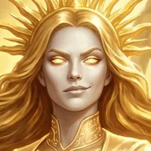{ .idx-ico loading=lazy } Сестра Солнца | Четвёртая Хранительница, Золотые Варвары | Действует | [Хранители Вечности](../personazhi/hraniteli.md), [Сестра Солнца](../personazhi/sestra-solntsa.md) |
| Предвестник | Первый Хранитель, Хронос | Действует | [досье](../personazhi/hraniteli.md) |
| Посланник/Посланница | Дом Норн, Храмы | Действует | [досье](../personazhi/hraniteli.md) |
| Странник | Убийца Шелеста | Неизвестно где | [досье](../personazhi/hraniteli.md) |
| Норны, Вестник | Слуги Посланника | — | [досье](../personazhi/hraniteli.md) |
| Небесный (Тар Энимус) | Пёс, гранд-инквизитор | Стёрт, 100 циклов у Бреши | [досье](../personazhi/psy_vechnosti.md) |
| Драконоборец | Пёс | Мёртв | [досье](../personazhi/psy_vechnosti.md) |
| Всполох (Тэйлисс Кел Эммис) | Пёс, предательница Дарующего | Трэль без Крови | [досье](../personazhi/psy_vechnosti.md) |
| Великие Черви (Мерзость, Гибель и др.) | Потомки Тварей Извне | Гибель жив | [досье](../personazhi/velikie_chervi.md) |
| 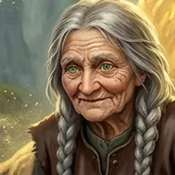{ .idx-ico loading=lazy } Бабушка Яшма | Тень Творящей? | Появляется | [досье](../personazhi/yashma.md) |
| Единые (7), Наблюдатель, Орден Истинных | Высшие силы | — | [досье](../personazhi/edinye.md) |

## 2. Схемы

### (а) Тысяча Братьев: кто жив, кто мёртв, кто в Кургане (на конец ТБ-5)
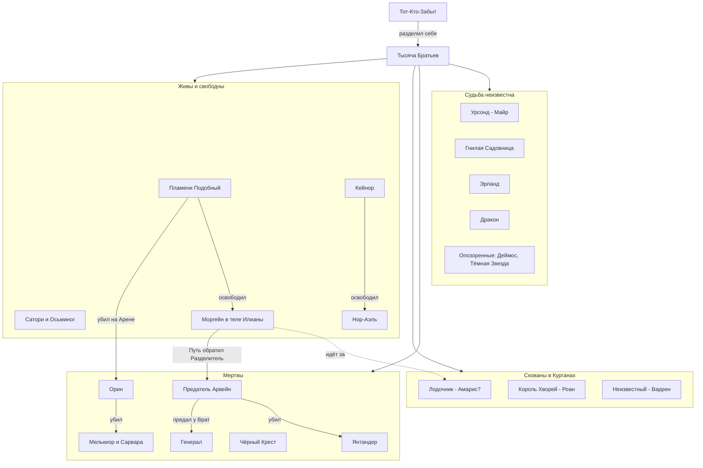

### (б) Окружение Пламени Подобного в ТБ
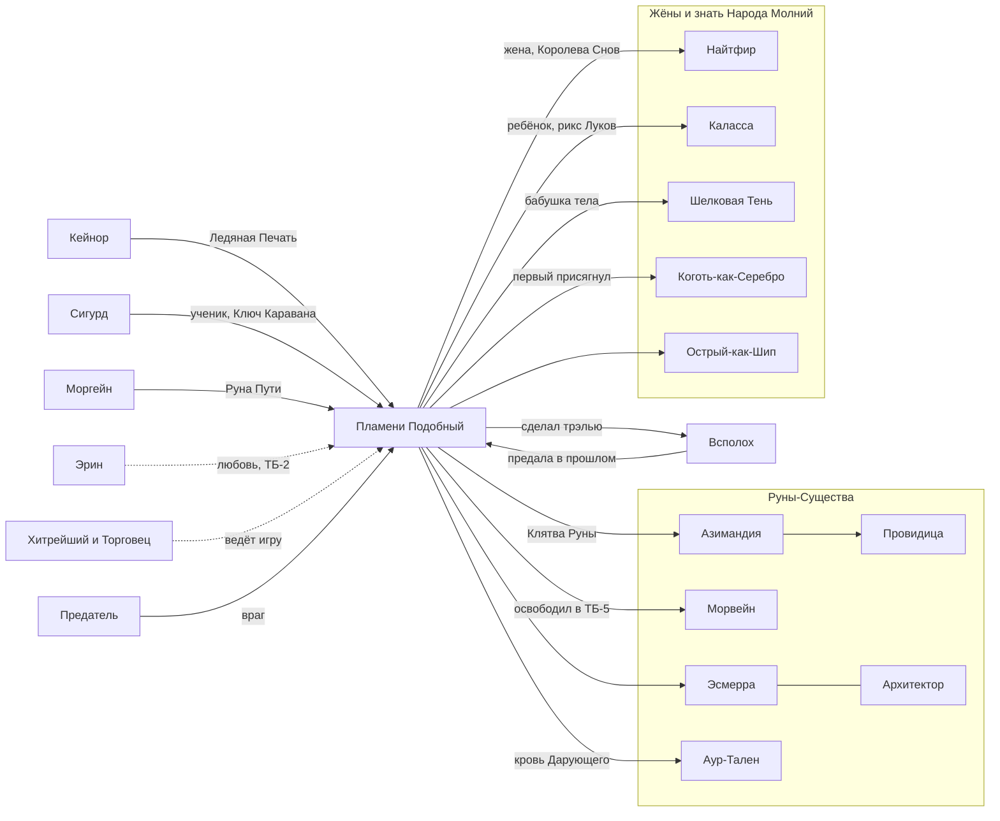

### (в) Хранители Вечности и их связи
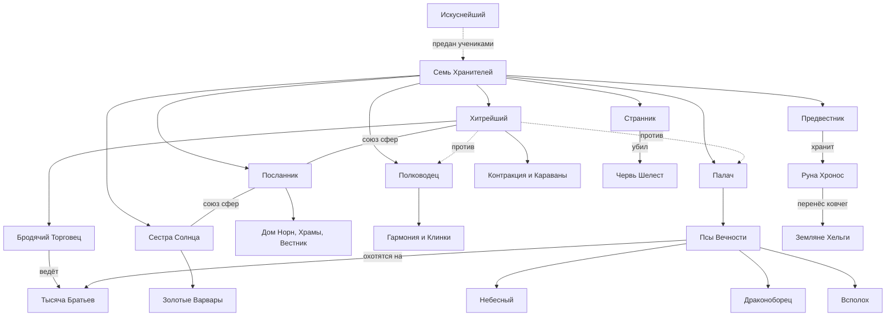

## 3. Главные противоречия по теме (сводно)
1. **Талар** — брат Морвейн (ЗК-5, ТБ-1, ЗК-9) vs муж из рода Саар (ТБ-5, гл. 7; ретконом объяснено её ложью).
2. **Сколько жизней у Белого Дьявола:** «трижды рождался» ещё в теле Сигурда (ЗК-3, гл. 14) vs тело Марка — «третье» (ТБ-1, ТБ-5).
3. **Когда родилась Тысяча:** «после Раскола» (ТБ-4, ТБ-5) vs голос правил «в эпоху Раскола» (ЗК-3) и «седьмая эпоха» астролитов (ТБ-3, гл. 9).
4. **Срок заточения БД:** «несколько сотен, а может, тысячу» циклов (ТБ-1) vs «тысячи циклов» (прологи, ЗК-1).
5. **Списки Хранителей** расходятся (ЗК-3: «крылатый с копьём», без Странника; ЗК-8: «Вестник» вместо Посланника; ЗК-9: канонический список).
6. **Осьминог** — Хранитель/страж Сатори (ЗК-8, ТБ-2) vs Брат (ТБ-3; Предатель в ТБ-5).
7. **Чёрный Крест** — жив (ЗК-8), пропал (ТБ-2), погиб в Зиккурате (ТБ-3).
8. **Глаза Кейнора** — звёздное серебро (ТБ-2) vs синие (ТБ-4).
9. **Прежний Аспект БД** — «Сплетённые Молнии» (ТБ-1) vs «Венец Молний» (ТБ-2).
10. **Флекс Торий** — казнён (ЗК-6) vs «жив за кадром» (таблица разбора ТБ-1); разбор ТБ-3 ошибочно называет «Тория» риксом землян.
11. **Морвейн, Азимандия, Провидица, свита** многократно «гибнут» как Руны (ТБ-1, ТБ-2, ТБ-4) и возвращаются без объяснения ремонта.
12. Написание: Тэйлисс Кел **Эмисс** (ТБ-1) / **Эммис** (ТБ-4); Сатори / Сатора (ТБ-2, гл. 15); Дракарис / Драккарис.
