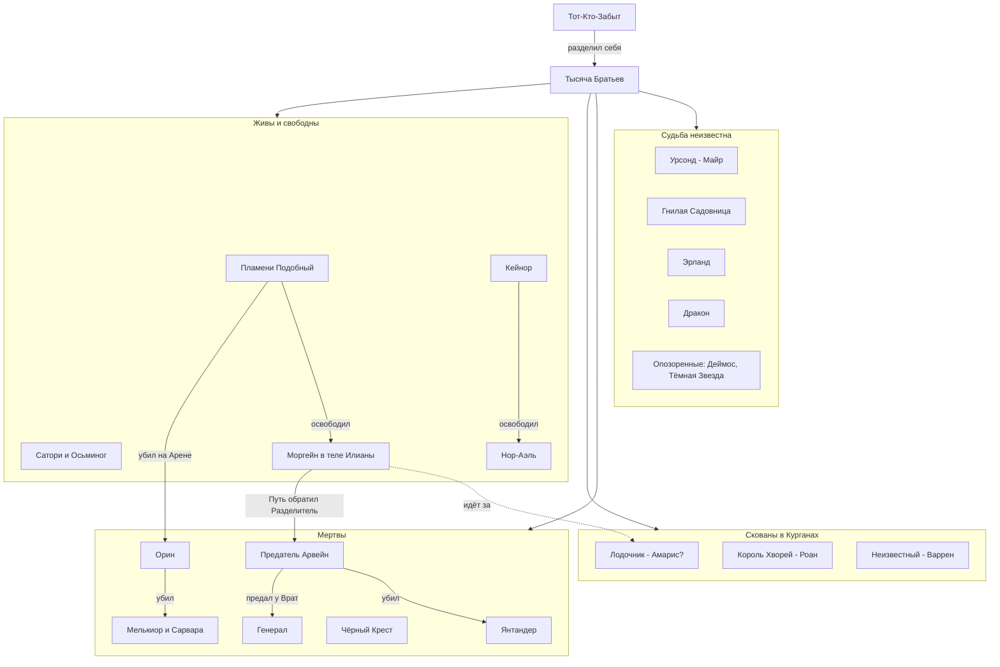
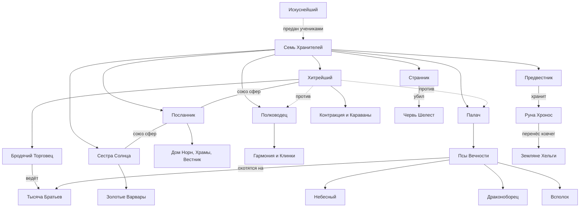

# Персонажи цикла «Тысяча Братьев» (TB-01…TB-05) и древние силы — сводный указатель

Досье лежат в этой папке. Персонажи основной серии (Сигурд, Травинка, Винсент, Аврора, Минос и др.) — в [_index_sk.md](../personazhi/zvezdnaya-krov.md). Статус — на конец канона (TB-05 / SK-11). «упом.» — только упоминания.

## 1. Сводная таблица

### 1.1. Протагонист и его Руны-Существа
| Имя | Кто | Книги | Статус | Досье |
|---|---|---|---|---|
| Белый Дьявол / Дарующий Молнии / Пламени Подобный | Осколок Забытого, Один из Тысячи; голос в Сигурде → тело Марка Кассиди; кинг Народа Молний | SK-01–11, TB-01–05 | Жив, золото | [belyj_dyavol.md](../personazhi/belyj_dyavol.md) |
| Морвейн кель'Талас (Морвена) | Заклинательница Душ, бывшая Хранительница Кургана Янтандера; Руна → свободная союзница | SK-05–06, 09–10, TB-01–05 | Мертва (TB-05, гл. 20) | [morvejn.md](../personazhi/morvejn.md) |
| Азимандия Визу Аран | Золотая кел-леди, рунный мастер; Руна-Существо | SK-02–06, TB-01–05 | Руна сломана | [azimandiya.md](../personazhi/azimandiya.md) |
| Провидица / Ида Сторн | Паладин Империи Семи Звёзд; Руна-Существо | SK-05, TB-01–05 | Руна сломана | [providica.md](../personazhi/providica.md) |
| Циклоп, Варвар, Танцовщица, Садовник, Лик, Собирашки, Призрачные Девы | Свита Азимандии | SK-05, TB-01–05 | Руны сломаны (TB-05) / Девы у Сигурда | [azimandiya.md](../personazhi/azimandiya.md) |
| Эсмерра | Разум астролита Аммос, навигатор | TB-03–05 | Сердце Эстэ | [sushchestva_skrizhali.md](../personazhi/sushchestva_skrizhali.md) |
| Архитектор Доменов | Отражение Зентариса | TB-03–04 | Действует | [sushchestva_skrizhali.md](../personazhi/sushchestva_skrizhali.md) |
| Аур-Тален | Держатель Молний Эстэ | TB-03–04 | Действует | [sushchestva_skrizhali.md](../personazhi/sushchestva_skrizhali.md) |
| Игг-Феникс | Золотая Руна воскрешения | TB-04–05 | Потерян (TB-05, гл. 15) | [sushchestva_skrizhali.md](../personazhi/sushchestva_skrizhali.md) |
| Белый Крылан → Ледяной Драккарис | Дрейк-Существо | TB-01–05 | Сломан (TB-05) | [sushchestva_skrizhali.md](../personazhi/sushchestva_skrizhali.md) |
| Скрипторум Некролита | Владыка Некролита | SK-09, TB-04–05 | Руна у ПП | [sushchestva_skrizhali.md](../personazhi/sushchestva_skrizhali.md) |
| Бродячий Торговец («Компания») | Существо-фактотум Хитрейшего | TB-01–05 | Действует | [hraniteli.md](../personazhi/hraniteli.md) |

### 1.2. Тысяча Братьев
| Имя | Кто | Книги | Статус | Досье |
|---|---|---|---|---|
| Кейнор, Ледяной Кузнец | Небо, владыка Эргиаля, убийца Мерзости | SK-08–11, TB-02–05 | Жив | [kejnor.md](../personazhi/kejnor.md) |
| Моргейн | Владычица Путей и Порталов, «собрала Тысячу» | SK-02, TB-05 | Жива в теле Илианы | [morgejn.md](../personazhi/morgejn.md) |
| Предатель — Арвейн Размыкатель | Небо, Аспект Разделитель, прародитель кель-родов | TB-05 | Мёртв | [arvejn_predatel.md](../personazhi/arvejn_predatel.md) |
| Орин Огненный Клинок | Владыка Горна, чемпион Арены | TB-01 | Мёртв | [orin.md](../personazhi/orin.md) |
| Сатори «Морская Роза» | Русалка-ментал | SK-08, TB-02–05 | Жива | [satori.md](../personazhi/satori.md) |
| Осьминог | Страж Сатори / Брат (противоречие) | SK-08, TB-02–04 | Жив | [satori.md](../personazhi/satori.md) |
| Нор-Аэль, Соловей-в-Ночи | Онейромантка, «второй голос Тысячи» | SK-11, TB-03–05 | Жива | [tysyacha_bratev.md](../personazhi/tysyacha_bratev.md) |
| Янтандер Златоуст | «Уста Тысячи», Курган Талас | TB-01–05 | Мёртв (TB-05) | [tysyacha_bratev.md](../personazhi/tysyacha_bratev.md) |
| Лодочник | Река времени, говорил с Молчащим | SK-11, TB-02–05 | Скован (Курган Амарис?) | [tysyacha_bratev.md](../personazhi/tysyacha_bratev.md) |
| Урсонд Несущий Бурю (Буревестник) | Проклятый флот, Курган Майр | TB-02–05 | Неизвестно | [tysyacha_bratev.md](../personazhi/tysyacha_bratev.md) |
| Король Хворей | Эпидемии, Курган Роан | TB-01, 03, 05 | Скован | [tysyacha_bratev.md](../personazhi/tysyacha_bratev.md) |
| Гнилая Садовница (Цветок) | Ученица Творящей, «срединное небо» | TB-03, 05 | Неизвестно | [tysyacha_bratev.md](../personazhi/tysyacha_bratev.md) |
| Чёрный Крест | Владыка Легионов, основатель ордена | SK-08, TB-02–03 | Мёртв (TB-03) | [tysyacha_bratev.md](../personazhi/tysyacha_bratev.md) |
| Эрланд | Прячется на Живом Острове | TB-03 | Неизвестно | [tysyacha_bratev.md](../personazhi/tysyacha_bratev.md) |
| Мелькиор, Сарвара Нежная | Убиты Орином | TB-01–02 | Мертвы | [tysyacha_bratev.md](../personazhi/tysyacha_bratev.md) |
| Генерал Тысячи (Алый Король) | Лидер Тысячи | TB-02–05 (упом.) | Мёртв (Чёрные Врата) | [tysyacha_bratev.md](../personazhi/tysyacha_bratev.md) |
| Дракон | Создатель драконьих Рун | TB-02–04 (упом.) | Неизвестно | [tysyacha_bratev.md](../personazhi/tysyacha_bratev.md) |
| Деймос, Тёмная Звезда, Миротворец, Тысячеликая | Опозоренные | TB-03 (упом.) | В Вечности | [tysyacha_bratev.md](../personazhi/tysyacha_bratev.md) |
| Лишённый Имени, Жаждущий, Считающий, Хор, Художник + галерея | Каталог прологов | TB-03, 05 (упом.) | В основном мертвы | [tysyacha_bratev.md](../personazhi/tysyacha_bratev.md) |
| Брат Кургана Варрен | Имя неизвестно | TB-05 | Скован | [tysyacha_bratev.md](../personazhi/tysyacha_bratev.md) |

### 1.3. Народ Теней / Молний, жёны и знать
| Имя | Кто | Книги | Статус | Досье |
|---|---|---|---|---|
| Найтфир (Ночной Страх) | Луноликая, первая жена, Королева Снов | SK-09, TB-03–04 | Жива, регент Эстэ | [najtfir.md](../personazhi/najtfir.md) |
| Каласса Огненная-как-Ветер | Полукровка, рикс Каменных Луков | SK-11, TB-03–04 | Жива, беременна | [kalassa.md](../personazhi/kalassa.md) |
| Шелковая Тень | Бабушка тела, первый знаменосец | TB-03–04 | Жива | [narod_tenej.md](../personazhi/narod_tenej.md) |
| Коготь-как-Серебро | Рикс Небесных Когтей | SK-03, 06, 09, TB-03–04 | Жив | [narod_tenej.md](../personazhi/narod_tenej.md) |
| Острый-как-Шип | Рикс Серых Шипов | TB-03–04 | Жив | [narod_tenej.md](../personazhi/narod_tenej.md) |
| Шепот-в-Ночи | Глава Луноликих | TB-03–04 | Мертва | [narod_tenej.md](../personazhi/narod_tenej.md) |
| Яростный-как-Пламя | Рикс Каменных Луков, потомок БД | SK-06, 09, TB-03 | Мёртв | [narod_tenej.md](../personazhi/narod_tenej.md) |
| Пожиратель Костей / Всадник | Золотой Отрекшийся, рикс Черепов | SK-09, TB-02–03 | Уничтожен | [narod_tenej.md](../personazhi/narod_tenej.md) |
| Режущий Руны | Эрл, рунный мастер Луков | TB-03–04 | Жив | [narod_tenej.md](../personazhi/narod_tenej.md) |
| Серебряное Облако, Молния-из-Стали, Рвущий-Червивые-Жилы и др. | Знать септ | TB-03–04 | Живы | [narod_tenej.md](../personazhi/narod_tenej.md) |
| Королева Снов (древняя) | Хранительница Архива Снов Эстэ | SK-05, TB-04 | Прах / Отражение развеяно | [narod_tenej.md](../personazhi/narod_tenej.md) |

### 1.4. Другие Народы и спутники
| Имя | Кто | Книги | Статус | Досье |
|---|---|---|---|---|
| Иниэсс Зелёный Лист | Кинг Народа Древа, золото | SK-06–07, TB-04 | Жива | [iniess.md](../personazhi/iniess.md) |
| Серебряная Форель (Мирисс) | Народ Реки, должница | TB-01, SK-09, TB-04 | Жива | [narody_tb.md](../personazhi/narody_tb.md) |
| Аурвак Владыка Чешуи | Рикс Мёртвой Рыбы | SK-06, TB-01, TB-04 | Мёртв (Псы) | [narody_tb.md](../personazhi/narody_tb.md) |
| Элесс Голубая Раковина | Фламиника Мёртвой Рыбы | TB-01 | Неизвестно | [narody_tb.md](../personazhi/narody_tb.md) |
| Чёрный Триглав | Рикс Болотных Пещер, драконий Жезл | TB-01 | Мёртв | [narody_tb.md](../personazhi/narody_tb.md) |
| Камешек, Змейка | Люди Гор | TB-01, TB-04 | Живы | [narody_tb.md](../personazhi/narody_tb.md) |
| Свирель и изгои | Земляне-изгои | TB-01 | Мертвы | [narody_tb.md](../personazhi/narody_tb.md) |
| Сторм Сто Смертей | Кинг Людей Моря | TB-04 | Жив | [narody_tb.md](../personazhi/narody_tb.md) |
| Ветер Равнин, Раатан, Безумец | Вожди Трав, Леса, пещер | SK-06–07, TB-04 | Живы | [narody_tb.md](../personazhi/narody_tb.md) |
| Тиис-Унно | Шайо-Иннах | TB-04 | Жив | [narody_tb.md](../personazhi/narody_tb.md) |
| Талайн Змеиный Глаз | Держатель Меча Эстэ (древность) | TB-01 | Давно мёртв | [narody_tb.md](../personazhi/narody_tb.md) |
| Эрин Ледяная Искра | Лед-кузнец, возлюбленная БД | TB-02 | Жива | [erin.md](../personazhi/erin.md) |
| Марисса Золотая Змея | Эвгина Ноктис, драконья Руна Кейнора | SK-08, TB-02, TB-04 | Жива (Руна) | [dom_noktis.md](../personazhi/dom_noktis.md) |
| Эверент Ноктис Кел Аммос | Экзарх Корпуса, авгур | SK-08, TB-02 | Жив | [dom_noktis.md](../personazhi/dom_noktis.md) |
| Онора | Эрда Корпуса | SK-08, TB-02, TB-04 | Жива | [dom_noktis.md](../personazhi/dom_noktis.md), [onora.md](../personazhi/onora.md) |
| Обочина, Вешка, Подкова | Караванщики рода Фел | TB-05 | Обочина и Подкова мертвы; Вешка — Руна | [karavanshchiki.md](../personazhi/karavanshchiki.md) |
| Найра Эль-Кадис, Вейн Эль-Керр | Великий Караван | SK-10, TB-05 | Живы | [karavanshchiki.md](../personazhi/karavanshchiki.md) |
| Флекс Торий | Душеторговец Вечности | SK-05–06 | Казнён (отражение) | [flex-torij.md](../personazhi/flex-torij.md) |

### 1.5. Кель-рода Курганов (TB-05)
| Имя | Кто | Статус | Досье |
|---|---|---|---|
| Талар кель'Саар | Муж Морвейн, дух Кувшина | Неизвестно | [kel_roda_kurganov.md](../personazhi/kel_roda_kurganov.md) |
| Эльвейн кель'Талас | Дочь Морвейн, Первый Ключ | Мертва | там же |
| Морри | Правнучка Морвейн, новая хранительница | Жива (Эстэ) | там же |
| Итта Основательница | Дочь Предателя, дух | Погибла | там же |
| Эйр-Талас, Коравейн, Хельвейн, Ллеу | Предки Талас | Духи | там же |
| Илиана кель'Саар | Хранительница Саар, сосуд Моргейн | Жива | там же |
| Арагвейн кель'Саар | Дух, муж Илианы | Неизвестно | там же |
| Кайр кель'Роан | Хранитель Роан | Мёртв | там же |
| Хранитель Варрен | Трус, отдал Ключ | Мёртв | там же |
| Лже-Амарис (фактотум), Сейта | Подменыш Вечности; дух-мать | Мёртв / дух | там же |
| Хранитель, Привратник, ключники Майр | Род Майр | Мертвы | там же |

### 1.6. Древние силы
| Имя | Кто | Статус | Досье |
|---|---|---|---|
| Хитрейший | Хранитель, Контракция | Действует | [hraniteli.md](../personazhi/hraniteli.md), [hitreyshiy.md](../personazhi/hitreyshiy.md) |
| Полководец | Хранитель, Гармония | Маска казнена, сам жив | [hraniteli.md](../personazhi/hraniteli.md) |
| Палач | Хранительница Закона, хозяйка Псов | Действует | [hraniteli.md](../personazhi/hraniteli.md) |
| Сестра Солнца | Четвёртая Хранительница, Золотые Варвары | Действует | [hraniteli.md](../personazhi/hraniteli.md), [sestra-solntsa.md](../personazhi/sestra-solntsa.md) |
| Предвестник | Первый Хранитель, Хронос | Действует | [hraniteli.md](../personazhi/hraniteli.md) |
| Посланник/Посланница | Дом Норн, Храмы | Действует | [hraniteli.md](../personazhi/hraniteli.md) |
| Странник | Убийца Шелеста | Неизвестно где | [hraniteli.md](../personazhi/hraniteli.md) |
| Норны, Вестник | Слуги Посланника | — | [hraniteli.md](../personazhi/hraniteli.md) |
| Небесный (Тар Энимус) | Пёс, гранд-инквизитор | Стёрт, 100 циклов у Бреши | [psy_vechnosti.md](../personazhi/psy_vechnosti.md) |
| Драконоборец | Пёс | Мёртв | [psy_vechnosti.md](../personazhi/psy_vechnosti.md) |
| Всполох (Тэйлисс Кел Эммис) | Пёс, предательница Дарующего | Трэль без Крови | [psy_vechnosti.md](../personazhi/psy_vechnosti.md) |
| Великие Черви (Мерзость, Гибель и др.) | Потомки Тварей Извне | Гибель жив | [velikie_chervi.md](../personazhi/velikie_chervi.md) |
| Бабушка Яшма | Тень Творящей? | Появляется | [yashma.md](../personazhi/yashma.md), [yashma.md](../personazhi/yashma.md) |
| Единые (7), Наблюдатель, Орден Истинных | Высшие силы | — | [edinye.md](../personazhi/edinye.md) |

## 2. Схемы

### (а) Тысяча Братьев: кто жив, кто мёртв, кто в Кургане (на конец TB-05)

### (б) Окружение Пламени Подобного в TB

### (в) Хранители Вечности и их связи

## 3. Главные противоречия по теме (сводно)
1. **Талар** — брат Морвейн (SK-05, TB-01, SK-09) vs муж из рода Саар (TB-05, гл. 7; ретконом объяснено её ложью).
2. **Сколько жизней у Белого Дьявола:** «трижды рождался» ещё в теле Сигурда (SK-03, гл. 14) vs тело Марка — «третье» (TB-01, TB-05).
3. **Когда родилась Тысяча:** «после Раскола» (TB-04, TB-05) vs голос правил «в эпоху Раскола» (SK-03) и «седьмая эпоха» астролитов (TB-03, гл. 9).
4. **Срок заточения БД:** «несколько сотен, а может, тысячу» циклов (TB-01) vs «тысячи циклов» (прологи, SK-01).
5. **Списки Хранителей** расходятся (SK-03: «крылатый с копьём», без Странника; SK-08: «Вестник» вместо Посланника; SK-09: канонический список).
6. **Осьминог** — Хранитель/страж Сатори (SK-08, TB-02) vs Брат (TB-03; Предатель в TB-05).
7. **Чёрный Крест** — жив (SK-08), пропал (TB-02), погиб в Зиккурате (TB-03).
8. **Глаза Кейнора** — звёздное серебро (TB-02) vs синие (TB-04).
9. **Прежний Аспект БД** — «Сплетённые Молнии» (TB-01) vs «Венец Молний» (TB-02).
10. **Флекс Торий** — казнён (SK-06) vs «жив за кадром» (таблица разбора TB-01); разбор TB-03 ошибочно называет «Тория» риксом землян.
11. **Морвейн, Азимандия, Провидица, свита** многократно «гибнут» как Руны (TB-01, TB-02, TB-04) и возвращаются без объяснения ремонта.
12. Написание: Тэйлисс Кел **Эмисс** (TB-01) / **Эммис** (TB-04); Сатори / Сатора (TB-02, гл. 15); Дракарис / Драккарис.
