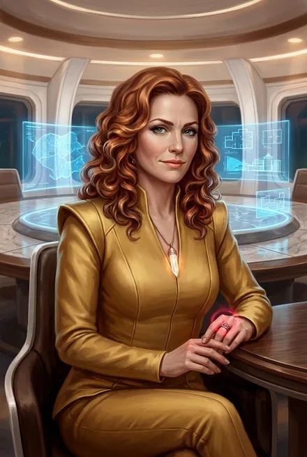
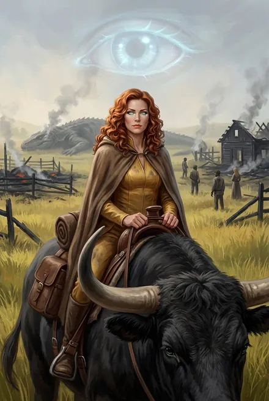
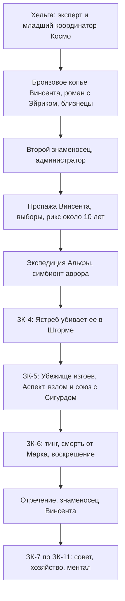
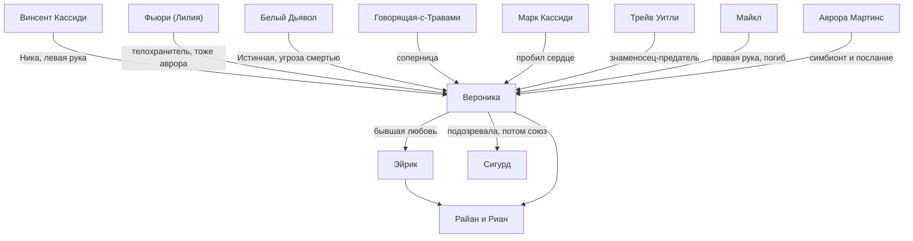

# Вероника «Ника» Максвелл

## Облики на иллюстрациях

<figure markdown="span">
  [{ loading=lazy }](../assets/portrety/015.webp)
  <figcaption>Рикс в золотом комбинезоне <small>ЗК-1, гл. 16 — ЗК-5</small></figcaption>
</figure>
<figure markdown="span">
  [{ loading=lazy }](../assets/portrety/016.webp)
  <figcaption>В поле: серебряная Восходящая на тауро; Аспект-глаз <small>ЗК-6</small></figcaption>
</figure>

Иллюстрации созданы нейросетью по описаниям из книг; это трактовка, а не официальный арт.

## 1. Шапка

| | |
|---|---|
| **Имя** | Вероника Максвелл |
| **Прозвища, обращения** | «Ника»: так её зовут старые соратники, Винсент, Эйрик, Ветер Равнин, жёны Эйрика (ЗК-6, гл. 5, 8; ЗК-7, гл. 1; ЗК-9, гл. 3). «мэм», «мисс Максвелл»: так она требует обращаться к себе (ЗК-1, гл. 16). «рыжая рикс» (Аурвак, ЗК-6, §2, гл. 25). «Истинная» (Белый Дьявол, ЗК-5, гл. 21). «Хитрая старая лиса» (мысленно Сигурд, ЗК-6, гл. 5). Она сама о себе: «подлая старуха» (ЗК-5, гл. 21) |
| **Происхождение** | Землянка с ковчега «Хельга», первая волна. «Эксперт-колонист, младший координатор проекта „Космо“» (ЗК-4, интерлюдия «Фригольд»). Носит статусный **золотистый комбинезон** (ЗК-1, гл. 16). По иерархии «Космо» жёлто-золотые носят эксперты, чёрные — координаторы (ЗК-5, интерлюдия «Аврора»). *Отсюда вопрос: сочетание «эксперт» и «младший координатор» не объяснено* |
| **Природа** | С прошлого цикла — носитель **«авроры»**, брахма-симбионта проекта «Аврора» из Колонии Альфа. Это даёт ей «техническое бессмертие» и Восхождение без зависимости от стигмата. Белый Дьявол называет её «Истинная, одна из первых детей Истока» (ЗК-5, гл. 20–21) |
| **Роль** | Второй знаменосец Винсента Кассиди (административная часть). Около 10 лет **рикс** фригольда «Небо» (ЗК-1–04). В ЗК-5–06 «мёртвый» рикс, потом беглянка и союзница Сигурда. С ЗК-6, гл. 27 снова **знаменосец** Винсента: хозяйство, производство, администрация |
| **Возраст** | «Совсем не молодая» (ЗК-1, гл. 16). «Явно разменяла шестой десяток» (ЗК-4, гл. 2). Восходящие сохраняют молодость (ЗК-4, §6) |
| **Семья** | Бывший возлюбленный — **Эйрик**. Их дети — близнецы **Райан** и **Риан** («Рин») Максвелл, рыжие. Рождены под небесным знаком Целующихся Близнецов, «когда все женщины приносили минимум двойню» (ЗК-6, гл. 1) |
| **Книги** | ЗК-1–ЗК-11. Ключевые книги: ЗК-4 (интерлюдия «Фригольд» от её лица), ЗК-5 (гл. 19–21 и интерлюдия «Аврора» из её памяти), ЗК-6 (гл. 1–12) |
| **Статус на конец канона** | Жива. Знаменосец Винсента, член тайного совета фригольда. Последнее появление: вместе с Сигурдом принимает в Эстэ возвращённые грузы «Хельги» и освобождённых землян (ЗК-11, гл. 20) |

---

## 2. Личность

### Характер
- **Администратор и политик, а не воин.** Её собственная формула: «Послушай, Сигурд, я — политик и администратор, а не воин» (ЗК-5, гл. 21). «Талантливейший организатор»: отлично разбирается в людях, делегирует полномочия, жёстко контролирует исполнение, «при необходимости безжалостно наказывала виновных» (ЗК-4, интерлюдия «Фригольд»). При Кассиди взяла на себя «все административные функции, быстро став незаменимой опорой земной колонии» (там же).
- **Интриганка и манипулятор.** «Хитрая старая лиса, расчётливая и злопамятная, с двойным, даже тройным дном и навыками лицемерия, достойными гениальной актрисы» (ЗК-6, гл. 5). Белый Дьявол о ней: «Ваш рикс играет людьми, как фигурами в сферах» (ЗК-4, гл. 4). Сигурд после ментального взлома: «Она не была хорошим человеком… Но всё-таки она была землянкой… искренним желанием Вероники было сохранение и процветание земной колонии» (ЗК-5, гл. 20).
- **Холодный расчёт.** Конфликт Сигурда с Говорящей был для неё «беспроигрышной ставкой»: «Мне было интересно, кто возьмёт верх, и всё равно, кто победит» (ЗК-5, гл. 21). Её план на тинг предусматривал смерть Сигурда или Марка, а лучше обоих (там же).
- **Выдержка и ирония.** Шутит даже после ментальной пытки: «ты просто обязан на мне жениться, Сигурд» (ЗК-5, гл. 21). Сохраняет достоинство перед риксом Народа Реки (ЗК-6, гл. 2–3). Насмешка над противником: «Ох, Трейв… конец тебе. Советую: беги, спасайся» (ЗК-6, интерлюдия).
- **Властность.** Формальная дистанция («мэм»), обрывает неуместные реплики, принимает решения за людей («Р-раз — и взяла в оборот», ЗК-1, гл. 16). Командные повадки сохраняются и после потери Титула (ЗК-8, гл. 1).
- **Признание силы.** Склоняется перед сильным, когда проигрывает: «Я — сильнее, я выше в иерархии Восхождения, она поняла и признала это» (ЗК-5, гл. 21). Быстро уходит под руку Винсента и отрекается от Титула (ЗК-6, гл. 26).
- **Признание вины, но на своих условиях.** «Я не отрицаю свою вину. Я неверно оценила наши силы… и я готова ответить за это. Но только — если рядом со мной будет стоять кое-кто ещё!» (ЗК-5, гл. 21).
- **Осторожность.** Против Порталов в неизвестность (ЗК-2, гл. 12; ЗК-10, гл. 4), против открытого союза с Тысячей (ЗК-9, гл. 3), против риска основным пилотом (ЗК-10). Ворчит, но подчиняется риксу.
- **Страх.** Боится Сигурда в Небесном Ястребе: «мисс Максвелл меня боялась» (ЗК-6, гл. 5). Боится собственной Руны-Существа Дикого Карха и плохо её контролирует (ЗК-8, гл. 1).

### Мотивация и ценности
- Сохранить земную колонию как **земную**: конституция, выборы, моногамия, равенство. Эйрик говорил, что люди выбрали её, потому что «мисс Максвелл обещала им» жить «как будто ещё на Земле» (пересказ Травинки, ЗК-4, гл. 9).
- **Избежать гражданской войны** любой ценой. Поэтому она медлит с Говорящей и Марком: «Изгнать можно слабого. А изгони я Говорящую с семьёй… начался бы открытый вооружённый конфликт!» (ЗК-5, гл. 21; ЗК-6, гл. 1).
- Защита тайны «авроры» и Истока от Вечности. Уверена в существовании «шпионов» оттуда («указывает пальцем в потолок», ЗК-5, гл. 20–21).
- Лояльность Альфе «по умолчанию». Предлагает альтернативу союзу с Тысячей: «Колонию Альфа» (ЗК-9, гл. 3). Но признаёт, что её координаторы хотят «полного контроля» (ЗК-9, §2).

### Слабости
- Недооценивает военные угрозы: рейд в Шторм «был дерьмово спланирован» (ЗК-5, гл. 21). Отмахивается от предупреждения Сигурда о засаде: «окрестности проверены» (ЗК-4, гл. 22).
- Не доверяет никому, поэтому проигрывает: «лучшим вариантом для меня было признаться ей сразу» (ЗК-5, гл. 21).
- Ментал, но не самый сильный: Сигурд с Белым Дьяволом её взламывают (ЗК-4, гл. 2; ЗК-5, гл. 20). Шелковая Тень — «опытный ментал — куда сильнее той, что была риксом Народа Земли» (ТБ-3, гл. 7).
- Уязвима для «авроры»: не восстанавливается, если тело разделено на много частей или испепелено. Уязвима для ударов по средоточию (ЗК-5, интерлюдия «Аврора»; гл. 20).

### Эволюция
1. **ЗК-1–04: всевластный рикс.** Подозревает Сигурда, использует его и Травинку. Выжидает с заговорщиками. Гибнет от собственного промаха (Небесный Ястреб).
2. **ЗК-5: падение и раскрытие.** Захватывает Убежище изгоев. Убита Сигурдом, взломана ментально, признаёт его старшинство и становится союзницей.
3. **ЗК-6: последняя игра рикса.** Ведёт отряд на тинг, торгуется с Народами, похищена и «убита» Марком. Проигрывает и отрекается.
4. **ЗК-7–11: «левая рука» Винсента.** Хозяйственник, ментал-специалист, голос осторожности в совете. Привычная интриганка, но уже внутри команды.

---

## 3. Речь

**Манера.** Подчёркнуто вежливая и официальная («Сигурд, верно?», «Дмитрий», «мистер Морозов»). Ко всем подчинённым на «вы», после союза с Сигурдом переходит на «ты». Под маской вежливости жёсткость: «процедила», «отрезала», «ледяным тоном». Земные восклицания: «О боже мой», «Боже милосердный», «Черт!». В гневе ругается «не хуже Толи Грохота» (ЗК-7, гл. 12). Иногда язвительно иронизирует. Говорит на Едином Наречии и ведёт переговоры с вождями Народов (ЗК-6, гл. 2–3).

**Обращения.** Себя требует называть «мэм» или «мисс Максвелл». К Травинке обращается «мисс Кассиди», «Адель». К Динамиту «Дмитрий». К Миносу «Матиас». К Кассиди «Винс», «Винсент».

**Цитаты:**
1. «У нас не осматриваются, Сигурд, это не Земля» (ЗК-1, гл. 16).
2. «Мэм! Во-первых, я старше вас, во-вторых, выше по рангу, в-третьих, я не терплю панибратства» (ЗК-1, гл. 16).
3. «Сигурд, вы не на Земле! Какое ещё личное? Личное остаётся за порогом фригольда» (ЗК-1, гл. 16).
4. «Боже милосердный, ты прикончил меня, а потом подверг жёсткому ментальному сканированию. После такого… ты просто обязан на мне жениться, Сигурд» (ЗК-5, гл. 21).
5. «Что, подлая старуха, да? Можешь убить меня ещё раз, если хочется. Мне не жалко» (ЗК-5, гл. 21).
6. «Если хотите, считайте, что у вашего рикса несколько жизней…» (ЗК-6, гл. 1).
7. «Ну ты и мразь, Трейв… Ох, Трейв… конец тебе. Советую: беги, спасайся, пока ещё не поздно. Предателям пощады не будет» (ЗК-6, интерлюдия).
8. «Ты угрожаешь мне, но не властна даже над своей дочерью» — Говорящей (ЗК-6, интерлюдия).
9. «Ты немедленно отдашь нам пленников и груз, безо всяких условий… Ты меня знаешь!» — Кнуду Ларссону (ЗК-4, интерлюдия «Переговоры»).

В её адрес: «Восхождение — это не демократия, Ника!» (Кассиди, ЗК-9, гл. 3).

---

## 4. Предыстория (до ЗК-1)

- **Земля и «Хельга».** Эксперт-колонист и младший координатор «Космо» (ЗК-4, интерлюдия). Земная профессия не названа.
- **Молодое бронзовое копьё.** Винсент, Ветер Равнин, Эйрик, Вероника, Гай Флоу, Кнут Ларссон, Говорящая-с-Травами (ЗК-7, гл. 15). Ветер Равнин: «Тот-Кто-Сражается смотрел на нас. И четверо ныне здесь. Кано, я, Эйрик, Ника…» (ЗК-7, гл. 15).
- **Второй знаменосец Винсента.** Взяла на себя всю администрацию (ЗК-4, интерлюдия). Знаменосцами Кассиди были Эйрик и Вероника (ЗК-4, гл. 4) и Кнут (ЗК-5, гл. 12).
- **Роман с Эйриком.** В её памяти «рыжеволосый Эйрик» был возлюбленным, «позже ставшим соперником и врагом». Их дети уехали заложниками к Народу Трав (ЗК-5, гл. 20). На последнем большом тинге Эйрик и Вероника договорились с Ветром Равнин: их дети живут у Трав, Лэндо и Эйно у землян (ЗК-5, интерлюдия 2).
- **Выборы после пропажи Винсента.** По законам Восхождения титул полагался Говорящей, у неё выше Слава, но её не приняли. Из знаменосцев Слава выше у Эйрика, но «Вероника настояла на выборах по земной конституции, и люди выбрали её». Эйрик ушёл строить ферму (ЗК-4, гл. 9). Говорящую «мягко оттеснили от руля» (ЗК-5, гл. 19). Говорящая потом бросит ей: «Из дома, созданного нашими руками, в который тебя саму когда-то пригласили как доброго гостя?» (ЗК-4, интерлюдия).
- **Десять лет правления.** «Десять лет тащила земную колонию, не растеряв людей и ресурсы» (ЗК-6, гл. 27). Её знаменосцы — Майкл (правая рука, военное крыло) и Трейв Уитли (левая рука, производство и рунное мастерство) (ЗК-4, §4). Запретила Порталы в неизвестность после гибели Хавьера, Соколовой и группы Танаки (ЗК-10, гл. 4). Отказалась признавать нарушение Клятвы Мраком перед Народом Реки, чтобы не было войны (ЗК-2, гл. 12).
- **Экспедиция Альфы «Одиссей».** Винтокрыл «Грифон» с людьми Колонии Альфа (Шон Макдональд, пилот ван Саар, его жена Лилия) прилетел во фригольд. В памяти Вероники видна их встреча под Сферой Тишины: Фьюри вскрывает биопротез руки и достаёт сияющую ампулу (ЗК-5, гл. 20). «„Одиссей“ отбыл в экспедицию из Альфы в прошлом цикле, чуть больше полутора земных лет назад» (ЗК-5, гл. 21). Позже экспедиция попала к Теням. Ван Саар убит, Лилию выкупила Вероника (ЗК-3, §4, гл. 15).
  - *Противоречие:* в ЗК-10, гл. 9 сказано, что «Фьюри в первую очередь выкупила мисс Максвелл из плена Народа Теней, предпочтя её эксперту Шону Макдональду». Это прямо противоречит ЗК-3, где Вероника выкупила Лилию. Вероятно, авторская перестановка подлежащего *(предположение)*. Если брать текст буквально, Вероника тоже побывала в плену у Теней. В ЗК-10, §10 это упомянуто как «плен Вероники у Теней».
- **Получение «авроры».** Фьюри передала ей симбионт и вокс-послание Авроры Мартинс, предназначенное «исключительно для глав земных поселений» (ЗК-5, интерлюдия «Аврора»; ЗК-10, гл. 9). Первая смерть и воскрешение случились лишь в Шторме (ЗК-5, гл. 21).
- **Отношение к «шпионам Вечности».** Послание Авроры рекомендует не вскрывать шпионов, а «устранить так, чтобы не возникло подозрений… либо держать под наблюдением» (ЗК-5, интерлюдия). Вероника считала Сигурда таким шпионом «с первой секунды» и приставила к нему Фьюри (ЗК-5, гл. 20–21).

---

## 5. Биография по книгам

### ЗК-1 «Звёздная Кровь»
- **Гл. 16.** Принимает Сигурда в штабе вместе с Трейвом и Майклом. Тайно включает Ауру Доверия: голос в голове Сигурда снимает внушение. Сканирует его лицо по базе колонистов и опознаёт «кадрового специалиста Звёздного Флота, с засекреченной второй специализацией». Узнав о попытке кражи Рэнди, приказывает приструнить копьё Марка. Не отдаёт «Дефендер», разрешает оставить йурра и криптор. Определяет новичка учеником в подразделение Дмитрия Воронина.
- **Гл. 18.** Копьё Марка наказано вывозом «дерьма камнеедов» (ЗК-1, §2).

### ЗК-2 «Фригольд»
- **Гл. 12.** Разбирает драку Сигурда с бандой Рэнди. Сигурд говорит, что дрались «из-за девушки»: ментальный допрос раскрыл бы его тайну. Банду штрафуют и ссылают. После потерь в рейде Вероника **запрещает Порталы** (ЗК-2, §2). Динамит объясняет её политику: она не признает нарушения Клятвы, иначе будет война с Народом Реки, а Марк — сын героя, это «индульгенция».

### ЗК-3 «Земли Теней»
- Упомянута: ранее выкупила Лилию у Теней (гл. 15). В эпилоге разрешает посадку «Грифона» и встречает Сигурда.

### ЗК-4 «Одиссей»
- **Интерлюдия «Фригольд» (её POV).** Брифинг о Сигурде. Минос считает его «А-изменённым» и предлагает дать ему стигмат. Трейв подчёркивает ценность пилота. Говорящая против. Вероника решает: «У нас сейчас есть три гвоздя на обмен». Противостояние с Говорящей: «если снова узнаю, что из-за твоей дочери Сигурду… пытались причинить вред… я не буду долго искать виноватых!». Ответ: «Изгонишь меня… рикс?». Решает лично проверить: «гвоздь или посох».
- **Гл. 2. Допрос.** Сфера Тишины, Аура Доверия, бронзовый Гипнотизм, турель «Трезубец» в потолке. Чувствует ложь в истории о плену у Теней. Сигурд контратакует серебряным Гипнотизмом, Вероника «верит». Под Руной Тишины он рассказывает о Марке и Свирели. Вероника приказывает молчать: «Ваше слово против его… Тут нужно действовать тоньше». Позже в ЗК-5 она признаётся, что поддалась нарочно.
- **Гл. 4.** Создаёт аэромобильную группу «Одиссей»: командир Динамит, первый пилот Сигурд. Включает в неё Фьюри (свои «глаза и уши») и Травинку-добровольца. Белый Дьявол: она удалила сына Говорящей в горы и «отнимает у матери дочь».
- **Гл. 10.** Делит координаты с Эйриком «полюбовно» (ЗК-4, §2).
- **Гл. 17.** Её **малое Око Наблюдателя** видит безумного Небесного Змея, напавшего на караван.
- **Гл. 18–22.** Лично ведёт фригольд в Шторм почти всеми силами. Во фригольде из Восходящих остаётся только Трейв. Отмахивается от предупреждения Сигурда о ловушке.
- **Интерлюдия «Переговоры».** Узнаёт в главаре изгоев Кнуте Кнуда Ларссона. Ставит ему ультиматум: «Ты немедленно отдашь нам пленников и груз, безо всяких условий… В противном случае, клянусь, я плазмой выжгу тебя и весь твой сброд из этих развалин, и плевать, скольких мы потеряем при этом. Ты меня знаешь!». Ларссон глумится в ответ («О да, я тебя знаю»), предъявляет «законы Единства», унижает Майкла.
- **Гл. 23.** Небесный Ястреб разрубает её вместе с доспехом «Лорика». Все считают её погибшей.
- **Эпилог.** Марк докладывает матери: «Тела рикса нет. Только разрубленная броня. Пустая».

### ЗК-5 «Вечность»
- Во фригольде её хоронят. Новый рикс — Трейв (87 %), знаменосцы Серена и Марк (интерлюдия 1). Фьюри уверяет копьё: «Вероника Максвелл жива!».
- **Гл. 21 (её рассказ).** «Я восстановила носитель, когда Ястреб уже погнал рейд с площади. Это была моя первая смерть и очень нехорошая». Собрала Руны и Кровь со своих людей, бежала от Червей, два дня скиталась по Шторму. Изгои взяли её в плен и хотели обменять. Вероника убила их единственную Восходящую и тех, кто стоял за ней: «у меня наконец-то пробудился Аспект». Освободила пленников, захватила Убежище, искала в руинах Небесного Ястреба. «Стыдно» возвращаться.
- **Гл. 19–20.** Сигурд, не зная, кто под шлемом, побеждает её. Над телом нет Рун и Крови. Белый Дьявол вводит тарн в её средоточие, Скрижаль трескается, Вероника оживает: «Я знаю, кто ты… Меня предупреждали о таких как ты». Ментальная дуэль: она сопротивляется на равных. Белый Дьявол трижды усиливает Гипнотизм до уровня «слабого золота» (Ментальное Доминирование) и взламывает её. Сигурд видит её память: фригольд, тинги, Древо, Саркофаги, молодого Винсента с семьёй, Эйрика, детей-заложников, прибытие «Одиссея» Альфы и послание Авроры.
- **Гл. 21.** Сигурд передаёт ей «осанну» своей истории, и она верит. Объясняет: она «аврора» и видит всех Восходящих, Фьюри тоже «аврора» и приставлена к нему. Шпионов «используют, пичкают дезинформацией». Раскрывает свой план тинга против Марка. Говорит с Белым Дьяволом: «Кто ты? Как твоё имя?». Тот объясняет «печать сброса» и обещает убить её, если она выдаст тайну. Вероника: «Я поняла. Придётся прикрывать вашу с Сигурдом задницу». Признаёт старшинство Сигурда. Союз: «Мир?». Сообщает, что Травинка в безопасности, а к Убежищу идёт копьё Динамита.

### ЗК-6 «Тинг»
- **Гл. 1.** Совет с копьём Динамита: «считайте, что у вашего рикса несколько жизней». Выводы: связным с Кнутом был младший Кассиди, к Уитли много вопросов. Стратегия: не давать боя во фригольде, где Говорящую поддерживают «старые друзья Кассиди» и молодёжь, а разоблачить заговорщиков на тинге по законам Единства: «рикс — это особый Титул». В её Скрижали «запас Звёздных Монет всего фригольда» и обменные гвозди. Раздаёт Руны павших: Динамит поднимает Тело до первого серебра, получает Сокрушающий Крик, Громовую Волну, Сферу Льда; Фьюри получает Ледяные Иглы, Бесшумный Шаг, Ослепление. Оставляет в Убежище 26 человек под началом Доу Вэя (гл. 2).
- **Гл. 2.** Лекция о Славе: «сложный, комплексный показатель ценности Восходящего». При нападении волкеров выпускает **Дикого Карха**. У брода на Едином Наречии вызывает из засады Людей Реки во главе с Аурваком Владыкой Чешуи.
- **Гл. 3.** Аурвак не признаёт старый фионтар Гая Флоу. Вероника выставляет Сигурда, и тот побеждает Серебряную Форель. Долгий разговор с Аурваком наедине под Сферой Тишины, после которого она выглядит «очень довольной». Позже выясняется, что она обещала Аурваку **голову Марка** («рыжая рикс обещала», ЗК-6, гл. 25).
- **Гл. 4–5.** Посылает вперёд свой Аспект и видит бой Сигурда в Небесном Ястребе с Огнезубом. Боится его. Предлагает присвоить себе подвиг: «Украду немного твоей Славы, прости». Принимает Ястреба на хранение под **Клятвой** с карой «смерть Вероники Максвелл» (текст Клятвы в гл. 5). На ферме показывает золотой глиф и приписывает победу себе. Сюгретта: «Ты восстала из мёртвых, Ника?». Тайно получает от Сигурда серебряное Исцеление для раненых.
- **Гл. 6–7.** Выдаёт копью «легенду» о Крови Сигурда. Щедро раздаёт Руны Огнезуба: Динамиту Раскалённую Ауру, Фьюри Огненный Болид и Звезду Искателя, Травинке бронзовое Развитие.
- **Гл. 8.** Пылающий Рог, кинг Ветер Равнин («Ника»). Показывает голограмму боя Ястреба, записанную Аспектом. Жемчужина-в-Волосах предупреждает: «Будь осторожна с дарами Небесного Трона». Кинг готов подтвердить старые Клятвы, но только после того, как она докажет на тинге свою Славу.
- **Гл. 10.** Отказывает кингу: если Райан останется у Трав, Лэндо должен ехать к землянам. Объясняет: «Потому что здесь ценят силу. Принять предложение кинга было бы слабостью». Близнецов на тинг не берёт, они уходят на ферму. Лекция о Титулах (хейр, танаан, эрл, фламиника, рикс) и о фионтаре при споре двух риксов: «наш боец будет равен по рангу и получит лучшее из того, что у нас есть».
- **Гл. 11–12.** Инструктирует о законах Древа. Обменивает стигматы павших на пустые и «идёт говорить с мёртвыми» в Храме.
- **Интерлюдия «Травинка».** Стычка с группой Трейва у Храма, обвинения. Расспрашивает Травинку о Рунах её матери. Ставит Аспект-Глаз сторожить лагерь. Ночью отряд усыпляют и опутывают Железным Вьюном. **Невидимый Марк пробивает сердца Веронике и Фьюри** «первыми, как ты приказала». Говорящая: «они не мертвы и не живы. Я заберу их тела в Домен».
- **Гл. 25.** Семя Древа выжигает Вьюн в Домене Говорящей: Вероника, Фьюри, Инь, Грай, Грохот живы.
- **Гл. 26.** Приходит в себя «пару часов назад», её выводят под руки. Немедленно **признаёт Винсента риксом** и опускается «до танаана». Даёт исчерпывающие показания против Марка и Говорящей. Публично отрекается от Титула и просит прощения у родственников погибших, делая упор на заговорщиков: «Прекрасная актриса». Её ментальные способности используют на допросах сообщников. Получает от Сигурда Руну-Портал в Шторм, через неё вытаскивают колонистов.
- **Гл. 27.** Назначена знаменосцем вместо Трейва и отвечает за «весь административно-производственно-хозяйственный сектор колонии». «По крайней мере, сама мисс Максвелл выглядела вполне довольной таким исходом».

### ЗК-7 «Дикая Охота»
- **Гл. 1–2.** Вместе с Фьюри рассказала Винсенту про проект «Аврора» и про Сигурда, о Белом Дьяволе промолчала. Ставит Сферу Тишины по просьбе Винсента: «Ника, поставь Сферу Тишины и тоже иди». Предлагает в копьё Сигурда менеджера Даниэля Арджента и холодна после отказа (гл. 5).
- **Гл. 3.** По оценке Эйрика, у неё **14 серебряных звёзд**. У Эйрика 32, у Винсента около 50.
- **Гл. 12.** Лечит Сигурда от кошмара после осанны Улья: входит с ним в **Резонанс** и берёт часть ноши на себя: «Я теперь тоже не засну».
- **Гл. 14–15.** Входит в посольство к Народу Трав (рикс, знаменосец, бывший рикс). На переговорах предлагает: «Мой Райан готов остаться в твоём Народе до конца этого цикла». Райан «готовит дары» девушке Трав.
- **Гл. 16–17.** Вместе с Винсентом и Сереной «гоняют всех как сумасшедших» перед войной с таврами.
- **Гл. 20.** Голосует по поводу золотой награды (Эйрик: «Так ты за Существо, Ника?»).

### ЗК-8 «Истинный»
- **Гл. 1.** Страхует призыв **Скрипторума Некролита** на полигоне вместе с Миносом и Сигурдом. Пытается ментально прощупать Существо и предупреждает Миноса: «Это может быть опасно, он играет с нами!». Сигурд отмечает, что она давно не рикс, но командные повадки остались.
- По разбору, проверяет пленников Домена (ЗК-8, §4).

### ЗК-9 «Ранг неизвестен»
- **Гл. 3.** Член тайного совета (Кассиди, Минос, Серена, Вероника, Адамант, Сигурд). Сомневается в союзе с Тысячей: «это союз с давними врагами Вечности… что скажут другие Народы?», «Ты должен это понимать. Что скажет тинг?». Предлагает альтернативу, Колонию Альфа (§2). Спрашивает о голосовании и получает ответ: «Восхождение — это не демократия, Ника!». На докладе Миноса о том, что стигматы не нужны, напрягается: «ей, обладательнице „авроры“, стигмат тоже больше был не нужен».

### ЗК-10 «Прозрачные Дороги»
- **Гл. 4.** «Яростно протестует» против рейда через Портал Голубой Стрелы: Порталы запрещены после гибели Хавьера, Соколовой и группы Танаки. Спорит о том, стоит ли рисковать Сигурдом. Винсент: «Спокойно, Ника, я — рикс, и мне решать».
- **Гл. 9.** Вместе с Кассиди просит разместить вокс-маяки по маршруту в Альфу. Иронизирует: «Колония с населением свыше двадцати тысяч человек — не иголка в стоге сена».
- **Гл. 22.** Командует фригольдом в отсутствие рикса. Сообщает Сигурду о Прозрачной Дороге, Псах и отъезде Винсента с Эйриком на тинг. Держит два резервных копья, «у нас остался всего один запасной Портал». Уговаривает не воевать в Либерти: «Это же земная колония, в конце концов, мы всегда можем договориться». Без «твёрдой руки Винса» колеблется (ЗК-11, гл. 12).

### ЗК-11 «Колония Альфа»
- **Гл. 12.** Принимает доклад Сигурда в Домене вместе с Миносом и Травинкой. Долго не верит новостям: «Наверное? Что это значит, Сигурд? Опять перестрелка?».
- **Гл. 20.** Сопровождает Сигурда в Эстэ (столица Народа Молний). Около трёх суток принимает у королевы Найтфир грузы «Хельги» и полсотни освобождённых землян-трэлей.

### Цикл ТБ
- Прямо не действует. Пламени Подобный вспоминает «план рыжеволосой Истинной», провалившийся в первый день тинга (ТБ-1, §10). Применяет к ней Ментальный Императив (ЗК-5; упомянуто в ЗК-11, гл. 1, §10).

### Хронология (схема)

### Вероника как «толкователь» законов Единства
Вероника — главный в серии источник лекций о политическом устройстве Круга:
- **Тинг** — «совет свободных Восходящих Круга. Там, под оком Наблюдателя, решаются вопросы жизни и смерти» (ЗК-6, гл. 2).
- **Слава.** «Сложный, комплексный показатель ценности Восходящего, который зависит от многих параметров. От известности, уважения людей, поступков… От выполнения заданий Наблюдателя, от побед и поражений Народа, если ты вождь». На малом тинге победитель выборов получает Славу, проигравший теряет (ЗК-6, гл. 2).
- **Титулы.** Ювейн становится хейром за бронзовое задание Наблюдателя. Танааном может стать хейр при 500 Славы, выполненном серебряном задании и «доверии группы воинов». Эрла назначает рикс. Фламиника должна иметь «специфические Навыки и пройти особое испытание Наблюдателя». Рикс — «не только Восходящий, чья Слава выше всех, но и тот, кому племя… готов вручить полную власть» (ЗК-6, гл. 10).
- **Кто выбирает рикса.** «Я запрещаю вам это разглашать, но рикс выбирается только Восходящими… Люди, не участвующие в Восхождении, на этот процесс вообще не влияют» (ЗК-6, гл. 10). Поэтому заговорщики выбивали лучших Восходящих, начиная с Гая Флоу.
- **Два рикса.** При споре Народ раскалывается («Так сделал в своё время Эйрик»), а если никто не уходит, Наблюдатель предлагает «судебный поединок Восходящих. Фионтар». Слабый может выставить бойца равного ранга (ЗК-6, гл. 10).
- **Рикс как особый Титул.** «Нельзя просто так взять и объявить себя новым риксом… Вождя должны признать другие Народы и Наблюдатель. На тинге новый рикс вступает в права» (ЗК-6, гл. 1).
- **Земной компромисс.** «Когда мы создавали фригольд, договорились на берегу — живём и выбираем правительство по законам Земли… Старый рикс просто добровольно передаёт Титул выбранному кандидату» (ЗК-6, гл. 10).
- **Цена силы.** Ветер Равнин мог бы дать воинов, «чтобы силой отобрать фригольд у Говорящей», но «это — та цена, которую я не готова платить!» (ЗК-6, гл. 10). Клятвы с Травами откладывает: «Если одолеем врагов… поговорим о новых Клятвах. Если же нет — зачем нам вообще что-то обещать?» (там же).
- **Суеверие игрока.** «Говорить о планах заранее — плохая примета!» (ЗК-6, гл. 10). «Не стоит вести такие разговоры раньше времени, можно спугнуть удачу» (ЗК-6, гл. 2).

---

## 6. Способности по книгам

| Период | Ранг | Возможности |
|---|---|---|
| ЗК-1–02 | серебро (ЗК-1, гл. 16) | **Аура Доверия**. **Гипнотизм**, в ЗК-4 он бронзовый (§4). Руна Тишины / **Сфера Тишины** |
| ЗК-4 | серебро. Скрижаль серебряная, «три огромных круга заполнены на три четверти» (гл. 2) | Сфера Тишины, Аура Доверия, бронзовый Гипнотизм. **Малое Око Наблюдателя**: дистанционно видеть задания области, привилегия вождей (гл. 17, 21). Доспех «Лорика» (разрублен). В кабинете турель «Трезубец». Кристалл-Предмет на груди, перстень с алой аурой |
| ЗК-5 | серебро + «аврора» | **Аспект — гипнотический Глаз**, пробудился в плену у изгоев (гл. 21). Сильный ментал, сопротивлялся слиянию Сигурда и Белого Дьявола на равных (гл. 20). «Аврора»: брахма-репликация тела после смерти. Не работает, если тело испепелено или «разделено на много частей», и при нехватке брахма-частиц. Уязвима к ударам по энергоинформационному контуру. Видит всех Восходящих «вне зависимости от сортов» (гл. 21) |
| ЗК-6 | серебро | Аспект-Глаз умеет летать далеко и быстро, **записывать увиденное и проецировать голограммой** (гл. 5, 8). **Дикий Карх** — бронзовая Руна-Существо, огромный оранжевый хищник, плохо управляемый (гл. 2; ЗК-8, гл. 1). «Лёгкий Шаг», «Быстрые Ноги», «Неутомимость» накладывает на тауро (гл. 4). Ментальная беседа без слов с Сигурдом (гл. 3–4). Касса фригольда, Руны павших, обменные стигматы. Временно хранила Небесного Ястреба под Клятвой (гл. 5). Руна-Портал в Шторм (гл. 26). **Исцеляющих Рун нет** (гл. 3) |
| ЗК-7 | серебро, **14 серебряных звёзд** (гл. 3) | **Резонанс**: ментальное слияние, позволяет разделить с человеком кошмар (гл. 12) |
| ЗК-8–11 | серебро | Ментальные проверки и допросы. Восьмая-девятая из серебряных Восходящих фригольда (ЗК-10, §2; ЗК-11, гл. 20) |

**Титулы:** рикс (ЗК-1–06, гл. 26), затем танаан, затем **знаменосец/эрл** Винсента (ЗК-6, гл. 27).

---

## 7. Отношения

- **Винсент Кассиди.** Его старый соратник по копью и второй знаменосец. «Замещала» его десять лет. После его возвращения сразу признаёт его и снова становится «левой рукой». Он держит её близко, ценит как администратора и ментала, но спорит с ней жёстко: «Восхождение — это не демократия, Ника!» (ЗК-9, гл. 3). Вероника не знает всего о Мико и Ордене *(видимо)*: в ЗК-11, гл. 18 это узнаёт Аврора, Вероника при совете не названа.
- **Эйрик.** Бывший возлюбленный, отец её близнецов. После выборов соперник, сейчас танаан Винсента. Его жёны называют её «Ника» и знают её как «восставшую из мёртвых» (ЗК-6, гл. 5).
- **Райан и Риан Максвелл.** Близнецы-ювейны (уровень «дерево»), воспитанники и заложники Народа Трав (ЗК-6, §4). Райан рыжий, хочет остаться у Трав ради девушки (ЗК-6, гл. 8; ЗК-7, гл. 14) и в итоге возвращается с невестой из Людей Трав (ЗК-11, гл. 20). Риан участвует в экспедиции в западные горы (ЗК-9, гл. 15). Вероника стоит за детей жёстко, но не берёт их на тинг из соображений безопасности (ЗК-6, гл. 10).
- **Фьюри (Лилия ван дер Саар).** Её телохранительница и агент, «глаза и уши». Тоже «аврора». Обязана Веронике «больше, чем жизнью» (ЗК-5, интерлюдия 1). Вероника приставила её следить за Сигурдом. Через Фьюри к Веронике пришли симбионт и послание Авроры.
- **Сигурд.** Сначала объект подозрения и использования, после взлома союзник, ставший выше неё в иерархии (ЗК-5, гл. 21). Связаны Клятвой о Небесном Ястребе (ЗК-6, гл. 5, исполнена). Знает о Белом Дьяволе (ЗК-5), но, по требованию вселенца, держит это в тайне. Ментальная связь между ними всегда напоминает обоим о допросе: «неприятная заноза» (ЗК-6, гл. 4).
- **Белый Дьявол.** Называет её «Истинной», дерзит ей и угрожает смертью при разглашении (ЗК-5, гл. 21). Она: «Не могу сказать, что рада знакомству».
- **Говорящая-с-Травами.** Соперница за власть с момента выборов. Вероника её недооценивала. Говорящая организовала её «смерть» в Шторме и нападение у Древа.
- **Марк Кассиди.** Вероника отсылала его подальше (ЗК-4), планировала его смерть на тинге руками Сигурда или речных (ЗК-5, гл. 21) и обещала его голову Аурваку (ЗК-6, гл. 25). Марк пробил ей сердце (ЗК-6, интерлюдия).
- **Трейв Уитли.** «Старый друг», знаменосец, предал: «тем больнее слышать, что он спелся с Говорящей» (ЗК-6, гл. 1).
- **Майкл.** Её правая рука и военный знаменосец, погиб в Шторме (ЗК-4, гл. 23).
- **Кнут (Кнуд) Ларссон.** Бывший соратник по копью Кассиди, изгнанный. Убил её (ЗК-4, гл. 23).
- **Ветер Равнин.** Старый товарищ по копью («Ника»). Партнёр по Клятвам о заложниках.
- **Аврора Мартинс.** Автор её «авроры». В ЗК-9 Вероника предлагает союз с Альфой, но понимает, что координаторы хотят «полного контроля».
- **Аурвак, рикс Мёртвой Рыбы.** Тайная договорённость на тинге (ЗК-6, гл. 3, 25).
- **Травинка.** «Мисс Кассиди». Использовала её как щит Сигурда и способ спровоцировать мать (ЗК-4, гл. 4), но защищала её право выбора (ЗК-4, интерлюдия).

---

## 8. Тайны, крючки, ограничения

### Открытые вопросы
1. **Когда и как она стала «авророй».** Время и место передачи симбионта известны лишь в общих чертах (после прибытия «Одиссея» Альфы, ЗК-5, гл. 20). Как её «аврора» связана с Альфой? Есть ли у Альфы контроль над носителями? Кассиди именно поэтому не берёт симбионт себе (ЗК-11, гл. 18).
2. **Плен у Теней** (ЗК-10, гл. 9) — авторская оговорка или скрытый эпизод её прошлого?
3. **Её роль в «Космо».** Эксперт или младший координатор? Знала ли она о капитане «Хельги» и протоколах колонизации?
4. **Роман с Эйриком.** Почему возлюбленный стал «врагом» (ЗК-5, гл. 20)? Как прошёл раскол на выборах?
5. **Договор с Аурваком** (ЗК-6, гл. 3): что ещё она обещала Народу Реки?
6. **Её Аспект-Глаз**: как работает запись и проекция (ЗК-6, §12 — «белое пятно»).
7. **Её мёртвые.** В Храме у Древа «идёт говорить с мёртвыми» (ЗК-6, гл. 12). С кем? *(Скорее всего, с павшими в Шторме, предположение.)*
8. **Печать сброса.** Белый Дьявол обещал научить её этим печатям (ЗК-5, гл. 21). Осталось неизвестным, научилась ли.
