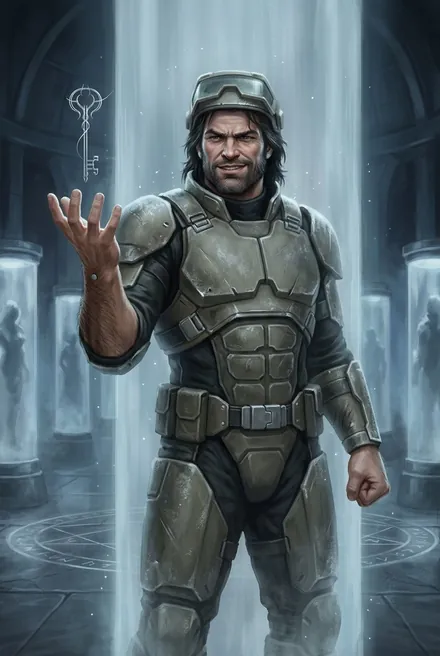
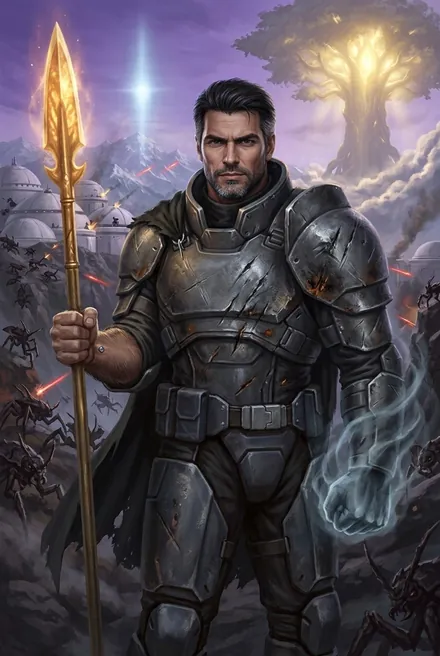
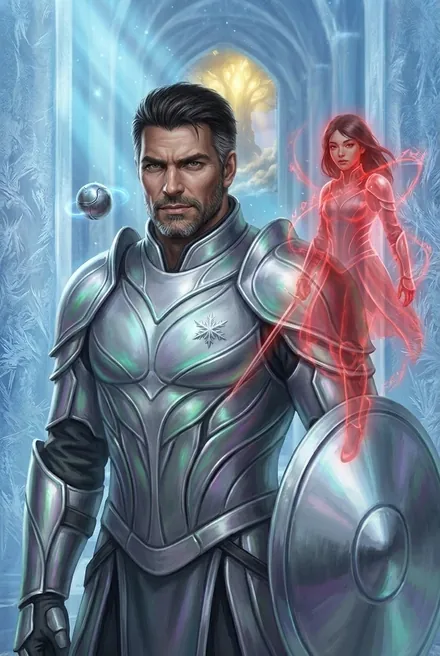
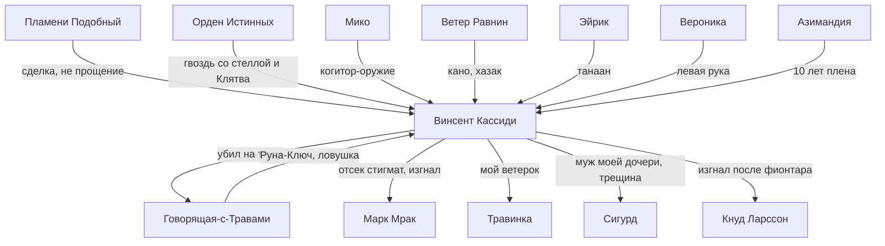

# Винсент «Винс» Кассиди

## Облики на иллюстрациях

<figure markdown="span">
  [{ loading=lazy }](../assets/portrety/017.webp)
  <figcaption>Пленник Колонны Безвременья <small>ЗК-2, гл. 22 — ЗК-6, гл. 19</small></figcaption>
</figure>
<figure markdown="span">
  [{ loading=lazy }](../assets/portrety/018.webp)
  <figcaption>Возвращённый рикс с Игг-Копьём <small>ЗК-6, гл. 19 — ЗК-8</small></figcaption>
</figure>
<figure markdown="span">
  [{ loading=lazy }](../assets/portrety/019.webp)
  <figcaption>В лед-доспехе, с драконьей Руной Мико <small>ЗК-9 — ЗК-11</small></figcaption>
</figure>

Иллюстрации созданы нейросетью по описаниям из книг; это трактовка, а не официальный арт.

## 1. Шапка

| | |
|---|---|
| **Имя** | Винсент Кассиди, «Винс». Также «старший Кассиди», «Кассиди-старший» |
| **Прозвища, обращения** | «первое серебро» фригольда, «создатель Народа Земли» (ЗК-4, гл. 4). «Кано» Ветра Равнин, кинга Народа Трав (ЗК-6, гл. 8–9). Позывной его аватара в Вечности — **«Доннерветтер»** (ЗК-9, гл. 12). Сигурда называет «муж моей дочери». Говорящую называл «буря моя», и она его, видимо, так же: отсюда домашние «мой ветерок» и «моя буря» (ЗК-6, гл. 22). Пламени Подобный зовёт его «Истинный» (ТБ-4, гл. 12) |
| **Происхождение** | Землянин с ковчега «Хельга», **первая волна** колонистов. «Кадровый военный — этого не скроешь» (ЗК-6, гл. 19). По Мико: «Я был одним из первых колонистов и поднял фригольд» (ЗК-11, гл. 18) |
| **Особая природа** | Носитель **стигмата Ордена Истинных**: вместо клейма Вечности на нём синяя трёхлучевая **«стелла»** (ЗК-7, гл. 1). Когда-то «носил в себе душу и Кровь Истинных» (Мико, ЗК-10, гл. 1). Владелец драконьей Руны-когитора **Мико** (ЗК-9–11). Природа самого Винсента спорна (см. §8) |
| **Роль** | Основатель колонии землян в Круге Элтанир и первый рикс фригольда «Небо». Пропавший легендарный отец Травинки и Марка (ЗК-1–05). С ЗК-6 освобождённый и снова избранный рикс, тесть и командир Сигурда |
| **Семья** | Жена — **Говорящая-с-Травами**, убита им на тинге (ЗК-6, гл. 23). Сын — **Марк** («Мрак»), изгнан им (ЗК-6, гл. 27), позже погиб, тело занято Пламени Подобным. Дочь — **Травинка (Адель)**. Внуки — двое детей Марка (ЗК-7, гл. 9) и будущий ребёнок Травинки и Сигурда |
| **Книги** | Заочно ЗК-1–05. Действует в ЗК-6–ЗК-11. В цикле ТБ: ТБ-1 (упоминание, гл. 15), ТБ-4 (гл. 11–12, 14, 17–18) |
| **Статус на конец канона** | Жив, **рикс** «Неба». В Скрижали Мико. Связан тайной **Клятвой** Ордена, о которой молчит. Заключил асимметричный оборонительный пакт с Тысячей Братьев (ЗК-11, гл. 18). Орден вызвал его, Аврору и Сигурда к небо-стражам в дрейф-цитадель у Бреши: визит отложен (ЗК-11, гл. 18; ТБ-4, гл. 18). Объявил мобилизацию против наступающих Червей (ЗК-11, гл. 20). Между ним и Сигурдом «трещина» из-за смерти Марка (ЗК-11, гл. 15) |

**Внешность кратко.** Глыба: «на полголовы выше меня и шире в плечах, матёрая копия Марка» (ЗК-6, гл. 19). «Внушительный мужчина в расцвете сил». После 10 лет стазиса «почти не постарел» (ЗК-6, гл. 21). Позже у него «полуседая щетина» (ЗК-9, гл. 7) и «угловатый, покрытый щетиной подбородок» (ТБ-4, гл. 12). Носит старый облегчённый солдатский доспех «Гардиан» без шлема (ЗК-6, гл. 22). В Вечности его аватар — «молодой брутальный воин, похожий на сына Марка» (ЗК-9, §4). Женщины фригольда «точили на него свои коготки» (ЗК-6, гл. 26; ЗК-7, гл. 14).

---

## 2. Личность

### Характер
- **Прирождённый вождь.** «Таких даже в толпе видно издалека — люди сами расступаются перед ними, почуяв харизму настоящего лидера… прямым и простым, без заусенцев, но при этом явно обладал ясным умом и характером» (ЗК-6, гл. 19). «Крутой и опасный мужик, настоящий вождь, это не Вероника» (ЗК-7, гл. 1). «Тяжёлая харизма и аура силы»: в Либерти «мгновенно стал своим» среди бандитских боссов, «одной с ними масти» (ЗК-11, гл. 15).
- **Рисковый первопроходец.** Его кредо: «Я рикс, а не собачка на привязи, буря! Я всегда шёл первым — в Порталы, Домены, Вечность! Кто, если не я?» (ЗК-9, гл. 14). О его «сверхъестественной удачливости» во фригольде ходили легенды (ЗК-10, гл. 1). «Пора тряхнуть стариной!» (ЗК-10, гл. 4). Рад любому испытанию (ЗК-10, гл. 13).
- **Рикс выше воина.** Сам предпочитает «рубить, а не развязывать узлы», но когда речь о Народе, «он действовал как рикс, а не как Восходящий»: отказывается рисковать единственным золотом и строит союзы (ЗК-7, гл. 15). Берёт ответственность на себя: «в случае… дерьмового исхода вся ответственность будет на мне» (ЗК-9, гл. 3).
- **Прагматичная жёсткость.** Без колебаний казнит опасных пленников Азимандии (Ночная Гостья, ЗК-8, гл. 5). Ссылает людей Трейва на принудительные работы, людей Мрака изгоняет (ЗК-6, гл. 26). «Лютовал»: в каталажке около пятидесяти человек (там же). Не терпит, когда его слова ставят под сомнение (ЗК-8, гл. 5).
- **Справедливость с расчётом.** Изгнанникам даёт шанс вернуться за серебряную виру. Хитрость: «переложить отдачу долгов на плечи виновников» (ЗК-6, гл. 26). Защищает права «детей предателей»: «У Марка тоже есть дети… мои внуки» (ЗК-7, гл. 9).
- **Ревнитель ресурсов фригольда.** Засекречивает Домен Азимандии (ЗК-6, гл. 26). Отказывает зятю в серебряных Рунах, чтобы не говорили о кумовстве (ЗК-8, гл. 2). Сигурд считает, что он скуповат к «чужим»: «не заметил» Фьюри при раздаче наград (ЗК-10, §4). Запрещает спасательную экспедицию для тех, кто не присоединится к фригольду и не даст Клятвы (ЗК-10, гл. 2). Но: «Люди Земли не торгуют спасением» (ЗК-8, гл. 5).
- **Тайны и Клятвы.** Многое держит под Клятвой Ордена: «Хотел бы рассказать, как всё было, — но Клятва» (ЗК-10, гл. 1). «Я тоже расскажу тебе кое-что, доннерветтер. Когда смогу снять эту чёртову Клятву» (ЗК-11, гл. 15). Скрывает Мико даже от дочери: «Даже Травинке! Сам знаешь почему» (ЗК-10, гл. 1).
- **Компанейский.** Пьёт с зятем «настоящий земной ром» «Островная Латиника» (ЗК-7, гл. 1; ЗК-10, гл. 1). Пиво с нордийцами. Живёт по обычаям Трав как свой (ЗК-7, гл. 14).
- **Отец и муж с виной.** «Я виноват перед вами. Особенно перед Марком» (ЗК-6, гл. 19). Любил коварную жену: «сердцу не прикажешь». Отвергнутый взгляд жены «ранил его сильнее клинка» (ЗК-6, гл. 21). Убив её, шепчет «Буря…» «с болью в голосе» (ЗК-6, гл. 23).

### Мотивация и ценности
- **Выживание и сила Народа Земли.** Колония должна стать «единым кулаком Земли» (ЗК-7, гл. 1). Независимость от Альфы: «нам нужна помощь, а не хозяин» (ЗК-10, гл. 9). Равноправное партнёрство: протоколы «Космо» юридически несостоятельны, потому что «Земли больше не существует» (позиция Кассиди в изложении Сигурда, ЗК-11, гл. 7).
- **Знания из независимых источников.** «Нашему Народу нужны знания — но не те, что нам скормят, как подачку, а добытые, буря, из независимых источников!» (ЗК-9, гл. 14). Хочет свои стигматы и Саркофаги без зависимости от Храма (ЗК-9, гл. 3).
- **Слава и сила по законам Единства.** «Слава иногда важнее Рун и Монет» (ЗК-7, §6). Признаёт право сильного, но держит под ним земной порядок.
- **Верность старым друзьям.** Ветер Равнин, Ангел, Рэйчел: «Мы вас обязательно вытащим… других землян» (ЗК-9, гл. 14).

### Слабости
- **10 лет плена** у Азимандии. «Опустошён», лишён Рун, памяти и драконьей Руны (ЗК-5; ТБ-1, гл. 15).
- **Самоуверенность и самоуправство.** Одиннадцать раз тайно уходит в Вечность и попадает в плен к Золотым Варварам (ЗК-9, гл. 10–13). По словам Сигурда, «глупо вляпался в Фонтан Грёз» (ЗК-10, гл. 1). Отмахивается от предупреждений о Скрипторуме (ЗК-9, гл. 3). Не предупредил, что Мико опасно «опознаваема», и тем подставил себя и Сигурда перед Велиором (ЗК-10, гл. 1).
- **Клятва** связывает ему язык (ЗК-10, гл. 1; ЗК-11, гл. 15).
- **Семейная слепота.** Проглядел замыслы жены и падение сына: «Если вы говорите правду, фригольду конец… Не думал я, что так всё повернётся» (ЗК-6, гл. 19).

### Эволюция
- **До ЗК-1:** герой-основатель, вечно в походах.
- **ЗК-6:** возвращение мстителя. Убивает жену, судит сына, берёт власть.
- **ЗК-7–08:** строитель обороны и союзов, полководец (Пожиратель, тавры).
- **ЗК-9–10:** авантюрист в Вечности. Возвращает Мико, частично раскрывает тайну.
- **ЗК-11 / ТБ-4:** государственный муж. Договоры с Либерти, Альфой, Тысячей и Народами. Узнаёт правду о сыне, сдерживает гнев ради Народа.

---

## 3. Речь

**Манера.** Коротко, грубовато, по-военному, «голосом, которым обычно отдавал приказы командирам боевых групп» (ЗК-11, гл. 15). Постоянные немецко-«штормовые» междометия: **«буря»**, **«бур-ря!»**, **«доннерветтер!»**, «буря моя» (жене). Присказка: **«когда собаки залают хвостами»**, то есть «никогда/неизвестно когда» (ЗК-7, гл. 1, 9; ЗК-10, гл. 4). Обращения: «муж моей дочери» (Сигурду, с ЗК-7), «мой ветерок», «мой маленький вихрь» (Травинке), «Ника», «кано», «Ветер». Ругается «дерьмом». Насмешливо-отеческая интонация (ЗК-6, §4). Свободно говорит на Едином Наречии и языке Народа Трав (ЗК-7, гл. 14), знает язык Кел (ЗК-10, гл. 1). Народную мудрость цитирует как «Люди Трав говорят…».

**Цитаты:**
1. «Кто, если не мы, доннерветтер? Пора навести порядок» (ЗК-6, гл. 19).
2. «Ты почти не изменилась, доннерветтер! А помнишь, как мы встретились, буря моя? Тоже дрались…» — Говорящей перед фионтаром (ЗК-6, гл. 21).
3. «Наблюдатель отметил тебя, Сигурд. Тяжёлая ноша? Даны тебе плечи — неси! А дочь я отдам и так, безо всяких даров…» (ЗК-6, гл. 25).
4. «Я не могу отдать тебе сына, но отдаю дочь. Вот твой фионтар, Сигурд… Я, доннерветтер, когда-то дал тебе гвоздь. Я его и забираю» (ЗК-6, гл. 27).
5. «На его руках слишком много крови, а в сердце — зла… Я забрал у него гвоздь и изгнал из Народа Земли. У меня больше нет сына» (ЗК-7, гл. 14).
6. «Люди Земли не торгуют спасением» (ЗК-8, гл. 5).
7. «Восхождение — это не демократия, Ника!» (ЗК-9, гл. 3).
8. «Я рикс, а не собачка на привязи, буря! Я всегда шёл первым — в Порталы, Домены, Вечность!» (ЗК-9, гл. 14).
9. «Но запомни — эта смерть всегда будет стоять между нами!» и «Люди Трав говорят — цена правды очень высока, но трус всегда платит больше» (ЗК-11, гл. 15).
10. «Я был в Ордене, это правда!… Но я не шпион и никогда им не был! Я не Истинный и не чёртов кел в человеческой шкуре, доннерветтер!» (ЗК-11, гл. 18).

---

## 4. Предыстория (до ЗК-1)

*Хронология первых циклов колонии фрагментарна. Ниже собраны все известные эпизоды.*

1. **Падение «Хельги» и первая волна.** Капсулы колонистов падали на земли разных Народов, «много смертей быть» (Юки, ЗК-3, гл. 5). Первое поселение землян было «у лесов, на границе с Морем Трав». Там было опасно: ваал, налёты кланов Народа Леса и Камней, тавры (Грай, ЗК-1, гл. 15). Там же росли Марк и Травинка (ЗК-1, гл. 21).
2. **Ветер Равнин и Народ Трав.** «Когда Народ Земли начинать падать с небес, Винс Кассиди спасать моего отца от огнезуба». Тогда отец Лэндо был простым хейром, а Винс ещё не был риксом. Отец подарил Винсу **хазак** (ледяной кинжал из клыка ледозуба) и назвал его своим **кано** (побратимом). Ветра лечили и учили языку у землян, потом Винс «долго жить у Пылающий Рог». Так началась дружба Людей Трав и Земли (Лэндо, ЗК-6, гл. 9). Лэндо повторяет этот обычай: зовёт Сигурда «кано» и дарит ему свой ледяной хазак (ЗК-4, §5; ЗК-6, гл. 9).
3. **Молодое бронзовое копьё:** Винсент, Ветер Равнин, Эйрик, Вероника, Гай Флоу, Кнут Ларссон, Говорящая-с-Травами (ЗК-7, гл. 15). Другой состав копья молодого Кассиди: **Микки «Ангел»** (нейробиолог, погиб у него на руках около 20 циклов назад), **Рэйчел Смит**, **Марс**, **Лионель** (ЗК-9, гл. 14; §4, §12). Их имена носят коктейли в баре «Виски»: «Удар Кассиди», «Кричащий Эйрик», «Рэйчел Смит», «Полёт Ангела» (ЗК-9, гл. 14).
4. **Встреча с Говорящей.** «А помнишь, как мы встретились, буря моя? Тоже дрались…» (ЗК-6, гл. 21). Изгнанница Каменных Луков указала землянам «священное» плато над Расколотыми Землями (ТБ-3, интерлюдия «Народ Теней»; ЗК-9, гл. 7; ЗК-6, гл. 1). Каменные Луки пошли войной «покарать предательницу», фригольд её не выдал и «не проиграл»: помогли земное оружие и Народ Трав (ЗК-9, гл. 7; ТБ-3, интерлюдия). По §12 разбора ЗК-9, это было на **2-м цикле**.
   - *Противоречие:* по Граю (ЗК-1, гл. 15), место для фригольда землянам показали **Люди Трав**. Поздние книги (ЗК-6, ЗК-9, ТБ-3) называют **Говорящую**.
5. **Основание фригольда.** Зачистка гигантопитеков на плато (Винс, Эйрик, Гай). С вожака выпали серебряные Руны, «они позволили Винсу первым из наших Восходящих взять серебряный ранг» (ЗК-1, гл. 15). На большом тинге Винс, Эйрик и Вероника «заявили право, принесли Клятву Единству… И у нас появился свой фригольд» (там же). Он собрал «тысячное племя» из выживших и добился признания землян Народом Круга (ЗК-2, §10).
6. **Нордийцы.** На первом визите к Древу Винс решил «познакомиться с Людьми Моря» и выиграл их **«чемпионат по оплеухам»**. Наутро его «сняли с корабля» с Холодных Берегов: «двое эрлов лишились Титулов, а капитанша хотела сделать Винса своим консортом». Славы хватило, «чтобы дорасти до рикса» (рассказ Вероники, ЗК-6, гл. 11).
7. **Кнуд Ларссон.** Знаменосец и «безжалостная правая рука» завидовал Винсенту, завёл людей вождя в ловушку, чтобы самому стать риксом. План раскрылся. Винсент победил его на фионтаре, «пощадил, унизив на глазах у всего фригольда», и изгнал из Круга под страхом смерти (ЗК-5, гл. 12). Ларссон дал Кассиди клятву не возвращаться (ЗК-4, §10).
8. **Эйрик и одиночество Народа Трав.** Винсент и Эйрик исследовали пещеры Одинокого Пика с печатью Пожирателя и каменными жуками-стражами, «нашли способ скрытно проникнуть» и отступили (ЗК-7, гл. 3).
9. **Орден Истинных и Мико.** Версия Мико (ЗК-10, гл. 1): её Истинный «потерял тело на дороге сброса, в одной из Башен». Останки нашёл Винсент и смог вернуть их в Орден. «Там он получил меня — себе в дар, а мне в искупление». Винсент сам признаётся: «Как и ты, я нашёл Истинного, лишённого тела. Как и ты, я делил с ним тело… он был моим проводником и учителем». Мико: «Винсент носил в себе душу и Кровь Истинных… В награду он получил гвоздь и меня, но сам не стал Истинным, ибо для этого нужна Кровь Истока». Чтобы душа Истинного сменила тело, «Он умер и был оживлён заново».
   - Версия Азимандии (ТБ-1, гл. 15): «нет никаких следов сброса. Просто их жалкая марионетка». Он нашёл драконью Руну, она «говорила с ним и вела его»: «странный мир — наверное, в Изнанке или большом Домене», «потом разрушенная Башня, Портал — и цитадель Истинных». Истинные «дали свой гвоздь. Ну, один из тех, старых…».
   - Он побывал в **дрейф-цитадели**, прошёл испытания (серебряный Лабиринт Второго Шага). У него была «особая Руна особого ранга» и «старое оружие», утраченные у Азимандии (ЗК-7, гл. 1, 12, 15; ЗК-8, гл. 14). Получил Навыки Печатей **Тайны** и **Забвения** «задолго до меня» (ЗК-10, гл. 1; ЗК-9, гл. 1). Был в Улье (ЗК-7, §10).
   - «Мико помогала нам… Я был одним из первых колонистов и поднял фригольд! Благодаря Мико во многом, старики знают» (ЗК-11, гл. 18).
10. **Стигматы для детей.** Портал-Руна от Наблюдателей принесла «богатую добычу». На большом тинге он **купил** в Храме стигматы Марку (17 лет) и Травинке (6 лет). Жена «очень сильно ругала отца» (ЗК-2, гл. 9; ЗК-6, интерлюдия). Свой стигмат он получил «не в Храме» (ЗК-7, гл. 1).
11. **Семья.** Редко бывал дома, привозил детям дары со Звёздной Кровью (ЗК-4, гл. 4). Учил Марка («Отец учил брата, а мать — меня», ЗК-1, гл. 21). Хотел развивать Остров Трав, построил там хижину (ЗК-6, гл. 6, 25). Разрыв с женой: «когда вы начали взрослеть, у неё появились планы, которые я отверг». Хотел забрать Марка в копьё, «чтобы оторвать от матери» (ЗК-6, гл. 19).
12. **Ловушка.** Говорящая «сама дала мне Руну-Ключ. Это была ловушка, доннерветтер!» (ЗК-6, гл. 19). Для фригольда: экспедиция в теневые земли (ЗК-1, гл. 15), засада в ледяных тоннелях, нашли тела его копья, но не его (ЗК-6, гл. 19). Азимандия держала его «давно» как «сильное серебро», вскрыла его криптор (ЗК-2, гл. 23). Отняла все Руны, вынула память, драконью Руну продала или передала Флексу Торию (ТБ-1, гл. 15). Колонна Безвременья завязана на генетическое «созвездие» (ЗК-2, эпилог). Срок плена — «десять, почти одиннадцать» лет (Травинка, ЗК-6, гл. 19). Сигурд видит его в колонне: он «жестом Восходящего открывает Скрижаль», застыв в момент схватки с хозяйкой (ЗК-6, гл. 19).
   - Почему Азимандия его не убила? Белый Дьявол: «поэтому ты и не выпотрошила его полностью» — из-за связи с Орденом (ТБ-1, гл. 15).

**Хронологические противоречия.** В ЗК-1 колонии «27 лет» (§12 разбора ЗК-1), в других местах «29 циклов». Плен — 10 лет (ЗК-7, §4; ЗК-6). Ангел погиб около 20 циклов назад и не знал о рождении Травинки (ЗК-9, гл. 14), значит, он умер до её рождения.

---

## 5. Биография по книгам

### ЗК-1–ЗК-5: заочно
- **ЗК-1, гл. 15.** Грай рассказывает о нём как о первом риксе, получившем серебро, и о его пропаже. Марк обрывает: «прекращай трепать имя моего отца своим грязным языком! С чего ты вообще решил, что он мёртв⁈».
- **ЗК-2, гл. 22–23; эпилог.** Сигурд находит его в Колонне Безвременья в Домене Азимандии «Серебряный Замок». Освободить нельзя: нужна сама Азимандия и 240 капель.
- **ЗК-4, гл. 16.** Говорящая называет цену за дочь, и Сигурд предлагает вернуть её мужа. Она: «Мой муж действительно жив… Мой муж вошёл в Серебряный Замок… оттуда не возвращаются».
- **ЗК-5, гл. 5, 15–16.** Сигурд облетает Домен и видит Кассиди «опустошённым». Освобождение Кассиди — второй этап его плана.

### ЗК-6 «Тинг»
- **Гл. 19. Освобождение.** Выпав из колонны, готов бить «золотую тварь»: «Ты копалась в моей памяти? Подлая сука!». Рука в призрачном кулаке Аспекта. Узнаёт дочь по вихрю Пояса Трёх Ветров. Слушает историю Сигурда и мрачнеет. Признаётся: Ключ дала жена, они были «отличным тандемом», но разошлись. Требует увидеть сына до суда. Получает от Сигурда «осанну» с посланием Посланника из Храма и понимающе показывает пальцем вверх. Обещает Клятвой вернуть Сигурду все Руны Азимандии, если выживет: «Добыча Восходящего священна».
- **Гл. 21. Тинг.** Под капюшоном держится позади. После «Кинг, ещё не все имена названы!» выходит: «Я». Тингвеллир узнаёт его: «Винсент… Винсент Кассиди!». Ветер Равнин обнимает кано, Иниэсс приветствует как старого друга. Жена: «Здравствуй, бывший муж». Он: «Не помню, чтобы давал тебе развод…». Марк отрекается от него («Не знаю тебя!»), и Винсент «лишь крепче сжал челюсти». Вызывает Трейва на фионтар, вместо бронзового Трейва выходит сама фламиника.
- **Гл. 22. Фионтар с женой.** В «Гардиане» с Торком (30 зарядов неуязвимости), с семью Рунами, одолженными Сигурдом под Клятву возврата. Отдаёт право первого удара. Голыми руками рвёт клетку корней. Методично гасит болото, Ядовитый туман, Звериную Стаю, Обжигающий Взгляд, Чёрную Гниль (её снимает заготовленное средство). Аспектом даёт жене «презрительную пощёчину». Буря-смерч и Иллиумовая Пыль сбивают его, змея-Аспект душит. Тогда он выпускает Экзо-Шейда ей в спину, развеивает Пыль Поясом Трёх Ветров и вбивает её в арену «ударом Кассиди». Добивать не спешит: «Плоскостной Меч трепещет возле открытого белого горла». Сигурд: «он мог одолеть фламинику даже с половиной этих Рун».
- **Гл. 23.** Говорящая применяет **Кошмарную Рощу**. Винсента опутывают Железный Вьюн и лианы, невидимый Марк трижды бьёт его рунным кинжалом, его же подарком. Торк истощается. Травинка бросает на него серебряное Исцеление. Он вырывается, Плоскостным Мечом пробивает жене средоточие и обезглавливает её: «Буря!». Втягивает её Руны. Проклятую Руну поглотил её стигмат (гл. 24).
- **Гл. 24.** Отвечает перед Иниэсс и Хранителями: «Та, что виновна, уже понесла наказание». Народ Древа требует **золотую виру**. Не отдаёт сына Хранителям и вырубает его оплеухой. Трейв отрекается от Титула и лжёт о пленниках, Винсент объявляет его изгоем, и Хранитель испепеляет его. Входит с Сигурдом и Миносом в Домен Говорящей (Остров Трав).
- **Гл. 25.** На Острове Трав его старая хижина. Аурвак требует голову Марка («рыжая рикс обещала»), Винсент откупается кейсом «Суворовых». Кинг Трав встаёт рядом с землянами. Яростный-как-Пламя признаёт Винсента (под «осанной» Белого Дьявола), кинг Людей Моря Сторм Сто Смертей тоже. Сигурд дарит ему Семя как свадебный дар за Травинку. Винсент принимает решение посадить Древо во фригольде, но возвращает Семя: «Даны тебе плечи — неси!». Сигурд потом заподозрит, что отказ был сделан так, «будто заранее знал, что ничего не потеряет» (ЗК-7, §10).
- **Гл. 26.** Возвращает все Руны Сигурду. Засекречивает Домен Азимандии и «золотого друга из Вечности». Предупреждает Травинку. Победа на вокс-выборах (у соперников меньше 10 %). Аресты, допросы, принудительные работы для людей Трейва. Изгнание с правом вернуться за серебряную виру для людей Мрака: «Каждый должен принести серебро!».
- **Гл. 27. Суд над сыном.** Перечисляет вины Марка. Отказ в фионтаре: «Нет чести драться с предателем, ни мне, и никому из моих Восходящих». Запрещает Сигурду драться («Ты можешь выйти… но тогда тебе придётся перестать быть частью моего Народа») и отдаёт ему дочь. Синей молнией кинжала отсекает Марку кисть со стигматом: «Ты больше не Восходящий… изгой». По его знаку Травинка исцеляет культю. Возвращение возможно только за **золотую виру** и прощение всех родичей жертв. Белый Дьявол: «Он решил его спасти. Не хотел убивать свою кровь». Назначения: Минос — фламин; знаменосцы Серена Лафайет (безопасность) и Вероника (хозяйство); Ключ — рунный мастер; Сигурд — командир «Одиссея». «Разбуди его, Травинка». Посадка Ростка.
- **Эпилог 1.** Эйрик Клятвой перед Оком признаёт его риксом и становится танааном.

### ЗК-7 «Дикая Охота»
- **Гл. 1.** Ночной разговор за ромом. Сигурд показывает стигмат-обманку и рассказывает о вселенце. Винсент: «я сам повидал в Единстве много похожего дерьма», показывает свой гвоздь со «стеллой». Спрашивает про «особую Руну особого ранга», отнятую Азимандией. Велит больше не скрывать серебро. Просит отдать золотую награду за Росток фригольду. Сигурд соглашается на условиях: Винсент клянётся хранить тайну, Руна принадлежит семье, берущий её приносит Клятву возврата. Так **Копьё Игг-Света** становится оружием фригольда в руках Винсента.
- **Гл. 2.** Требует ускорить подготовку Фьюри как второго пилота, добрать бойцов за трое суток. Выдаёт Сигурду бронзовую Руну **Глаз Небесного Змея**, которую когда-то копил для него Динамит.
- **Гл. 9.** Возглавляет рейд шести копий. Войска везут внутри кристалл-сферы Домена Говорящей. Убивает Прыгуна Копьём. Учит Сигурда: дети за отцов не отвечают («У Марка тоже есть дети… мои внуки»). «Держи друзей близко, а врагов ещё ближе. Люди хорошо раскрываются в море, в неволе и на войне».
- **Гл. 10–11.** Запрыгивает в винтокрыл и отдаёт Сигурду Копьё: «Лети!». Его Аспект — «призрачная длань, по которой он прыгает, как по лестнице».
- **Гл. 12.** Получает от Сигурда осанну Улья: «до орды год-три». Знает об испытаниях Истинных: второй Шаг — серебряный Лабиринт, третий — золотой. Ему передают серебряную Руну-Существо **Экзо-Арсенал**.
- **Гл. 14–15. Посольство к Народу Трав.** Его «принимают как своего». Ночует в шатре с женщиной в цветочном венке. «Я пока подожду с жёнами, Ветер… Сейчас время думать о войне». О сыне: «У меня больше нет сына». План войны: армия Трав выманивает тавров, рейд из кристалл-сферы отсекает логово. Воспоминание о бронзовом копье, и при имени Говорящей его лицо мрачнеет. Об «старом оружии»: «Она потеряна, Ветер… И не спрашивай, где и как». Жёсткий торг: земное оружие, заложники, Лэндо во главе копья землян.
- **Гл. 16.** Бабушка Яшма видит на нём метку: «Пусть Тот-Кто-Сражается тебя одаривает… Ты — его, вон, даже метка стоит». Грамотно отводит гарнизон с Южного Поста и дожидается союзников.
- **Гл. 17–18.** Битва у Одинокого Пика. Эйрик «Дорогой» переносит его к логову. Сигурд в Ястребе раскрывает сердце **Пожирателя**, Винсент, падая сверху, раскалывает его Копьём. Спасает Торк.
- **Гл. 19–20.** Активирует Печать (жуки-стражи, угроза Наблюдателя). **Золотым Усилением** улучшает Копьё. Разрешает лишь точечные опыты, объявляет исследование Домена.
- **Гл. 21–22.** Вместе с Миносом исследует Серебряный Замок. Отчитывает Сигурда за самоуправство (Сага), мирится и ведёт его к руинам Кел у Скалы.

### ЗК-8 «Истинный»
- **Гл. 2.** Отказывает зятю в серебряных Рунах: колонисты шепчутся, что Сигурду всё достаётся из-за тестя. Белый Дьявол через Говорящий Камень обещает помочь вернуть Кассиди его «драконью спутницу».
- **Гл. 3.** Принимает в Народ бродячих диггеров, чей тарг уничтожен.
- **Гл. 4–5.** Освобождает пленников Азимандии: аэри («Я тоже был пленником здесь. Ты помнишь меня?»). «Люди Земли не торгуют спасением». Решает уничтожить опасных — нага, слугу Глубинных Королей, и **Ночную Гостью**, садистку-тюремщицу. Устраивает им поединок и бьёт Гостью Аспектом-ладонью и лучом Копья. Объясняет: Изменяемость необратимо превращает людей в монстров.
- **Гл. 14, 16.** Понимает молчание Сигурда о Хитрейшем и Ордене: сам «проходил этой дорогой». Сделка приносит Сигурду четыре серебряных Развития. Советует продать Руну через посредника. Прошёл Лабиринт (§4).

### ЗК-9 «Ранг неизвестен»
- **Гл. 1.** В Реликварии. У него уже есть **Печать Тайны**. Узнаёт о Тысяче Братьев, Эргиале, Белом Дьяволе (без того, что тот в теле сына) и о брахма-материи («Кровь Истока»): «спрятать», это сырьё для «аврор». Собирает малый совет.
- **Гл. 3.** Тайный совет принимает союз с Тысячей, с легендой «богатая добыча из Домена»: «Восхождение — это не демократия, Ника!». Отмахивается от предупреждений о Скрипторуме.
- **Гл. 6–7.** Считает, что Сигурд продал Руну Сна дёшево. Отдаёт ему пять серебряных Развитий. Узнаёт о гибели Яростного: наследники Луков теперь Травинка и её дети. Карта Земель Теней: Росток через ~10 циклов отнимет у Теней монополию, «война неизбежна». Решено известить Белого Дьявола.
- **Гл. 8–9.** Решает обменять Руну Скрипторума в Вечности. Его стигмат старый, без клейма, поэтому он тут же создаёт себе **отражение** через Саркофаг: «Золотой Город, Медовый Волос».
- **Гл. 10–13.** Журнал Миноса: рикс 11 раз самовольно уходил в Вечность (Медовый Волос — «салон красоты»). Застревает в Фонтане Грёз во дворце **Золотых Варваров** у экзарха **Сто Голосов**. Королевы Снов видят в его памяти кел-леди Азимандию, экзарх требует её Руну. Сигурд выкупает его через Сестру Солнца.
- **Гл. 14.** Отстаивает право рисковать. Сам платит 300 Монет «выкупа». Через Грёзы встречается с **Микки «Ангелом»** (Ангел: «Она… подсказала?» — Винсент: «Её со мной больше нет»). Даёт Ангелу Навыки Тайны и Забвения и поручает собрать тайный союз нео-землян **«Хельга»**, чтобы найти Рэйчел и других.
- **Гл. 17–19.** В Живой Башне кел-лорда **Велиора Вортекса** находит Мико: «полупрозрачная девушка-азио в позе медитации». Предлагает Кровь Истока, Велиор требует Скрипторум. Винсент разбивает зеркало, и Мико вырывается: щит, копьё, молот, сеть. Перенос к Бассейну Душ. Псы Вечности находят на нём «клейма Истинных» и выносят вердикт «Заговор Тысячи Братьев». Спасают Хитрейший и Предвестник («Предтечи неприкосновенны»).

### ЗК-10 «Прозрачные Дороги»
- **Гл. 1.** Анола (Вечность), затем Реликварий, за ромом. Признание: «Как и ты, я нашёл Истинного, лишённого тела… делил с ним тело». Мико рассказывает свою историю. Запрещает говорить о Мико «даже Травинке». «Или ты думаешь, что эти чёртовы Псы отпустили бы шпиона Ордена так просто?».
- **Гл. 2.** Запрещает спасательную экспедицию к посторонним без вступления во фригольд или Клятвы.
- **Гл. 4–8.** Достаёт Голубую Стрелу. Против Вероники идёт сам: «Пора тряхнуть стариной!». Его копьё: Призрачные Девы Айхо и Неумеха, аэри **Аэлин Поющая-с-Ветром**, **Тревор** (сын Трейва). Выбирает «тихий грабёж». Узнав про золотой корабль: «ты что, с подковой на заднице родился?». Отдаёт Сигурду три серебряных Развития.
- **Гл. 9.** Инструкция для миссии в Альфу: «нам нужна помощь, а не хозяин».
- **Гл. 13.** Станция Терра: вместе с Миносом и Травинкой лечит Мэй Чжэнь и мгновенно решает помочь. Держит двор с Игг-Копьём.
- **Гл. 22.** Уезжает с Эйриком на тинг: Псы Вечности, новый небесный знак.

### ЗК-11 «Колония Альфа» и ТБ-4 «Дарующий Молнии» (параллельно)
- **ТБ-4, гл. 11–12 (тинг).** Входит в длинный дом Людей Моря. Сторм: «Кассиди! Ты пришёл за своим демоновым отродьем?». Пиво: «Какого дьявола, доннерветтер, ты не разбавил моё пиво?». Под Сферой Тишины Пламени Подобному: «Как умер мой сын?» — «Я убил его… Сигурд не мой нож». — «Ты забрал не только жизнь моего сына, но и его тело». — «Не тебе, Истинный, упрекать других. Ты ведь сам когда-то взял чужое». Вызывает Мико: «Мико, просыпайся!». Мико: «Винсент Кассиди — это Винсент Кассиди». Берёт потускневшую молнию Эстэ («В ней то, что ищут ваши мудрецы… станьте Орденом сами»). Их руки смыкаются, «скрепляя не дружбу и даже не прощение — только сделку».
- **ТБ-4, гл. 14.** На тинге вместе со Стормом поддерживает Пламени Подобного, спрашивает о Стрелах.
- **ЗК-11, гл. 7.** Позиция Неба для Альфы: равноправие и независимость. Около 3000 колонистов.
- **ЗК-11, гл. 14–15.** Приходит через Портал в Либерти. Проводит «малый тинг Либерти»: штаб-квартира, Порталы, торговля с Гильдией, доступ в Заов. Ночной разговор на крыше: знает, что тело сына занял Пламени Подобный. Сигурд признаётся, что Белый Дьявол «позволил твоему сыну победить» его и вселился в Марка. Винсент: «Я сам вырвал у него гвоздь и знал, что Единство сожрёт его. Но не я. И не муж моей дочери!», «ты достоин изгнания. Но я тебе должен… эта смерть всегда будет стоять между нами!». Решает: «Травинке лучше не знать». Узнаёт от Сигурда, что тот **капитан «Хельги»** (Мико: «предтеча предтеч»): «Бур-ря, доннерветтер!». Отдаёт Сигурду чистый стигмат для его копья и назначает его **четвёртым знаменосцем по особым поручениям**. «Я тоже расскажу тебе кое-что… Когда смогу снять эту чёртову Клятву». Слышит «Ночную Песню» и называет её объявлением войны Вечности. Посланник-норна предупреждал на тинге.
- **ЗК-11, гл. 16.** Встреча с Авророй Мартинс в Домене. Кассиди «в ярости» (§2).
- **ЗК-11, гл. 17–18 = ТБ-4, гл. 17–18.** Большой совет в Домене (Кассиди, Минос, Аврора, Пламени Подобный, Кейнор). «Мико… просыпайся». Мико от имени небо-стражей Ордена требует, чтобы Кассиди, Аврора и Сигурд прибыли в дрейф-цитадель у Бреши. Обещания: знания «о корнях и отражениях», Кассиди вернут «Клятву и то, что под ней», Сигурду — его самого. Аврора спрашивает, не агент ли он Ордена: «Нет, буря!… Эта Руна — их дар нашему Народу!». Предлагает тайный союз с Тысячей под Печатями Тайны, визит в Орден откладывает «после подготовки». Брахма-симбионты Авроры распределяет так: Минос, Адамант, вероятно Серена. **Сам отказывается**, не доверяет Авроре (ЗК-11, гл. 18).
- **ЗК-11, гл. 20.** Объявляет мобилизацию. Глубинная разведка — «Одиссею».

---

## 6. Способности по книгам

| Период | Ранг | Возможности и снаряжение |
|---|---|---|
| Инициация | Сразу **бронза** (как Эйрик): «Очень хороший старт, почти максимальный» (ЗК-6, интерлюдия) | — |
| Первые циклы | **Первое серебро** фригольда, с Рун вожака гигантопитеков (ЗК-1, гл. 15) | Мико. «Особая Руна особого ранга» и «старое оружие» утрачены (ЗК-7, гл. 1, 15). Рунный кинжал, позже подарен Марку (ЗК-6, гл. 27) |
| ЗК-6 | «Сильное серебро» (ЗК-2, гл. 23; ЗК-6, §4). Скрижаль пуста после Азимандии, Навыки и Аспект сохранены (гл. 19) | **Аспект — призрачная рука (кулак)**: кулак «размером с мужскую голову», «каменная твёрдость», вершина — «удар Кассиди» (гл. 19, 22). Серебряные Атрибуты Тела выше, чем у Сигурда: рвёт корни руками (гл. 22). На фионтар: «Гардиан», **Торк** (серебряный артефакт Азимандии, 30 зарядов Экзопокрова), Пояс Трёх Ветров, **Экзо-Шейд**, **Плоскостной Меч** (невидимое лезвие) — Руны Сигурда под Клятву возврата (гл. 22) |
| ЗК-7 | Около **50 серебряных звёзд** (Эйрик, гл. 3) | **Призрачная длань-трамплин**: прыгает по ней, «как по лестнице», поднимается к своду (гл. 11; ЗК-8, гл. 5). **Копьё Игг-Света** — золотая Руна-Предмет, дальнобойный луч, «не требующий Крови при ударах» (гл. 2), принадлежит семье Сигурда и Травинки, улучшено **Золотым Усилением** (гл. 20). **Экзо-Арсенал** — серебряная Руна-Существо (гл. 12). Торк в финальной битве (гл. 18) |
| ЗК-8 | сильное серебро | Аспект-ладонь давит Ночную Гостью «как скала». Луч Игг-Копья (гл. 5). Опыт Лабиринта |
| ЗК-9 | серебро | **Печать Тайны** (гл. 1). Навыки Печатей Тайны и Забвения, передаёт их Ангелу (гл. 14). **Скрипторум Некролита** — золотая Руна-Существо, хранится у него, не обменян (ЗК-9, §4, §10; противоречия с владением см. [`minos.md`](../personazhi/minos.md)). Отражение в Вечности «Доннерветтер» |
| ЗК-10–11 | серебро | **Мико** — драконья Руна, «рунный когитор Ордена», трансформирующееся разумное оружие: щит, копьё, молот, сеть, «практически любая форма» (ЗК-9, гл. 18; ЗК-10, гл. 1). Ранг растёт с владельцем. «Даже на серебре эта Руна была опасна для золота» (ТБ-4, гл. 12). Говорит за него на совете (ЗК-11, гл. 18). **Сфера Тишины** (ТБ-4, §5) |

**Языки.** Единое Наречие, язык Народа Трав, язык Кел (ЗК-10, гл. 1).
**Боевой стиль.** «Тигр, играющий с мышкой», экономит Руны (ЗК-6, §5). «Уверенные, скупые движения мастера — без спешки, без суеты» (ЗК-6, гл. 22). Пламени Подобный: «От этого Восходящего тянуло древней школой — той, что некогда проходил сам осколок Единого» (ТБ-4, гл. 12).
**Титулы.** Рикс (до пропажи и с ЗК-6, гл. 26). Признан кингом Трав, Стормом, Яростным (ЗК-6, гл. 25).

---

## 7. Отношения

- **Говорящая-с-Травами.** Встретились в драке. Любил её «даже такой», были «отличным тандемом». Разошлись из-за планов на детей. Она заманила его в ловушку. Через 10 лет фионтар, публичное унижение, затем убийство (ЗК-6, гл. 21–23). После этого лицо мрачнеет при её имени (ЗК-7, гл. 15).
- **Марк.** Сын, «массивная копия». Воспитывал его, но мало бывал рядом. На тинге Марк отрекается от отца и в бою наносит ему три удара отцовским кинжалом. Винсент не убивает сына, а лишает стигмата и изгоняет («решил его спасти»). Позже: «У меня больше нет сына», но внуков защищает. Узнав правду о смерти, называет Пламени Подобного «тем, кто украл тело моего сына» и не прощает ни его, ни Сигурда (ЗК-11, гл. 15; ТБ-4, гл. 12).
- **Травинка.** «Мой ветерок». Нежность и опека. Отдаёт её Сигурду «безо всяких даров». Прячет от неё тайны (Мико, судьба Марка, Домен).
- **Сигурд.** Спаситель, зять, лучший боец и пилот, потом знаменосец по особым поручениям. Есть Клятвы: возврат Рун (ЗК-6, гл. 19), тайна Домена и условия Копья (ЗК-7, гл. 1). Сближение в общих эскападах («Побывать на одном эшафоте дорогого стоит», ЗК-10, гл. 1). Трещина после признания о Марке (ЗК-11, гл. 15). Пятнами соперничество и подозрения: Сигурд подозревал его в том, что он «креатура Истинных в чужом теле» (ЗК-10, гл. 1).
- **Пламени Подобный (Белый Дьявол).** Через Сигурда помог вернуть Мико (ЗК-8, гл. 2; ТБ-4, гл. 12). Тайная сделка на тинге (ТБ-4, гл. 12), пакт на совете (ЗК-11, гл. 18). Пламени Подобный считает его Истинным «на дороге сброса» или землянином с двумя душами. Пламени Подобный о его памяти: она «могла обмануть глупую кел-леди».
- **Мико и Орден Истинных.** Мико — «залог и знак» дружбы Ордена с Народом Земли. Связь с Орденом Винсент «не держит» (ЗК-11, гл. 18), но связан его Клятвой. Орден вызывает его к Бреши.
- **Ветер Равнин (Айно), кинг Народа Трав.** Кано с первых дней. Их Клятвы — основа союза Трав и Земли (ЗК-7, гл. 14–15). Лэндо, сын Ветра, теперь кано Сигурда.
- **Эйрик.** Старый соратник и бывший знаменосец, ушёл при Веронике. По возвращении Винсента присоединяется к фригольду и становится его **танааном** (ЗК-6, эпилог 1). Вместе с ним рейды, тинг, «Дорога».
- **Вероника.** Бывший второй знаменосец, «замещавшая» его 10 лет. Снова его «левая рука». Он её ценит и обрывает: «Ника».
- **Серена Лафайет, Минос, Адамант.** «Старики», опора его власти. Серена — первый знаменосец, Минос — фламин, Адамант — эрл-командующий копьями (ЗК-9, гл. 3).
- **Кнуд Ларссон.** Бывший знаменосец-предатель, изгнан им. Вернулся по зову Говорящей и погиб (ЗК-4–05).
- **Микки «Ангел», Рэйчел Смит, Марс, Лионель.** Его старое копьё. Ангел и Рэйчел — нео в Вечности. Лионель «продался» туманникам (ЗК-9, гл. 14).
- **Азимандия Визу Аран.** Пленила его, опустошила и отняла Мико. Он её ненавидит: «Надеюсь, вы прикончили эту суку?» (ЗК-7, гл. 1).
- **Сторм Сто Смертей, кинг Людей Моря.** Старое уважение со времён «чемпионата оплеух». Признал его на тинге (ЗК-6, гл. 25), союзник на тинге ТБ-4.
- **Аурвак, рикс Мёртвой Рыбы.** Откуплен кейсом «Суворовых» за голову Марка (ЗК-6, гл. 25).
- **Аврора Мартинс.** Недоверие. Отказ от её симбионта (ЗК-11, гл. 18).
- **Бабушка Яшма.** Видит на нём «метку» Того-Кто-Сражается (ЗК-7, гл. 16).
- **Люди Либерти.** Его стиль им «родной» (ЗК-11, гл. 15).

---

## 8. Тайны, крючки, ограничения

### Главная загадка: кто такой Винсент Кассиди
| Версия | Источник |
|---|---|
| Землянин, носивший душу Истинного. Умер и был оживлён, душа ушла в Ордене. Получил гвоздь и Мико «в дар», сам Истинным не стал | Мико, ЗК-10, гл. 1. Поддержка: «Винсент Кассиди — это Винсент Кассиди» (ТБ-4, гл. 12) |
| «Жалкая марионетка» Ордена: нашёл драконью Руну, она привела его в цитадель. «Никаких следов сброса» в памяти | Азимандия, ТБ-1, гл. 15 |
| Истинный «на дороге сброса», взявший мёртвое тело землянина, **или** землянин с двумя душами, «суть едина»: тайный представитель Ордена | Пламени Подобный, ТБ-4, гл. 12 |
| Сигурд подозревает «креатуру Истинных в чужом теле», но отказывается от подозрения | ЗК-10, гл. 1 |
| Сам Винсент: «не Истинный и не чёртов кел в человеческой шкуре» | ЗК-11, гл. 18 |
| «Винсент Кассиди не был просто землянином или просто риксом фригольда Небо. Никогда не был» | Вывод Сигурда, ЗК-11, гл. 15 |

*Противоречие:* Мико говорит, что Истинный был «в одной из Башен», то есть «нашёл останки». Азимандия говорит, что Руна сама вела его через «странный мир», разрушенную Башню и Портал. Оба рассказа совместимы, если останки и Руна были вместе *(предположение)*.

### Другие крючки
1. **Клятва и «то, что под ней»** (ЗК-11, гл. 18). Что за знание закрыто Клятвой Ордена? Обещание Сигурду: «Когда смогу снять эту чёртову Клятву» (ЗК-11, гл. 15).
2. **«Особая Руна особого ранга»** и «старое оружие» (ЗК-7, гл. 1, 15). Это сама Мико или ещё один предмет? Мико вернулась, но Винсент в ЗК-7 говорит об оружии «Она потеряна», и это может быть Мико *(предположение)*.
3. **Визит в дрейф-цитадель у Бреши** (вызов ЗК-11, гл. 18) не состоялся. Сюжет для продолжения.
5. **Отношения с Пламени Подобным** — «сделка, не прощение». Возможна вспышка, если Тысяча предаст.
6. **Союз «Хельга»** в Вечности (Ангел) и обещание вытащить Рэйчел.
7. **Внуки.** Двое детей Марка во фригольде. Их Шелковая Тень хотела похитить и сделать риксами Луков (ТБ-3, гл. 7).
8. **Отношение к Сигурду-капитану.** «Ты капитан ковчега! Первое лицо в этом чёртовом „Космо“!» (ЗК-11, гл. 15). Кто будет главнее, когда «Хельга» спустится с неба?
9. **Почему стигматы детям он купил в Храме**, а сам носит гвоздь Ордена. Был ли у него прежний храмовый стигмат при инициации? *(Неясно: в интерлюдии ЗК-6 он «при инициации сразу получил бронзу», а свой гвоздь «получил не в Храме», ЗК-7, гл. 1.)*
