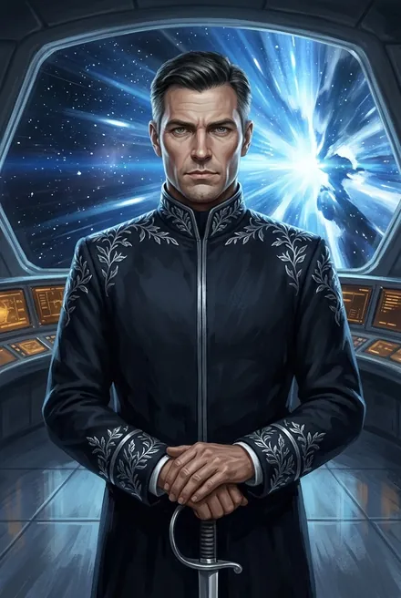

# Йан Воглер (капитан «Хельги»)

| | |
|---|---|
| **Имена** | Йан Воглер (ЗК-1, гл. 4; ЗК-11, гл. 8); «Ян Воглер, кажется, его звали» — у Сигурда в Лабиринте (ЗК-8, гл. 11) — *вариант написания*. «Капитан», «капитан ковчега» |
| **Должность** | «Координатор Звездного Флота и капитан ковчега "Хельга"» (ЗК-1, гл. 4); высшая командная должность проекта «Космо» до завершения колонизации (ЗК-11, гл. 8, 15) |
| **Природа** | **Единственный Инкарнатор на борту** — с онтологическим прионом в аниме; носитель капитанского нейрокогитора **«Скай 2.0»**; «спец по криптографии» (ЗК-11, гл. 8) |
| **Происхождение** | Земной проект: «Стеллар» (Инкарнаторы), «Космо» (ковчеги), Звёздный Флот |
| **Книги** | ЗК-1 (вокс-запись — гл. 4; интерлюдия «Хельга» — безымянный капитан), ЗК-2 (видения), ЗК-8 (Лабиринт — гл. 11; мостик-иллюзия — гл. 9), ЗК-11 (гл. 8–9, 12, 15–16, 19) |
| **Статус** | В системах ковчега — «DEAD», «KIA» или «MIA» (ЗК-11, гл. 8). По версии Альфы — его анима внедрена в клон Сигурда Морозова (ЗК-11, гл. 8) |

## Облики на иллюстрациях

<figure markdown="span">
  [{ loading=lazy }](../assets/portrety/054.webp)
  <figcaption>основной облик <small></small></figcaption>
</figure>

Иллюстрации созданы нейросетью по описаниям из книг; это трактовка, а не официальный арт.

## 1. Внешность (кратко)
- В записи — «элегантный мужчина в черно-серебряном мундире со звездным плетением на плечах и жестком воротнике», за спиной мостик и обзорный экран (ЗК-1, гл. 4).
- В Лабиринте — «темноволосый статный мужчина в мундире Звездного Флота с серебряной вязью на плечах и рукавах» (ЗК-8, гл. 11).
- Скай, сличая: «Импозантный темноволосый моно в мундире Звездного Флота, причем офицер, неизвестный широкой общественности» (ЗК-11, гл. 12).
- **Анимафикация Сигурда** — тело подстраивается под аниму: лицо угловатее, надбровные дуги толще, глаза из серо-голубых в стальные, волосы темнеют к тёмно-русому, +2 см роста; но Скай считает сдвиги в «естественном антропометрическом диапазоне моно, к которому мы оба принадлежали» (ЗК-11, гл. 12).

## 2. Природа: что такое «капитан-Инкарнатор»
- **Инкарнаторы «Стеллара»** — бессмертные с онтоприоном, который «невозможно подделать»; у клонов-колонистов его нет. «На ковчеге был единственный Инкарнатор, обладающий таким свойством. — Капитан "Хельги". Йан Воглер» (ЗК-11, гл. 8).
- **Бессмертие.** «Согласно секретным протоколам "Космо" он не был обычным человеком и мог воскресать даже в тех случаях, когда материальная оболочка утрачена» (ЗК-1, интерлюдия «Хельга»).
- **Когитор.** «Скай два ноль… Предназначена для капитанов, потому что способна полностью синхронизироваться с любыми объектами Звездного Флота. Ее устанавливали ограниченному кругу, в их числе был и Йан Воглер» (Рашидов, ЗК-11, гл. 8). Подробно — [Скай («Скай 2.0»)](../personazhi/skay.md).
- **Правило капитана.** «Капитан не может покинуть борт ковчега до окончания миссии… вперед ногами либо — после назначения замены из числа других Инкарнаторов. Это правило невозможно нарушить»; без капитана ковчег уходит в аварийный режим и «программа "Космо" начинает выполняться автоматически» — кружит и сбрасывает модули (ЗК-11, гл. 8).
- **Капитан по иерархии.** Кондор: «Капитан — это тот, кто принял пост, синхронизирован с кораблем и выполняет директивы проекта. Согласно формальным признакам — сейчас ты член экипажа, самовольно покинувший борт в аварийной ситуации… Дезертир» (ЗК-11, гл. 8). Аврора: «Сигурд — не капитан "Хельги". Капитаном был Йан Воглер. Сигурд — носитель его анимы и привязанных к ней ключевых доступов» (ЗК-11, гл. 16). Кассиди: по иерархии «Космо» «именно капитан — первое лицо землян» (ЗК-11, гл. 15).

## 3. Личность (что можно восстановить)
- **Голос записи** — бодрый официальный тон: «Приветствую, колонист!.. Пожалуйста, не волнуйтесь — вашему здоровью ничего не угрожает» (ЗК-1, гл. 4). Запись «запаяна»: монтажные склейки, вырезанная длительность полёта — «…лет» (там же).
- **В интерлюдии** капитан действует хладнокровно: разбивает аварийный колпак, вручную подключает резерв; сквернословит земным «астра фатида!» (ЗК-1, интерлюдия). *(Интерлюдия не называет имени; идентификация — по когитору «Скай», ЗК-11, гл. 8.)*
- **Криптограф и стратег.** «Капитанов специально обучали таким вещам, плюс он был спецом по криптографии» — потому мог зашифровать часть памяти (ЗК-11, гл. 8). У Сигурда «спящий» Навык Криптография и Шифрование — сразу 5/10 (ЗК-5, гл. 10); в Лабиринте он читает шифр «спящим Навыком Криптографии» (ЗК-8, гл. 11) *(вероятный след Воглера — по логике ЗК-11)*.
- **«Отражение» в Лабиринте** (порождение испытания, не сам Воглер): «Ты мог бы стать капитаном, Сигурд. Но твои ошибки привели тебя на этот путь. Сегодня ты умрешь…» (ЗК-8, гл. 11).

## 4. Хронология событий вокруг Воглера
1. **Земля / Мир-Кольцо.** В памяти Сигурда — серебряный тор Мира-Кольца с причальными «клыками» и «громады двух ковчегов, похожие на древние океанские лайнеры» (ЗК-1, гл. 23). «Хельга» — «один из двух ковчегов проекта "Космо"» (ЗК-11, гл. 8).
2. **Переход.** Капитан выводил ковчег на безопасную орбиту, «пытаясь опередить зловещего пришельца, вышедшего из А-пространства рядом с Миром-Кольцом»; «синяя вспышка Грани» (ЗК-1, интерлюдия). Видения Сигурда: «огни боевой тревоги», «Карронады» ищут цель, «черная сфера» в перекрестье прицела, «КРАСНАЯ ТРЕВОГА!» (ЗК-8, гл. 18; ЗК-2, гл. 15; ЗК-10, эпилог).
3. **Выход в Единство.** «Все на борту "Хельги" были мертвы. Все, кроме капитана»; приборы мертвы, навигация «не в силах отыскать опорные точки… как будто в Солнечной системе пропали все объекты»; капитан зовёт Скай — без ответа; на обзорном экране — нечто, что «не могло существовать в природе»: «Куда мы, астра фатида, попали?» (ЗК-1, интерлюдия).
4. **≈29 циклов назад.** «Ковчег прибыл в Единство двадцать девять циклов назад и сразу же — или почти сразу же… перешел в аварийный режим» (ЗК-11, гл. 8). Хранители: «старые отражения уже двадцать восемь циклов вовне» (ЗК-8, постскриптум).
5. **Исчезновение капитана.** Статус DEAD/KIA/MIA (ЗК-11, гл. 8). Версия Рашидова: анима «не погибла, а была захвачена… ее нештатно внедрили в новый носитель с твоей нейрограммой»; Воглер «был обнулен вместе с когитором»: Скай «стерла его память и привела себя в состояние предстартовой активации… Возможно, в момент вторжения на борт и угрозы захвата ковчега»; часть памяти Воглер «успел зашифровать» (ЗК-11, гл. 8).
6. **Капсула Сигурда** падает в Круге Элтанир примерно за полтора цикла до ЗК-11 (ЗК-11, гл. 5) — нестыковка во времени, которая «несколько… беспокоит» Рашидова (ЗК-11, гл. 8).
7. **Три экспедиции Альфы** к ковчегу провалились: «Ковчег не отвечает на вызовы, функционирует на автоматике, системы управления заблокированы, боевые системы не дают проникнуть на борт» (ЗК-11, гл. 8). Модель орбиты: волнообразный эллипс, над Заовом раз в 60–70 дней, «окна» по 3–20 минут (ЗК-11, гл. 12); ближайшее — через 47 дней после совета с Тысячей (ЗК-11, гл. 18).

## 4а. Корабль капитана: «Хельга» сегодня (что ждёт преемника)
- **Груз.** «Один из двух ковчегов проекта "Космо", хранящий материалы и технологии, предназначенные для восстановления Земли» (ЗК-11, гл. 8); «пятьдесят тысяч альфа-инкубаторов» для выращивания клонов под нейрограммы; «миллион добровольцев» — почти все в виде нейрограмм, «криогенная заморозка — легенда» (ЗК-11, гл. 2); база «Полариса», нейрограммы Рэя Мартинса, Элизабет Янг, Ивана Кляйнера, Луизы Шварц, «живая материя» (ЗК-11, гл. 8, 11, 18).
- **Защита.** Ковчегом управляет «даже не корабельный когитор, а циклично заскриптованная мертвая автоматика»; на протоколы «Космо» не отвечает; охранный периметр уничтожил флаинг Альфы (ЗК-11, гл. 12).
- **Три экспедиции Альфы** (ЗК-11, гл. 12):
  1. Шаттл за «атмосферным одеялом» уничтожен каэдометрией Наблюдателя — существует «высотный потолок».
  2. Малозаметный флаинг в гост-режиме (≈5 циклов подготовки) дошёл до ковчега в момент сброса — уничтожен охраной; выжившие «авроры» вернулись через полтора цикла.
  3. Два цикла назад: золотой летающий транспорт (Рунный) и единственный альфа-вингер «Гермес»; пилот «высадился на "Хельгу"» — и пропал. Итог — «минус два флаинга и один вингер… И два десятка людей».
- **Окна.** «Альфа за двадцать девять циклов накопила обширную базу» проявлений ковчега; гост-режим, сбросы, «окна» по 3–20 минут (ЗК-11, гл. 12).
- **Капитанский ключ.** Только носитель анимы капитана может «принять командование» и «достать "Хельгу" с неба, перезагрузив "Космо"» (Аврора, ЗК-11, гл. 16); Сигурд полетит на Стигисе «Голубая Стрела» с кел-пилотом Эйлорианом (ЗК-11, гл. 12, 18–21).

## 4б. Как писать Воглера
- **Голос записи** — корпоративно-флотский, бодро-успокаивающий: «Приветствую, колонист!», «Пожалуйста, не волнуйтесь», «Краткая инструкция:» (ЗК-1, гл. 4).
- **Голос в кризисе** — короткие команды себе и когитору: «Скай, ты меня слышишь? Активация! Доклад…»; ругательство «астра фатида» (ЗК-1, интерлюдия). *(«Астра фатида» — общее ругательство землян-космонавтов: его говорят Серена Лафайет (ЗК-1, гл. 14), Фьюри-«Лилия» (ЗК-4, гл. 18) и сам Сигурд (ЗК-4, гл. 21); у капитана — первое употребление в серии.)*
- **Внешне** — «импозантный», «элегантный», «статный», темноволосый моно в чёрно-серебряном мундире (ЗК-1, гл. 4; ЗК-8, гл. 11; ЗК-11, гл. 12).

## 5. Версии о том, кто «внутри» Сигурда
| Версия | Кто выдвигает | Источник |
|---|---|---|
| Клон Морозова с его нейрограммой, анима — «другой личности» | Скай | ЗК-8, гл. 14 |
| Нейрограмма Морозова, ставшего основой гранд-легата Зигфрида; три «инкарнации» (Земля, «Гедеон», «Хельга») | Скай | ЗК-9, гл. 16 |
| Анима Воглера в клоне Морозова | Кондор, Рашидов, Аврора | ЗК-11, гл. 8 |
| «Не Воглера и не Морозова, а некий гибрид», «возможно, имеющий обширную историю предыдущих отражений» | Рашидов | ЗК-11, гл. 8 |
| «Предтеча предтеч», «дракон, кусающий свой хвост» | Щит Победы, Мико | ЗК-8, гл. 12; ЗК-11, гл. 15 |

Сам Сигурд: «Это совершенно точно не я» (ЗК-11, гл. 8); «образ капитана оставался пустым, холодным и далеким… Смогу ли я стать капитаном?» (ЗК-11, гл. 12).

## 6. Кто и как его использует
- **Альфа** хочет «полностью подконтрольного капитана»: экстракция анимы, азур-шок, обнуление через Скай, пересадка «в чистый носитель» — «процедура, очень похожая на ту, которой подвергся Йан Воглер. Только с нашей стороны…» (Рашидов, ЗК-11, гл. 9).
- **Аврора** предлагала поработать с сохранившимися фрагментами Воглера, прежде чем обнулять (ЗК-11, гл. 9).
- **Хитрейший** провёл первую беседу с Сигурдом на (иллюзорном?) мостике «Хельги», сидя «в капитанском ложементе» (ЗК-8, гл. 9); в ЗК-11 называет Сигурда «капитан» (ЗК-11, гл. 19). «Он знал. И похоже, знал всегда» (там же).
- **Кандидаты в «похитители» анимы**, по Рашидову: «Хранители Вечности. Орден Истинных. Тысяча Братьев. Возможно, коалиция из нескольких сил» (ЗК-11, гл. 8).

## 7. Связь с Сигурдом (наследие)
- Онтоприон, «анима со старыми письменами», «кел-маркеры» (ЗК-11, гл. 1–2).
- Капитанский когитор Скай (ЗК-8, гл. 12; ЗК-11, гл. 8).
- Криптография (ЗК-5, гл. 10; ЗК-10, гл. 6 — Скай читает интерфейс Колонны Ветров).
- Пилотский инстинкт и командный стиль (Фьюри оценивала его налёт «не меньше трёхсот часов», ЗК-4 по разбору) *(частично это и выучка Морозова)*.
- Видения мостика и «КРАСНОЙ ТРЕВОГИ» при «мощном А-воздействии» (ЗК-2, гл. 15; ЗК-8, гл. 18; ЗК-9, гл. 19).
