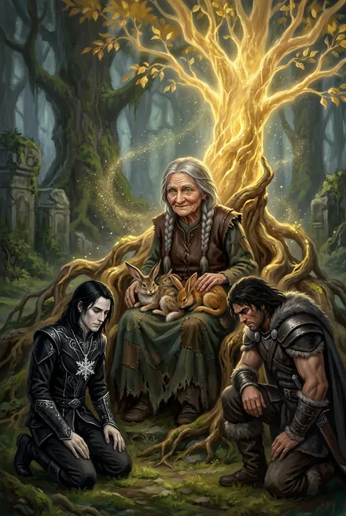

# Бабушка Яшма

> См. также: [Единые и высшие силы](../personazhi/edinye.md) (Творящая) · [Кейнор](../personazhi/kejnor.md) · [Белый Дьявол](../personazhi/belyj_dyavol.md) · [Псы Вечности](../personazhi/psy_vechnosti.md). Травинка, Кыш — досье основной серии.

| Поле | Значение |
|---|---|
| **Кто** | Легендарная «полубезумная» золотая Восходящая-странница — или сущность под этой маской; «тень Творящей», «личина, сквозь которую смотрит кто-то» (Кейнор, ЗК-11, гл. 17) |
| **Видимый ранг** | «Слабая золотая аура», без имени и Народа (ТБ-4, гл. 16); Скрижаль лазурно-золотая, в рост человека (ЗК-7); реально — «старше Тысячи и самого Единства», её боятся небо и Псы |
| **Книги** | ЗК-7 (гл. 16), ЗК-9, ЗК-10, ЗК-11 (упом., гл. 17), ТБ-4 (интерлюдия «Дикая Охота», гл. 16–17) |
| **Статус** | Исчезает и появляется; «приглядывает за Росточком» |

**Внешность.** Маленькая сгорбленная старушка в одежде Народа Гор, седые косички вокруг головы, лицо «как сморщенный пирожок», юные хитрые зелёные глаза (ЗК-7) — «цвета весенней листвы» (ТБ-4). Складывается из золотой пыли (ТБ-4, гл. 16).

**Речь.** Ласково-насмешливая, деревенская: «Смотрите, да глазки не сломайте, мои» (ЗК-7, гл. 16); «Червячки-то ползут…»; «детишек моих не обижайте» (ТБ-4, гл. 16). Кейнору: «Сам-то червяка убил, а пятнышко осталось»; кингу о ледяной печати: «Хороший у тебя подарочек-то… От брата…» (ТБ-4, гл. 16).

**Деяния.**
- Дарит Травинке Звёздный Кувшин (Кувшин Звёздной Воды), обещает «навещать» (ЗК-7); позже усиливает Кувшин (ЗК-10). Благодаря Кувшину Росток за цикл почти стал Малым Древом (ТБ-4, гл. 16).
- Псы Вечности атакуют Росток — и отступают перед ней (ЗК-9/ЗК-10); Небесный узнал «тень Скрижали» маленькой золотой старушки и запретил лезть к Ростку (ТБ-4, интерлюдия «Дикая Охота»).
- Встреча с двумя Братьями у Древа землян: оба ощущают силу, «что старше Тысячи и самого Единства», и **встают на колено**. «Это она?» — «Не знаю… мы меньше, чем полагали о себе». — «А фигур больше». — «Не фигур, брат. Игроков» (ТБ-4, гл. 16). Кейнор: «Ваш белый камень… Она была до нас и будет после нас» (ТБ-4, гл. 17); «лучший из знаков Незримого»; Червей она не остановит (ЗК-11, гл. 17).

**Легенды** (ТБ-4, разд. 12): травница, потерявшая детей; золотая странница; хранительница малых Древ.

**Гипотеза.** Личина/тень **Творящей** (Той-Кто-Творит) — Единой, которая «пропала» («одна пропала» в послании Посланника, ЗК-6, гл. 12) *(предположение, разделяемое Кейнором)*. Под её покровительством — Росток/Древо Скай и Травинка.

---

## Облики на иллюстрациях

<figure markdown="span">
  [{ loading=lazy }](../assets/portrety/151.webp)
  <figcaption>основной облик <small></small></figcaption>
</figure>

Иллюстрации созданы нейросетью по описаниям из книг; это трактовка, а не официальный арт.

## Дополнение: появления в основной серии

> Объединено из второго досье (взгляд основной серии).

| | |
|---|---|
| **Кто** | Легендарная полубезумная золотая Восходящая-странница — или сущность под этой маской (ЗК-7); «тень Творящей», «личина, сквозь которую смотрит кто-то» (Кейнор, ЗК-11, гл. 17) |
| **Роль** | Покровительница Ростка/Древа «Скай» и Травинки |
| **Книги** | ЗК-7, ЗК-9, ЗК-10, ЗК-11; упом. ТБ-4 (Минос спрашивает о ней) |
| **Статус** | Появляется и исчезает; «обещает навещать» |

**Облик:** маленькая сгорбленная старушка в одежде Народа Гор, седые косички вокруг головы, лицо «как сморщенный пирожок», юные хитрые зелёные глаза (ЗК-7). Скрижаль лазурно-золотая, в рост человека.
**Речь:** ласково-насмешлива: «Смотрите, да глазки не сломайте, мои» (ЗК-7, гл. 16).

**Появления.**
- ЗК-7: дарит Травинке Кувшин Звездной Воды (гл. 16), исчезает.
- ЗК-9: «приглядывает за Росточком»; небесные Псы Вечности атакуют Росток и отступают перед ней, склоняя головы; удивлены йуррами, которых «тысячу циклов не видели».
- ЗК-10: прогоняет Псов, усиливает Кувшин; её «боится небо».
- ЗК-11: Пламени Подобный и Кейнор говорят с ней у Древа (гл. 16); Кейнор: «ваш белый камень, лучший из знаков Незримого»; Червей она не остановит (гл. 17).

**Легенды:** травница, потерявшая детей (семью съели Черви); золотая странница между Кругами (ЗК-7 §12, ЗК-11 §12).
**Тайна:** служительница или аватар Творящей? Огромный потенциал для фольклорных вставок.
