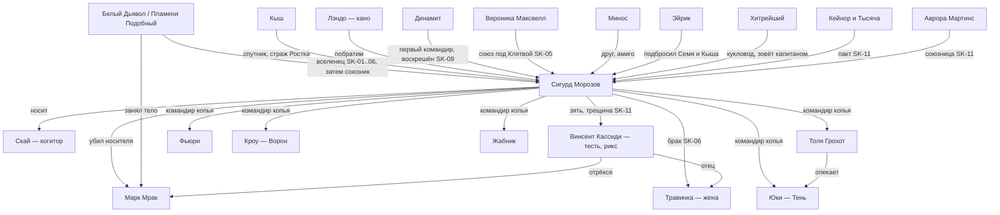
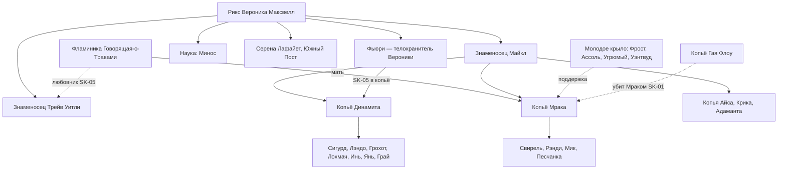
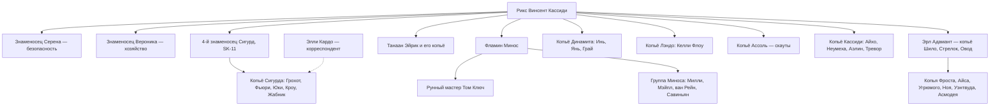
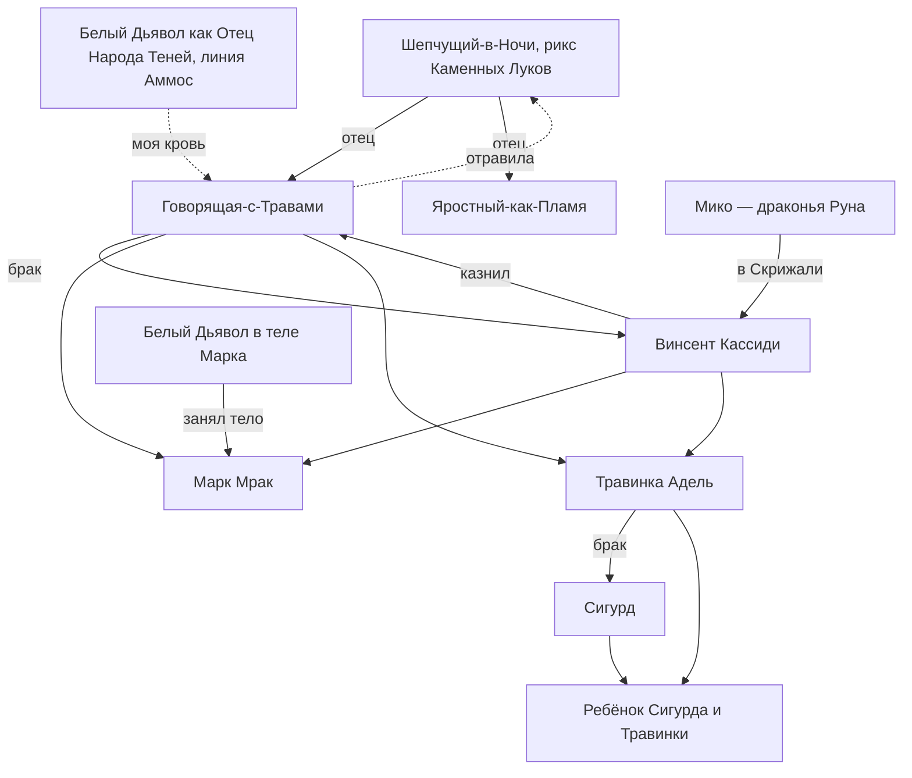
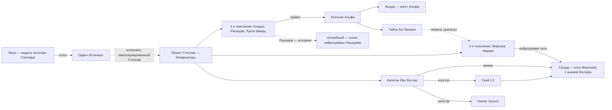
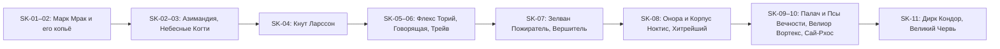

# Персонажи основной серии «Звездная Кровь» (SK-01…SK-11) — сводный указатель

Досье ключевых персонажей лежат в этой папке (ссылки в последнем столбце). Персонажи цикла «Тысяча Братьев» и древние силы (Белый Дьявол / Пламени Подобный, Азимандия, Морвейн, Кейнор, Эрин, Сатори, Каласса, Иниэсс, Хранители в целом и др.) описаны отдельно и здесь даны только строкой — для связей.

Обозначения статуса — на конец канона (SK-11 / TB-05). Книги: SK-xx, TB-xx; «упом.» — только упоминания.

## 1. Сводная таблица

### 1.1. Сигурд и его копьё
| Имя | Кто | Книги | Статус | Досье |
|---|---|---|---|---|
| Сигурд (Сигварт Морозов), «Звездный Флот» | Протагонист; клон с анимой Йана Воглера, Истинный; эрл, 4-й знаменосец Неба | SK-01–11, TB-01–05 | Жив | [sigurd.md](../personazhi/sigurd.md) |
| Скай («Скай 2.0») | Нейрокогитор «Полариса» в аниме Сигурда | SK-08–11 | Активна | [skay.md](../personazhi/skay.md) |
| Кыш | Йурр-«ключник», страж Ростка | SK-01–08, TB-04 | Жив, с семьёй у Древа | [kysh.md](../personazhi/kysh.md) |
| Толя Грохот (Анатолий Горохов) | Десантник-пулемётчик, бронза | SK-01–11 | Жив | [grohot.md](../personazhi/grohot.md) |
| Фьюри (Кристина Фальк / Лилия ван дер Саар) | Второй пилот, агент-дезертир Альфы | SK-03–11 | Жива | [fyuri.md](../personazhi/fyuri.md) |
| Юки / Тень / Тень-из-Неба | Скаут из Народа Теней, бывшая трэль | SK-03–04, 07–11 | Жива, дерево | [yuki.md](../personazhi/yuki.md) |
| Андре Кроу «Птица» → Ворон | Стрелок, будущий командир копья | SK-07–11 | Жив, бронза | [krou.md](../personazhi/krou.md) |
| Жабник (Деврадж Мукерджи) | Ксеномедик копья | SK-09–11 | Жив, дерево | [zhabnik.md](../personazhi/zhabnik.md) |
| Инь, Янь | Азио-близнецы (снайпер; медик-дроновод) | SK-01–11 | Живы, в копье Динамита | [in-yan.md](../personazhi/in-yan.md) |
| Грай | Латино, рождён в Единстве, стрелок | SK-01–10 | Жив | [grai.md](../personazhi/grai.md) |
| Тревор Моримото «Мажор» | Сын Трейва Уитли, новобранец | SK-07, 08, 10 | Жив, в копье Кассиди | [trejv.md](../personazhi/trejv.md) |
| Элли (Элеонора) Кардо | Журналистка «Голоса Фригольда» | SK-09–11 | Жива | [kardo.md](../personazhi/kardo.md) |
| Лохмач | Мохнач-следопыт копья Динамита | SK-01–04 | Погиб (SK-04) | [lohmach.md](../personazhi/lohmach.md) |
| «Второй Лохмач» | Йети Народа Леса, бывший пленник Азимандии | SK-08–10 | Жив, серебро | [lohmach.md](../personazhi/lohmach.md) |
| Лю Минь | Повариха, экс-су-шеф «Мишлен», любовь Грая | SK-08 | Жива | — |

### 1.2. Семья Кассиди и руководство фригольда «Небо»
| Имя | Кто | Книги | Статус | Досье |
|---|---|---|---|---|
| Винсент «Винс» Кассиди | Первый рикс, тесть Сигурда, носитель Мико | SK-01–11, TB-04 | Жив, рикс | [vinsent.md](../personazhi/vinsent.md) |
| Травинка-на-Ветру (Адель Кассиди) | Жена Сигурда, целительница | SK-01–11 | Жива, беременна | [travinka.md](../personazhi/travinka.md) |
| Марк «Мрак» Кассиди | Сын Винсента, убийца Гая и Динамита | SK-01–06 | Дух мёртв, тело — у Белого Дьявола | [mark-mrak.md](../personazhi/mark-mrak.md) |
| Говорящая-с-Травами | Фламиника, жена Винсента, Тень-изгнанница | SK-01–06 | Мертва (SK-06) | [govoryashchaya.md](../personazhi/govoryashchaya.md) |
| Мико | Драконья Руна-когитор Ордена Истинных | SK-09–11, TB-04 | В Скрижали Кассиди | [miko.md](../personazhi/miko.md) |
| Вероника «Ника» Максвелл | Бывший рикс, знаменосец, «аврора» | SK-01–11 | Жива | [veronika.md](../personazhi/veronika.md) |
| Райан и Риан Максвелл | Близнецы Вероники и Эйрика, заложники у Трав | SK-06–07, 09 | Живы | [veronika.md](../personazhi/veronika.md) |
| Минос (доктор Матиас Амин) | Глава науки, фламин | SK-01–11, TB-04 | Жив | [minos.md](../personazhi/minos.md) |
| Трейв Уитли | Завхоз → знаменосец → рикс-марионетка | SK-01–06 | Испепелён (SK-06) | [trejv.md](../personazhi/trejv.md) |
| Майкл | Знаменосец, правая рука Вероники, афро | SK-01–04 | Погиб (SK-04) | — |
| Серена Лафайет | Знаменосец (безопасность) | SK-01–11 | Жива, серебро | [serena.md](../personazhi/serena.md) |
| Эйрик (Мастер Зверей) | Рикс фермы → танаан | SK-01–11 | Жив, без руки | [eirik.md](../personazhi/eirik.md) |
| Сюгретта (Грета) | Старшая жена Эйрика, нордийка | SK-01, 04–07, 10 | Погибла (SK-10) | [eirik.md](../personazhi/eirik.md) |
| Людмила, Венди, Шизуки; Ярослав, Рэй, Бен | Семья и копьё Эйрика | SK-04–10 | Живы | [eirik.md](../personazhi/eirik.md) |
| Джимми Райнер | Копьё Эйрика | SK-07, 10 | Убит (SK-10) | — |
| Динамит (Дмитрий Воронин) | Первый командир Сигурда | SK-01–06, 09–11 | Убит (SK-06), воскрешён (SK-09) | [dinamit.md](../personazhi/dinamit.md) |
| Ханна | Жена Динамита | SK-05, 06, 09 | Жива | [dinamit.md](../personazhi/dinamit.md) |
| Гай Флоу | Ветеран, хейр | SK-01 | Убит Марком (SK-01) | [gai-flou.md](../personazhi/gai-flou.md) |
| Келли Флоу | Дочь Гая, невеста Лэндо | SK-01–02, 04, 06–08, 11 | Жива | [gai-flou.md](../personazhi/gai-flou.md) |
| Адамант (Крис Свенсон) | Командир сильнейшего копья, эрл | SK-04–11 | Жив, серебро | [adamant.md](../personazhi/adamant.md) |
| Ассоль (Патриция Эванс) | Командир копья скаутов | SK-01, 04, 06–07, 09–11 | Жива | [assol.md](../personazhi/assol.md) |
| Фрост, Айс, Угрюмый, Ной, Уэнтвуд, Асмодей | Командиры копий («молодое крыло» — Фрост, Ассоль, Угрюмый, Уэнтвуд) | SK-02–11 | Живы | — |
| Том «Ключ» Янг | Рунный мастер фригольда, мулат из Нео-Мумбаи | SK-04, 06–08, 11 | Жив | — |
| Милли (Миллисент Симмонс) | Лучница → инженер/рунный мастер группы Миноса | SK-01, 04, 06, 08–11 | Жива | — |
| Анни Ри | Биолог, отдала Сигурду Кыша | SK-01–09 | Жива | — |
| Эндрю «Зверолов» Мэйпл, Исла ван Рейн, Габриэль Савиньян | Учёные группы Миноса | SK-08 | Живы | — |
| Наив, Витольд, Сэм, Кевин, Илья Сухарин | Кладовщик; бармен «Виски»; оружейник; перекупщик; глава репликации | SK-01–11 (фон) | Живы (Наив под арестом, SK-06) | — |
| Айхо и Неумеха | Бывшие Призрачные Девы Азимандии, в копье Кассиди | SK-02–10 | Живы | — |
| Аэлин Поющая-с-Ветром | Аэри, крылатая, серебро Неба | SK-08–11 | Жива | — |
| Мэй Чжэнь | «Аврора», командор Станции Терра | SK-10–11 | Жива, в Небе | — |
| Мигель | Кандидат на стигмат | SK-02 | Мёртв (Гнездо) | — |
| Тадеуш | Колонист, бывший сосед Сигурда | SK-01, 10 | Погиб (SK-10) | — |

### 1.3. Враги-земляне и изгои
| Имя | Кто | Книги | Статус | Досье |
|---|---|---|---|---|
| Свирель, Рэнди, Мик, Песчанка | Копьё Мрака | SK-01–06 | Рэнди мёртв; прочие изгнаны | [kopyo-mraka.md](../personazhi/kopyo-mraka.md) |
| Кнут (Кнуд Ларссон) | Изгнанный знаменосец, главарь изгоев Шторма | SK-03–06 | Мёртв (SK-04) | [knut.md](../personazhi/knut.md) |
| Дуглас Кирк | Землянин-изгой с «Суворовым» | SK-03–04 | Убит хазаком (SK-03, гл. 3) | — |
| Раздавленный Клык | Восходящий-изгой из племени Камня | SK-03–04 | Убит (SK-03, гл. 3) | — |
| Черная Оса | Восходящая-изгой Народа Камня | SK-04 | ? | — |

### 1.4. Земля, «Стеллар», Колония Альфа, Либерти
| Имя | Кто | Книги | Статус | Досье |
|---|---|---|---|---|
| Йан (Ян) Воглер | Капитан «Хельги», Инкарнатор; анима в Сигурде | SK-01, 08, 11 | DEAD/KIA/MIA | [vogler.md](../personazhi/vogler.md) |
| Тайна (Аю Лакшми) | Возлюбленная оригинала Морозова | SK-01–02, 08, 11 | Жива, в Альфе | [tajna.md](../personazhi/tajna.md) |
| Аврора Мартинс (в SK-03 «Мартинес») | Создательница «авроры», Инкарнатор | SK-03, 05, 11, TB-04 | Жива | [avrora.md](../personazhi/avrora.md) |
| Олег Рашидов | Координатор Альфы, «исходник» Хитрейшего | SK-10–11 | Жив | [rashidov.md](../personazhi/rashidov.md) |
| Дирк Кондор | Диктатор Альфы, «Легат» | SK-11 | Личность стёрта | [kondor.md](../personazhi/kondor.md) |
| Шон Макдональд | Инженер экспедиции «Одиссей», трэль Теней | SK-03, 05 | Погиб (SK-03) | — |
| Андреас Берг | Техник Звездного Флота (воспоминание) | SK-01 | ? | — |
| Корни Рэнвуд, доктор Рихтер | Учёные Альфы | SK-11 | Живы | — |
| Рэй Мартинс, Элизабет Янг, Иван Кляйнер | CEO «Полариса»; глава совета координаторов; командующий Флотом — нейрограммы на «Хельге» | SK-11 | Не пробуждены | — |
| Луиза Шварц | Первая волна «Стеллара», «мертвое имя» | SK-11 | ? | [rashidov.md](../personazhi/rashidov.md) |
| Волк / Серый Волк (Маркус Крейв) | Рикс банды Волков Либерти, экс-трибун безопасности Альфы | SK-10–11 | Жив, должник | — |
| Мама Роза (Розалия Чен) | Глава «Приюта» Либерти, врач | SK-10–11 | Жива | — |
| Змей; Хель Раан; Пит Уильямс; Глен «Толстяк Митчелл»; Габо (Габриэль Марсо) | Люди Либерти | SK-10–11 | Живы | — |
| Микки «Ангел» | Нео, боец копья молодого Кассиди, нейробиолог | SK-09 | Нео в Вечности | — |
| Амадай Кассель; Лора Сингх, Кенджи Чен, Наоми Йо | Спасённые колонисты | SK-09 | Живы | — |

### 1.5. Народы Круга (союзники и противники)
| Имя | Кто | Книги | Статус | Досье |
|---|---|---|---|---|
| Лэндо Солнечное Крыло | Принц Трав, кано Сигурда | SK-01–08, 11 | Жив | [lendo.md](../personazhi/lendo.md) |
| Айно Ветер Равнин; Жемчужина-в-Волосах; Кандо | Кинг, фламиника, старший сын Трав | SK-05–07 | Живы | [lendo.md](../personazhi/lendo.md) |
| Коготь-как-Серебро | Рикс Небесных Когтей (Тени) | SK-03, 06, 09 | Жив | [kogot-kak-serebro.md](../personazhi/kogot-kak-serebro.md) |
| Видящая-сквозь-Тьму | Рикс Небесных Когтей, мать Когтя | SK-03, 06 | Мертва | [kogot-kak-serebro.md](../personazhi/kogot-kak-serebro.md) |
| Яростный-как-Пламя | Рикс Каменных Луков, брат Говорящей | SK-03, 06, 09 | Убит Червями (до SK-09) | [govoryashchaya.md](../personazhi/govoryashchaya.md) |
| Шепчущий-в-Ночи | Отец Говорящей | SK-03 | Мёртв | [govoryashchaya.md](../personazhi/govoryashchaya.md) |
| Серебряная Форель | Восходящая Мёртвой Рыбы, оборотень | SK-01, 06, 09 | Жива, должница | — |
| Зирдан (Зирдин) Хвост Акулы | Сын рикса Мёртвой Рыбы | SK-01, 06 | Жив | — |
| Аурвак Владыка Чешуи | Рикс Мёртвой Рыбы | SK-06, 09 | Жив | — |
| Сторм Сто Смертей; Викси Шип-Змея | Кинг Людей Моря; изгойка-серебро | SK-06 | Сторм жив, Викси мертва | — |
| Найтфир, Каласса (Огненная-как-Ветер) | Жёны Пламени Подобного | SK-09–11, TB | Живы | (досье TB) |
| Иниэсс Зеленый Лист | Кинг Народа Древа | SK-06–07, TB-04 | Жива | (досье TB) |
| Крагг-гор Кровавый Рог | Шаман Клана Зверя | SK-08 | Жив, в тюрьме | — |
| Эдри (Эд Ри Саттар) | Торговец Каравана, метаморф | SK-08–11 | Жив | [edri.md](../personazhi/edri.md) |
| Найра Эль-Кадис | Дочь Каравана | SK-10, TB-05 | Жива | [nayra.md](../personazhi/nayra.md) |
| Вейн Эль-Керр; Пустой Глаз | Хранитель путей; вождь вранов | SK-10 | Живы | — |
| Бабушка Яшма | «Тень Творящей» | SK-07, 09–11 | — | [yashma.md](../personazhi/yashma.md) |
| Каменный Гром | Альфа-гигантопитек | SK-10 | Убит | — |

### 1.6. Вечность, Кел и высшие силы (в SK)
| Имя | Кто | Книги | Статус | Досье |
|---|---|---|---|---|
| Хитрейший | Хранитель, хозяин Контракции | SK-02–03, 05, 08–11, TB | Действует | [hitreyshiy.md](../personazhi/hitreyshiy.md) |
| Сестра Солнца | Хранительница, подарила Сагу | SK-03, 05, 09 | Действует | [sestra-solntsa.md](../personazhi/sestra-solntsa.md) |
| Палач, Предвестник, Посланник, Полководец, Странник | Прочие Хранители | SK-03, 06, 08–10 | — | (досье TB / древние силы) |
| Флекс Торий | Кел-душеторговец | SK-05–06 | Мёртв | [flex-torij.md](../personazhi/flex-torij.md) |
| Эрда Онора | Эрда Корпуса Ноктис | SK-08, TB-02 | См. досье | [onora.md](../personazhi/onora.md) |
| Эриний Зариман кел Эррос; Азтелла | Кел-лорд Ковенанта «Феникс»; его эмма | SK-05–06, 09 | Живы | — |
| Велиор Вортекс | Кел-лорд-коллекционер | SK-09–10 | Душа у Хитрейшего | — |
| Тайновидица; Щит Победы | Истинная-хранительница Архива Тайн; небо-страж Ордена | SK-08 | Живы | — |
| Эйлориан (Эйлор) | Кел-пилот, анима в стигисе «Голубая Стрела» | SK-10–11 | Анима | — |
| Белый Дьявол / Пламени Подобный, Азимандия, Морвейн, Кейнор, Марисса, Эверент, Сатори, Чёрный Крест, Нор-Аэль | Тысяча Братьев и их Руны | SK-01–11, TB | — | [belyj_dyavol.md](../personazhi/belyj_dyavol.md), [azimandiya.md](../personazhi/azimandiya.md), [morvejn.md](../personazhi/morvejn.md), [kejnor.md](../personazhi/kejnor.md), [satori.md](../personazhi/satori.md), [tysyacha_bratev.md](../personazhi/tysyacha_bratev.md) |

## 2. Схемы отношений

### (а) Ближний круг Сигурда

### (б1) Фригольд «Небо» в SK-01–05 (власть Вероники и Трейва)

### (б2) Фригольд «Небо» в SK-06–11 (после возвращения Винсента)

### (в) Семья Кассиди и кровь Народа Теней

### (г) Земляне: «Стеллар», Альфа и их связь с Вечностью

### (д) Главные противники Сигурда по книгам

## 3. Противоречия и варианты имён (сводка)
- **Сигурд / Сигварт** — оба канон: Сигварт Морозов — паспортное имя, Сигурд — данное Тайной (SK-01, гл. 7, 16).
- **Аврора Мартинес (SK-03) / Мартинс (SK-05, SK-11)** — основное: Мартинс.
- **Йан / Ян Воглер** — основное: Йан (SK-11).
- **Фьюри** = Лилия ван дер Саар (псевдоним) = Кристина Фальк (настоящее, SK-10, гл. 23) = «Ледяная Лилия».
- **Зирдан (SK-01) / Зирдин (SK-06)** Хвост Акулы.
- **Неумеха / «Неряха»** (SK-05, гл. 14).
- **Эль-Кадис (SK-10) / «Эль-Керр»** для Найры (TB-05).
- **Марк** — «стопроцентный землянин по генотипу» (SK-01, гл. 12) vs сын Говорящей (SK-01, гл. 21 и далее).
- **Ранг Миноса** — серебро (SK-06) / «бронзовый рунный мастер» (SK-07) / серебро (SK-09).
- **Грохот** — в разборах SK-05 «Восходящий», SK-09 «не Восходящий»; канон — гвоздь и бронза с Титулом в SK-06.
- **Венди** — дочь Эйрика (SK-04) / жена (SK-05). **Победитель Варгов** — отдельный абориген (SK-05, SK-07) / прозвище Джимми Райнера (SK-10).
- **Инь и Янь** — «близнецы» (SK-01, 02, 09) / «братья» (SK-05).
- **Скрипторум Некролита** — у Миноса (SK-08) / у Кассиди (SK-09) / у Пламени Подобного (TB-04).
- **«Торий — рикс землян»** (разбор TB-03) — ошибка, имеется в виду Кассиди.
- **Ранг Сигурда в SK-11** — «золотой ранг» (гл. 10, 14) при самооценке «серебро» (гл. 20).
- **Онора** — жива с деревянной Скрижалью (SK-08) / душа в Драконьей Клетке (TB-02).
- **Трейв и Набор Колониста** — «тип 2» (SK-01, гл. 3) / «тип-3» (гл. 16).
- **Омонимы «Скай»:** фригольд «Небо» (англ. Sky), Древо «Скай», нейросеть Скай; в разборе SK-07 фригольд назван «Скай».
