# Персонажи основной серии «Звездная Кровь» (ЗК-1…ЗК-11) — сводный указатель

Досье ключевых персонажей лежат в этой папке (ссылки в последнем столбце). Персонажи цикла «Тысяча Братьев» и древние силы (Белый Дьявол / Пламени Подобный, Азимандия, Морвейн, Кейнор, Эрин, Сатори, Каласса, Иниэсс, Хранители в целом и др.) описаны отдельно и здесь даны только строкой — для связей.

Обозначения статуса — на конец канона (ЗК-11 / ТБ-5). Книги: ЗК-xx, ТБ-xx; «упом.» — только упоминания.

## 1. Сводная таблица

### 1.1. Сигурд и его копьё
| Имя | Кто | Книги | Статус | Досье |
|---|---|---|---|---|
| 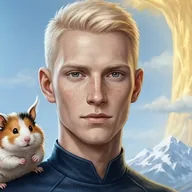{ .idx-ico loading=lazy } Сигурд (Сигварт Морозов), «Звездный Флот» | Протагонист; клон с анимой Йана Воглера, Истинный; эрл, 4-й знаменосец Неба | ЗК-1–11, ТБ-1–05 | Жив | [досье](../personazhi/sigurd.md) |
| 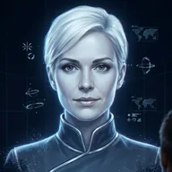{ .idx-ico loading=lazy } Скай («Скай 2.0») | Нейрокогитор «Полариса» в аниме Сигурда | ЗК-8–11 | Активна | [досье](../personazhi/skay.md) |
| 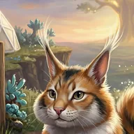{ .idx-ico loading=lazy } Кыш | Йурр-«ключник», страж Ростка | ЗК-1–08, ТБ-4 | Жив, с семьёй у Древа | [досье](../personazhi/kysh.md) |
| 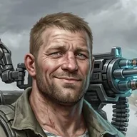{ .idx-ico loading=lazy } Толя Грохот (Анатолий Горохов) | Десантник-пулемётчик, бронза | ЗК-1–11 | Жив | [досье](../personazhi/grohot.md) |
| 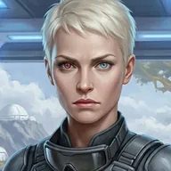{ .idx-ico loading=lazy } Фьюри (Кристина Фальк / Лилия ван дер Саар) | Второй пилот, агент-дезертир Альфы | ЗК-3–11 | Жива | [досье](../personazhi/fyuri.md) |
| 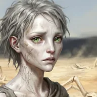{ .idx-ico loading=lazy } Юки / Тень / Тень-из-Неба | Скаут из Народа Теней, бывшая трэль | ЗК-3–04, 07–11 | Жива, дерево | [досье](../personazhi/yuki.md) |
| 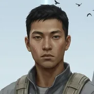{ .idx-ico loading=lazy } Андре Кроу «Птица» → Ворон | Стрелок, будущий командир копья | ЗК-7–11 | Жив, бронза | [досье](../personazhi/krou.md) |
| Жабник (Деврадж Мукерджи) | Ксеномедик копья | ЗК-9–11 | Жив, дерево | [досье](../personazhi/zhabnik.md) |
| 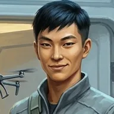{ .idx-ico loading=lazy } Инь, Янь | Азио-близнецы (снайпер; медик-дроновод) | ЗК-1–11 | Живы, в копье Динамита | [досье](../personazhi/in-yan.md) |
| 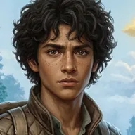{ .idx-ico loading=lazy } Грай | Латино, рождён в Единстве, стрелок | ЗК-1–10 | Жив | [досье](../personazhi/grai.md) |
| Тревор Моримото «Мажор» | Сын Трейва Уитли, новобранец | ЗК-7, 08, 10 | Жив, в копье Кассиди | [досье](../personazhi/trejv.md) |
| 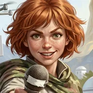{ .idx-ico loading=lazy } Элли (Элеонора) Кардо | Журналистка «Голоса Фригольда» | ЗК-9–11 | Жива | [досье](../personazhi/kardo.md) |
| 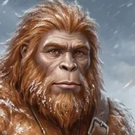{ .idx-ico loading=lazy } Лохмач | Мохнач-следопыт копья Динамита | ЗК-1–04 | Погиб (ЗК-4) | [досье](../personazhi/lohmach.md) |
| «Второй Лохмач» | Йети Народа Леса, бывший пленник Азимандии | ЗК-8–10 | Жив, серебро | [досье](../personazhi/lohmach.md) |
| Лю Минь | Повариха, экс-су-шеф «Мишлен», любовь Грая | ЗК-8 | Жива | — |

### 1.2. Семья Кассиди и руководство фригольда «Небо»
| Имя | Кто | Книги | Статус | Досье |
|---|---|---|---|---|
| 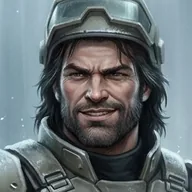{ .idx-ico loading=lazy } Винсент «Винс» Кассиди | Первый рикс, тесть Сигурда, носитель Мико | ЗК-1–11, ТБ-4 | Жив, рикс | [досье](../personazhi/vinsent.md) |
| 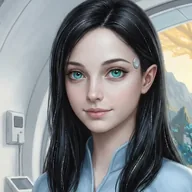{ .idx-ico loading=lazy } Травинка-на-Ветру (Адель Кассиди) | Жена Сигурда, целительница | ЗК-1–11 | Жива, беременна | [досье](../personazhi/travinka.md) |
| 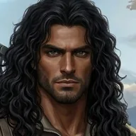{ .idx-ico loading=lazy } Марк «Мрак» Кассиди | Сын Винсента, убийца Гая и Динамита | ЗК-1–06 | Дух мёртв, тело — у Белого Дьявола | [досье](../personazhi/mark-mrak.md) |
| 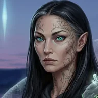{ .idx-ico loading=lazy } Говорящая-с-Травами | Фламиника, жена Винсента, Тень-изгнанница | ЗК-1–06 | Мертва (ЗК-6) | [досье](../personazhi/govoryashchaya.md) |
| 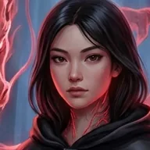{ .idx-ico loading=lazy } Мико | Драконья Руна-когитор Ордена Истинных | ЗК-9–11, ТБ-4 | В Скрижали Кассиди | [досье](../personazhi/miko.md) |
| 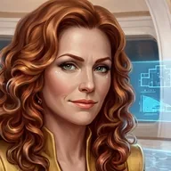{ .idx-ico loading=lazy } Вероника «Ника» Максвелл | Бывший рикс, знаменосец, «аврора» | ЗК-1–11 | Жива | [досье](../personazhi/veronika.md) |
| Райан и Риан Максвелл | Близнецы Вероники и Эйрика, заложники у Трав | ЗК-6–07, 09 | Живы | [досье](../personazhi/veronika.md) |
| 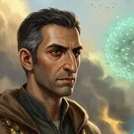{ .idx-ico loading=lazy } Минос (доктор Матиас Амин) | Глава науки, фламин | ЗК-1–11, ТБ-4 | Жив | [досье](../personazhi/minos.md) |
| 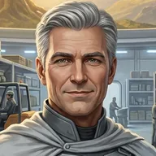{ .idx-ico loading=lazy } Трейв Уитли | Завхоз → знаменосец → рикс-марионетка | ЗК-1–06 | Испепелён (ЗК-6) | [досье](../personazhi/trejv.md) |
| Майкл | Знаменосец, правая рука Вероники, афро | ЗК-1–04 | Погиб (ЗК-4) | — |
| 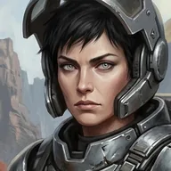{ .idx-ico loading=lazy } Серена Лафайет | Знаменосец (безопасность) | ЗК-1–11 | Жива, серебро | [досье](../personazhi/serena.md) |
| 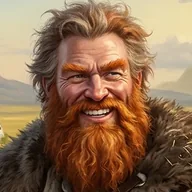{ .idx-ico loading=lazy } Эйрик (Мастер Зверей) | Рикс фермы → танаан | ЗК-1–11 | Жив, без руки | [досье](../personazhi/eirik.md) |
| Сюгретта (Грета) | Старшая жена Эйрика, нордийка | ЗК-1, 04–07, 10 | Погибла (ЗК-10) | [досье](../personazhi/eirik.md) |
| Людмила, Венди, Шизуки; Ярослав, Рэй, Бен | Семья и копьё Эйрика | ЗК-4–10 | Живы | [досье](../personazhi/eirik.md) |
| Джимми Райнер | Копьё Эйрика | ЗК-7, 10 | Убит (ЗК-10) | — |
| { .idx-ico loading=lazy } Динамит (Дмитрий Воронин) | Первый командир Сигурда | ЗК-1–06, 09–11 | Убит (ЗК-6), воскрешён (ЗК-9) | [досье](../personazhi/dinamit.md) |
| Ханна | Жена Динамита | ЗК-5, 06, 09 | Жива | [досье](../personazhi/dinamit.md) |
| 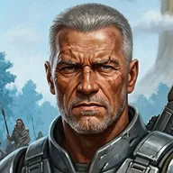{ .idx-ico loading=lazy } Гай Флоу | Ветеран, хейр | ЗК-1 | Убит Марком (ЗК-1) | [досье](../personazhi/gai-flou.md) |
| Келли Флоу | Дочь Гая, невеста Лэндо | ЗК-1–02, 04, 06–08, 11 | Жива | [досье](../personazhi/gai-flou.md) |
| Адамант (Крис Свенсон) | Командир сильнейшего копья, эрл | ЗК-4–11 | Жив, серебро | [досье](../personazhi/adamant.md) |
| 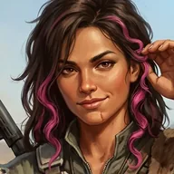{ .idx-ico loading=lazy } Ассоль (Патриция Эванс) | Командир копья скаутов | ЗК-1, 04, 06–07, 09–11 | Жива | [досье](../personazhi/assol.md) |
| Фрост, Айс, Угрюмый, Ной, Уэнтвуд, Асмодей | Командиры копий («молодое крыло» — Фрост, Ассоль, Угрюмый, Уэнтвуд) | ЗК-2–11 | Живы | — |
| Том «Ключ» Янг | Рунный мастер фригольда, мулат из Нео-Мумбаи | ЗК-4, 06–08, 11 | Жив | — |
| Милли (Миллисент Симмонс) | Лучница → инженер/рунный мастер группы Миноса | ЗК-1, 04, 06, 08–11 | Жива | — |
| Анни Ри | Биолог, отдала Сигурду Кыша | ЗК-1–09 | Жива | — |
| Эндрю «Зверолов» Мэйпл, Исла ван Рейн, Габриэль Савиньян | Учёные группы Миноса | ЗК-8 | Живы | — |
| Наив, Витольд, Сэм, Кевин, Илья Сухарин | Кладовщик; бармен «Виски»; оружейник; перекупщик; глава репликации | ЗК-1–11 (фон) | Живы (Наив под арестом, ЗК-6) | — |
| Айхо и Неумеха | Бывшие Призрачные Девы Азимандии, в копье Кассиди | ЗК-2–10 | Живы | — |
| Аэлин Поющая-с-Ветром | Аэри, крылатая, серебро Неба | ЗК-8–11 | Жива | — |
| Мэй Чжэнь | «Аврора», командор Станции Терра | ЗК-10–11 | Жива, в Небе | — |
| Мигель | Кандидат на стигмат | ЗК-2 | Мёртв (Гнездо) | — |
| Тадеуш | Колонист, бывший сосед Сигурда | ЗК-1, 10 | Погиб (ЗК-10) | — |

### 1.3. Враги-земляне и изгои
| Имя | Кто | Книги | Статус | Досье |
|---|---|---|---|---|
| Свирель, Рэнди, Мик, Песчанка | Копьё Мрака | ЗК-1–06 | Рэнди мёртв; прочие изгнаны | [досье](../personazhi/kopyo-mraka.md) |
| Кнут (Кнуд Ларссон) | Изгнанный знаменосец, главарь изгоев Шторма | ЗК-3–06 | Мёртв (ЗК-4) | [досье](../personazhi/knut.md) |
| Дуглас Кирк | Землянин-изгой с «Суворовым» | ЗК-3–04 | Убит хазаком (ЗК-3, гл. 3) | — |
| Раздавленный Клык | Восходящий-изгой из племени Камня | ЗК-3–04 | Убит (ЗК-3, гл. 3) | — |
| Черная Оса | Восходящая-изгой Народа Камня | ЗК-4 | ? | — |

### 1.4. Земля, «Стеллар», Колония Альфа, Либерти
| Имя | Кто | Книги | Статус | Досье |
|---|---|---|---|---|
| 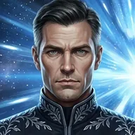{ .idx-ico loading=lazy } Йан (Ян) Воглер | Капитан «Хельги», Инкарнатор; анима в Сигурде | ЗК-1, 08, 11 | DEAD/KIA/MIA | [досье](../personazhi/vogler.md) |
| Тайна (Аю Лакшми) | Возлюбленная оригинала Морозова | ЗК-1–02, 08, 11 | Жива, в Альфе | [досье](../personazhi/tajna.md) |
| 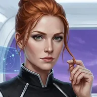{ .idx-ico loading=lazy } Аврора Мартинс (в ЗК-3 «Мартинес») | Создательница «авроры», Инкарнатор | ЗК-3, 05, 11, ТБ-4 | Жива | [досье](../personazhi/avrora.md) |
| Олег Рашидов | Координатор Альфы, «исходник» Хитрейшего | ЗК-10–11 | Жив | [досье](../personazhi/rashidov.md) |
| 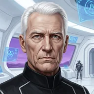{ .idx-ico loading=lazy } Дирк Кондор | Диктатор Альфы, «Легат» | ЗК-11 | Личность стёрта | [досье](../personazhi/kondor.md) |
| Шон Макдональд | Инженер экспедиции «Одиссей», трэль Теней | ЗК-3, 05 | Погиб (ЗК-3) | — |
| Андреас Берг | Техник Звездного Флота (воспоминание) | ЗК-1 | ? | — |
| Корни Рэнвуд, доктор Рихтер | Учёные Альфы | ЗК-11 | Живы | — |
| Рэй Мартинс, Элизабет Янг, Иван Кляйнер | CEO «Полариса»; глава совета координаторов; командующий Флотом — нейрограммы на «Хельге» | ЗК-11 | Не пробуждены | — |
| Луиза Шварц | Первая волна «Стеллара», «мертвое имя» | ЗК-11 | ? | [досье](../personazhi/rashidov.md) |
| Волк / Серый Волк (Маркус Крейв) | Рикс банды Волков Либерти, экс-трибун безопасности Альфы | ЗК-10–11 | Жив, должник | — |
| Мама Роза (Розалия Чен) | Глава «Приюта» Либерти, врач | ЗК-10–11 | Жива | — |
| Змей; Хель Раан; Пит Уильямс; Глен «Толстяк Митчелл»; Габо (Габриэль Марсо) | Люди Либерти | ЗК-10–11 | Живы | — |
| Микки «Ангел» | Нео, боец копья молодого Кассиди, нейробиолог | ЗК-9 | Нео в Вечности | — |
| Амадай Кассель; Лора Сингх, Кенджи Чен, Наоми Йо | Спасённые колонисты | ЗК-9 | Живы | — |

### 1.5. Народы Круга (союзники и противники)
| Имя | Кто | Книги | Статус | Досье |
|---|---|---|---|---|
| 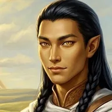{ .idx-ico loading=lazy } Лэндо Солнечное Крыло | Принц Трав, кано Сигурда | ЗК-1–08, 11 | Жив | [досье](../personazhi/lendo.md) |
| Айно Ветер Равнин; Жемчужина-в-Волосах; Кандо | Кинг, фламиника, старший сын Трав | ЗК-5–07 | Живы | [досье](../personazhi/lendo.md) |
| Коготь-как-Серебро | Рикс Небесных Когтей (Тени) | ЗК-3, 06, 09 | Жив | [досье](../personazhi/kogot-kak-serebro.md) |
| Видящая-сквозь-Тьму | Рикс Небесных Когтей, мать Когтя | ЗК-3, 06 | Мертва | [досье](../personazhi/kogot-kak-serebro.md) |
| Яростный-как-Пламя | Рикс Каменных Луков, брат Говорящей | ЗК-3, 06, 09 | Убит Червями (до ЗК-9) | [досье](../personazhi/govoryashchaya.md) |
| Шепчущий-в-Ночи | Отец Говорящей | ЗК-3 | Мёртв | [досье](../personazhi/govoryashchaya.md) |
| Серебряная Форель | Восходящая Мёртвой Рыбы, оборотень | ЗК-1, 06, 09 | Жива, должница | — |
| Зирдан (Зирдин) Хвост Акулы | Сын рикса Мёртвой Рыбы | ЗК-1, 06 | Жив | — |
| Аурвак Владыка Чешуи | Рикс Мёртвой Рыбы | ЗК-6, 09 | Жив | — |
| Сторм Сто Смертей; Викси Шип-Змея | Кинг Людей Моря; изгойка-серебро | ЗК-6 | Сторм жив, Викси мертва | — |
| Найтфир, Каласса (Огненная-как-Ветер) | Жёны Пламени Подобного | ЗК-9–11, ТБ | Живы | (досье ТБ) |
| Иниэсс Зеленый Лист | Кинг Народа Древа | ЗК-6–07, ТБ-4 | Жива | (досье ТБ) |
| Крагг-гор Кровавый Рог | Шаман Клана Зверя | ЗК-8 | Жив, в тюрьме | — |
| Эдри (Эд Ри Саттар) | Торговец Каравана, метаморф | ЗК-8–11 | Жив | [досье](../personazhi/edri.md) |
| 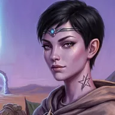{ .idx-ico loading=lazy } Найра Эль-Кадис | Дочь Каравана | ЗК-10, ТБ-5 | Жива | [досье](../personazhi/nayra.md) |
| Вейн Эль-Керр; Пустой Глаз | Хранитель путей; вождь вранов | ЗК-10 | Живы | — |
| 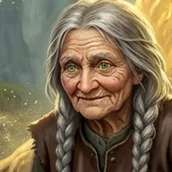{ .idx-ico loading=lazy } Бабушка Яшма | «Тень Творящей» | ЗК-7, 09–11 | — | [досье](../personazhi/yashma.md) |
| Каменный Гром | Альфа-гигантопитек | ЗК-10 | Убит | — |

### 1.6. Вечность, Кел и высшие силы (в ЗК)
| Имя | Кто | Книги | Статус | Досье |
|---|---|---|---|---|
| 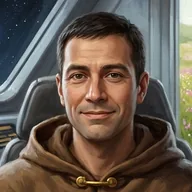{ .idx-ico loading=lazy } Хитрейший | Хранитель, хозяин Контракции | ЗК-2–03, 05, 08–11, ТБ | Действует | [досье](../personazhi/hitreyshiy.md) |
| 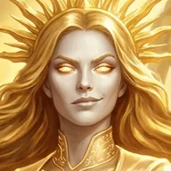{ .idx-ico loading=lazy } Сестра Солнца | Хранительница, подарила Сагу | ЗК-3, 05, 09 | Действует | [досье](../personazhi/sestra-solntsa.md) |
| Палач, Предвестник, Посланник, Полководец, Странник | Прочие Хранители | ЗК-3, 06, 08–10 | — | (досье ТБ / древние силы) |
| 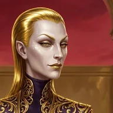{ .idx-ico loading=lazy } Флекс Торий | Кел-душеторговец | ЗК-5–06 | Мёртв | [досье](../personazhi/flex-torij.md) |
| 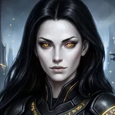{ .idx-ico loading=lazy } Эрда Онора | Эрда Корпуса Ноктис | ЗК-8, ТБ-2 | См. досье | [досье](../personazhi/onora.md) |
| Эриний Зариман кел Эррос; Азтелла | Кел-лорд Ковенанта «Феникс»; его эмма | ЗК-5–06, 09 | Живы | — |
| Велиор Вортекс | Кел-лорд-коллекционер | ЗК-9–10 | Душа у Хитрейшего | — |
| Тайновидица; Щит Победы | Истинная-хранительница Архива Тайн; небо-страж Ордена | ЗК-8 | Живы | — |
| Эйлориан (Эйлор) | Кел-пилот, анима в стигисе «Голубая Стрела» | ЗК-10–11 | Анима | — |
| 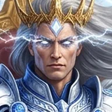{ .idx-ico loading=lazy } Белый Дьявол / Пламени Подобный, Азимандия, Морвейн, Кейнор, Марисса, Эверент, Сатори, Чёрный Крест, Нор-Аэль | Тысяча Братьев и их Руны | ЗК-1–11, ТБ | — | [досье](../personazhi/belyj_dyavol.md), [досье](../personazhi/azimandiya.md), [досье](../personazhi/morvejn.md), [досье](../personazhi/kejnor.md), [досье](../personazhi/satori.md), [досье](../personazhi/tysyacha_bratev.md) |

## 2. Схемы отношений

### (а) Ближний круг Сигурда
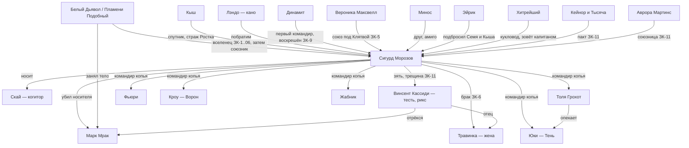

### (б1) Фригольд «Небо» в ЗК-1–05 (власть Вероники и Трейва)
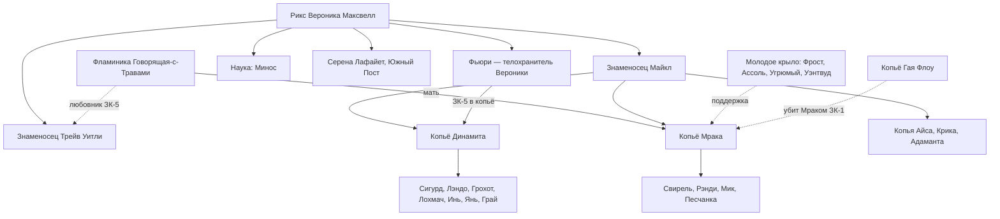

### (б2) Фригольд «Небо» в ЗК-6–11 (после возвращения Винсента)

### (в) Семья Кассиди и кровь Народа Теней
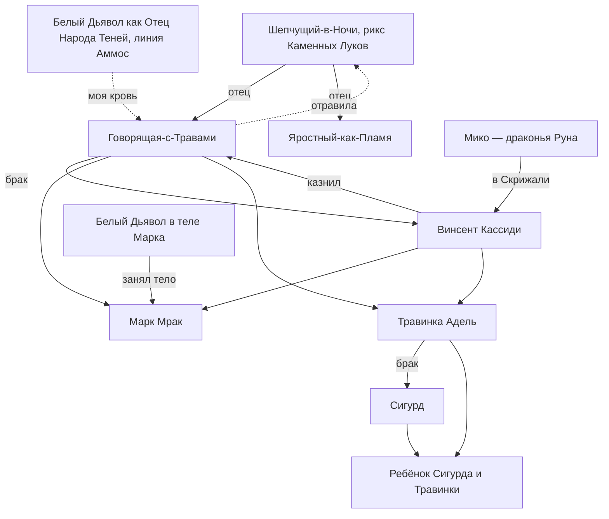

### (г) Земляне: «Стеллар», Альфа и их связь с Вечностью
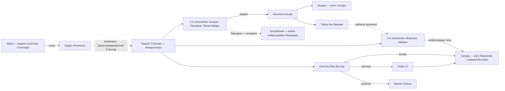

### (д) Главные противники Сигурда по книгам
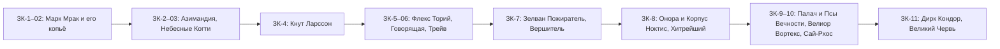

## 3. Противоречия и варианты имён (сводка)
- **Сигурд / Сигварт** — оба канон: Сигварт Морозов — паспортное имя, Сигурд — данное Тайной (ЗК-1, гл. 7, 16).
- **Аврора Мартинес (ЗК-3) / Мартинс (ЗК-5, ЗК-11)** — основное: Мартинс.
- **Йан / Ян Воглер** — основное: Йан (ЗК-11).
- **Фьюри** = Лилия ван дер Саар (псевдоним) = Кристина Фальк (настоящее, ЗК-10, гл. 23) = «Ледяная Лилия».
- **Зирдан (ЗК-1) / Зирдин (ЗК-6)** Хвост Акулы.
- **Неумеха / «Неряха»** (ЗК-5, гл. 14).
- **Эль-Кадис (ЗК-10) / «Эль-Керр»** для Найры (ТБ-5).
- **Марк** — «стопроцентный землянин по генотипу» (ЗК-1, гл. 12) vs сын Говорящей (ЗК-1, гл. 21 и далее).
- **Ранг Миноса** — серебро (ЗК-6) / «бронзовый рунный мастер» (ЗК-7) / серебро (ЗК-9).
- **Грохот** — в разборах ЗК-5 «Восходящий», ЗК-9 «не Восходящий»; канон — гвоздь и бронза с Титулом в ЗК-6.
- **Венди** — дочь Эйрика (ЗК-4) / жена (ЗК-5). **Победитель Варгов** — отдельный абориген (ЗК-5, ЗК-7) / прозвище Джимми Райнера (ЗК-10).
- **Инь и Янь** — «близнецы» (ЗК-1, 02, 09) / «братья» (ЗК-5).
- **Скрипторум Некролита** — у Миноса (ЗК-8) / у Кассиди (ЗК-9) / у Пламени Подобного (ТБ-4).
- **«Торий — рикс землян»** (разбор ТБ-3) — ошибка, имеется в виду Кассиди.
- **Ранг Сигурда в ЗК-11** — «золотой ранг» (гл. 10, 14) при самооценке «серебро» (гл. 20).
- **Онора** — жива с деревянной Скрижалью (ЗК-8) / душа в Драконьей Клетке (ТБ-2).
- **Трейв и Набор Колониста** — «тип 2» (ЗК-1, гл. 3) / «тип-3» (гл. 16).
- **Омонимы «Скай»:** фригольд «Небо» (англ. Sky), Древо «Скай», нейросеть Скай; в разборе ЗК-7 фригольд назван «Скай».
